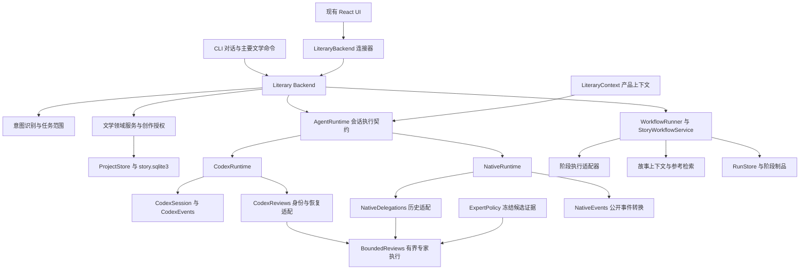

# LiteraryGiant 架构与执行模型

LiteraryGiant 拥有文学任务的执行语义、故事状态与作者控制。Codex 和 Native 是现有执行适配器；Skill、subagent 和声明式工作流是实现特定策略的手段。架构演进以文学任务能否可靠完成为依据，不以新增角色数量或目录拆分数量衡量。

本文描述截至 2026-10-22 的实现及后续职责划分。已验收范围、尚未完成的能力和下一阶段顺序见 [项目路线与进度](roadmap.md)；历史分批证据见 [Oh Story 融合记录](oh-story-integration.md)，本轮实际调用链与限制见 [接手实施记录](review-implementation.md)。目标职责不表示同名模块已经存在。

## 接手审查新增边界（2026-10-22）

`backend_tasks.py` 把有限 `task/*`、`narrative/*`、`sources/check` 接到共享 Backend。`task_cli.py` 和现有 `LiteraryBackend.ts` 消费同一契约，React 增加任务及结果动作，不另建 UI 框架。`literary_tasks.py` 在 RunStore 中保存两种有界任务的进度，复用 Story 修订、创作方向和候选；方向选择与正式采用仍走既有独立创作批准。chapter 生成候选携带 `required_decision`，ProjectStore 在采用事务中核对精确选择及来源，不能用任务完成事件替代正式提交。

Story 候选保存实际生成基础版本；旧候选修订不自动重绑最新 active head。`chapter_sync.py` 在导入前保存精确意图，提交后索引／基线失败明确为 `committed-needs-sync`，重试只在数据库内容、版本和 origin 相符时修复派生状态。原始导入只解析同一次文件快照。

`operation_receipts.py` 为受支持正式转换保存操作 ID／请求绑定；DB 效果记录与领域事务一起提交，运行尝试与结果保存在独立的运行收据库。`operation/read` 区分 committed、not_committed、unknown，重复 ID 不自动重放。收据不证明全部派生文件或工具返回成功，也不是任意 JSON-RPC 的全局幂等实现。

`narrative_execution.py` 只为 Native Responses 构造全新、无历史、无工具、固定用途的请求。人物／读者视图缺必要记录、来源失效、截断或超预算时拒绝；前后视图改变不释放结果。普通聊天和旧工作流的 `model_input_isolation=false` 不变；作者写作的“知道规划但不提前揭示”是另一类审读任务。

`runtime_identity.py` 报告实际包路径、解释器和磁盘包摘要，可显式核验 manifest 的文件 hash／pin；不证明旧进程已加载相同代码或可复现构建。`lg code` 不经 Backend，CLI 与适配器均对解析后的当前目录及祖先检查完整作品标记；此门禁不是全盘 OS 隔离。Mac RunStore 以进程启动时间和 boot UUID 校验恢复所有权，Linux 分支保留。Core 源码、Rust TUI 与独立 app_server 未改变。

## 本阶段验收结论（2026-10-16）

作者已明确选择：**保留 Rust TUI 与独立 app_server 为独立兼容入口，本次验收主 CLI／Extension。**
主入口通过产品 Backend 管理任务、权限、事件和领域状态；Codex／Native 是可选执行路径。
本阶段据此结单，两个兼容入口继续使用 Core 协议，不宣称已接入 `lg.backend.v1`。
完整模型输入隔离、全部 Runtime 能力等价和独立桌面 UI 属于后续路线。

## 当前执行结构

Extension 的 `literary` 与 `codex` 设置均通过 `createBackend → LiteraryBackend` 进入共享 Backend；后者显式指定 Codex Runtime。旧 CodexBackend 及专属生成协议已于2026-10-22经作者批准删除，兼容Core stdio测试直接复用RpcTransport。CLI 持续对话、主要单次文学命令、场景操作、分析和 Studio 已合流；作者直接维护数据、显式开发入口、Rust TUI 与独立 app_server 仍有各自行为。统一主要入口不等于全部 Runtime 能力已对齐。

| 当前职责 | 实现入口 | 已有边界 |
| --- | --- | --- |
| 会话与运行 | `backend.py`、`backend_stdio.py`、`session_runtime.py` | LG 会话、运行 ID、锁、取消、历史与审批 |
| 意图与范围 | `intent_router.py`、`task_scope.py` | 模型只读解释；宿主绑定对象、源版本、选区、交付类型和写入额度 |
| 领域写入 | `writing_mcp.py`、`studio.py`、`project_store.py` | 候选、采纳、事实确认、来源检查和版本事务 |
| 分阶段创作 | `workflow_runner.py`、`story_workflow.py`、`lg-agent/workflows.json` | 阶段 schema、交接、运行制品与恢复；staged/single-pass 为既有策略 |
| 上下文 | `story_context.py`、`ProjectStore.context_snapshot`、`fact_sources`、`knowledge.py` | 确认状态与来源有效性分开；场景正文先按位置过滤，再检索和截断；明确作者全局参考，尚无完整认知与叙事时间投影 |
| 会话 Runtime | `agent_runtime.py`、`codex_runtime.py`、`native_runtime.py`、`native_tools.py`、`native_delegation.py` | start/run/steer/interrupt/close；Codex 与 Native 均支持宿主绑定的无工具专家审读；通用委派尚未对齐 |
| 有界专家执行 | `bounded_reviews.py`、`review_policy.py`、`native_delegation.py`、`codex_reviews.py` | 产品策略冻结精确目标，公共执行器限制预算／工具／来源；两种适配器分别负责历史、调用身份和不重放恢复 |
| 阶段 Runtime | `execution_adapter.py`、`core_adapter.py`、`output_schema.py` | 按 runtime.engine 选择执行器；共享本地 Schema 门禁，Codex 用冻结契约验证最终响应 |
| 可观测结果 | `codex_events.py`、`native_events.py`、`backend_events.py`、`run_store.py` | 两条会话路径在事件适配处生成公开展示；公开结果、工具与任务事件不等于私人推理 |

上表 Python 文件位于 `lg-cli/lg_cli/`。协议细节以 [Backend 契约](extension-backend.md) 和实际 `backend_protocol.py` 为准。

## 产品裁剪、通用机制与任务策略

Runtime 精简与文学执行模型建设并行推进，目标是减少不需要的产品耦合、依赖和维护范围。分类依据是职责与实际使用，不是是否曾用于 Coding。

| 分类 | 处理原则 | 例子 |
| --- | --- | --- |
| 已退出的产品功能 | 退出入口、解除引用、删除实现与专属配置，再构建和验证；不长期停留于禁用 | 已放弃的订阅适配、确认不采用的云产品、确定重复的入口 |
| 通用执行机制 | 保留并按真实缺口增强，避免重写成熟底层 | 模型—工具循环、注册/调度、会话与历史、并发、文件搜索、差异编辑、受限脚本、隔离、审批、取消和恢复 |
| 领域默认策略 | 由 LG 产品策略层决定，Runtime 消费明确的执行输入 | 任务理解、上下文读取、工具集合、预算、停止和完成判定 |

工具实现存在、发布包包含工具、某次任务获准调用工具是三个独立决定。只读审读不能因 Runtime 支持 shell 就获得 shell 权限；通用编辑可处理候选或临时制品，正式写入仍经 Kernel 的版本、范围和作者授权。若尚不能防止通用执行绕过权威数据库或正文，应继续限制任务暴露范围，不能以删除基础能力代替权限设计。

搜索复用通用检索能力，产品层绑定作品、版本、身份、时间/揭示范围与预算；并发审读绑定同一版本，各自只生成候选结果。职责拆分不要求重新实现搜索、会话或并发。Rust TUI 已按作者决定保留为独立兼容入口，不属于删除对象。

[OpenAI 对 harness 与 App Server 的说明](https://openai.com/index/unlocking-the-codex-harness/)将会话持久化、工具执行、审批交互及客户端事件作为执行框架组成；这里将其作为概念背景，具体裁剪依赖仍以本地固定版本源码和构建证据为准。

## Runtime 隔离与认证边界

LG 已采用 API-only：保留 API Key、供应商/协议/端点配置及请求认证；订阅登录与激活被禁用，旧配置只提供迁移提示。Rust 上游登录代码仍存在于原始基线中，本批未裁剪其构建依赖。

Runtime 选择通过锁定清单或显式开发命令完成，不再自动尝试系统 Codex、Node 包装器或 Cargo 构建。上游与派生产物身份通过 `runtime_manifest.py` 校验，维护流程见 [版本与更新机制](codex-core-updates.md)。

目标依赖为 Backend → Literary Orchestrator → 两个协作边界：Kernel 管理故事状态与作者控制，Runtime 提供模型循环、工具执行、会话与恢复。文学工具把 Runtime 的执行结果交给 Kernel，Runtime 不直接决定正式剧情、采纳正文或修改长期规划。

当前 Orchestrator 职责仍分散在 Backend、任务与工作流服务中。会话输入通过 `agent_runtime.RuntimeContext` 注入，默认产品实现 `runtime_context.LiteraryContext` 负责文学模板、图谱规则、作品概况、审查指令与历史引导；工厂创建提供器时不读取作品。`CodexSession` 在配置校验后、启动或恢复线程时取指令，`NativeRuntime` 在每个父轮取一次指令。同轮工具循环与 steer 不重新构造上下文，是否补入历史由真实 thread／checkpoint 判断。

`LiveAgent` 是兼容产品入口，未显式提供上下文时装配 LiteraryContext；底层 CodexSession 必须接收提供器。主助手、工具和专家任务的 Native 展示转到 `native_events.NativeEvents`。只读工具白名单、Core sandbox、审批、取消与恢复仍是执行约束，不由提示词授予权限。

阶段输入由 `stage_input.prepare_stage_input` 在产品层一次准备：文学模板、按 Schema 选择的图谱指令及本次作者指导进入 StageInput。WorkflowRunner、StoryWorkflowService 和 ChapterAnalysisService 保存最终 prompt 与 instructions，再显式传给 CodexStageExecutor／NativeStageExecutor。执行器不追加文学内容；旧 CodexExecAdapter／NativeStageAdapter 名称保留兼容包装，仅在省略 instructions 时准备默认产品输入。doctor 使用独立的连通性指令。

RunStore 在 stages 中分别保存 `.prompt.md`、`.instructions.md` 与阶段 Schema 快照（保留原文件名）。WorkflowRunner 在准备阶段一次读取并验证 Schema，恢复指纹 `lg.stage-input.v3` 绑定这两份实际文本、冻结的原始 Schema 文本及作品、模型与 Runtime 条件；执行器接收当前 run 的快照路径，宿主以冻结契约验收响应。旧 v2 指纹不复用，文学阶段从失配处重算，code 检查点失配则拒绝自动重放；已验证恢复的阶段也保存当前输入。Core 通过权限 0600 的唯一临时指令文件读取 instructions，正文通过 stdin 原样发送；临时指令文件与既有 Core 运行制品一样保留在作品的 `.literarygiant/tmp`。一致性指保存文本与执行器输入；固定 Core 会去掉指令首尾空白，Codex 执行器提前拒绝空白指令，Native 则允许显式空指令。

CodexStageExecutor 现在在 Runtime 发现与供应商启动前读取、验证并冻结输出 Schema；每个候选进程使用唯一的权限 0600 快照文件，成功退出后以同一内存契约验证最终文本。源文件在发现或进程启动期间变化不会改变本次契约；无 Schema 的普通文本路径保留。Schema 读取、外部引用和快照保存失败不给可执行成功结果，输出不匹配返回固定错误并保留真实退出码。`output_schema.py` 提供两种执行器共享的本地引用校验，`execution_adapter._local_schema` 保留兼容导出。

WorkflowRunner 的检查点保存通过 Schema 与领域解析的完整 `response_text`，并纳入输出指纹。恢复重新验证完整响应和正文／摘要等投影的一致性，保留自定义必填字段与原始响应空白。Schema 快照在模型前后与冻结文本比较，发现变化时拒绝检查点；这不是文件系统不可变性保证。输入保存和检查点保存错误返回固定失败，不公开 Schema 异常中的模型文本。Director 的内置 Schema 要求已有的 book_overview 字段以保持严格结构，非正文阶段可返回空字符串，最终 write 阶段仍要求有效概述。Story 专项操作也在产品准备时冻结操作 Schema 和角色 model_profile，保存保留原名的阶段快照；执行前后检查快照，并在候选、场景卡和记忆提案写入前完成完整 Schema 验收。内部准备类型继承 StageInput，公开适配器路径接口与 dry-run 预览保留。Schema 输入准备、模型执行或 Schema 校验失败以固定错误结束 run，不新增通用重放。

ChapterAnalysisService 为每类分析一次准备基底报告 Schema 与参考卡 catalog，响应 Schema、方法说明、卡片转换和存储 Schema 从该快照产生；既有一次有界修复复用它。模型调用前后核对资源和请求快照，契约变化不进入模型修复。BookAnalysisStore.save 仅接收可选的 expected_contract_fingerprint，由存储层重新读取可信资源并核对，再执行原有证据和作品当前性验证；不接受调用者提供的宽松存储 Schema。默认 save 调用、旧报告读取与来源指纹语义保留。候选采纳预检对 reference-card.v1 报告执行对应类别的完整契约验证；带 contract_fingerprint 的报告还必须匹配可信当前资源，失配在正文激活前拒绝。缺少新指纹的旧报告仍按其声明的历史契约验证。JSON Schema 失败使用固定公开摘要，拒绝响应只进入私有诊断记录及标明不可信数据的修复上下文。契约快照是 run 证据，不是另一份正式故事状态。

专家输入通过 `agent_runtime.ExpertPolicy` 注入 NativeRuntime 与 CodexRuntime。工厂默认提供 `review_policy.LiteraryReviewPolicy`，在实际 prepare 时读取宿主任务、精确候选、共享审读快照与内置专家定义；构造时不读取作品。ExpertInput／ReviewInput 提供文学指令、证据、角色模型 profile、输出 Schema 和来源身份。调度器先绑定模型配置并序列化请求，再运行子任务；不在执行中重新读取产品定义或构造文学提示。

专家 payload 的 target 明确文档、版本、真实状态及活动版本；只在专家证据视图中将所选文档恢复为真实 candidate 等状态，正式 `studio.review_source` 和 sourceFingerprint 保持原契约，专家 taskFingerprint 另绑定 target，捕获同一版本 accepted→final 等状态变化。产品 BoundedReviews 强制名称唯一、单次及每父轮累计最多两位；替代策略和恢复检查也不能扩大该预算。无工具请求、来源复核、输出验证、私有错误、取消和不重放恢复保留。结果仍是临时意见，不等于正式证据报告或采纳许可。旧 tool 常量导出与检查点字段格式兼容。

`bounded_reviews.BoundedReviews` 不读取 Native owner、messages/pending 或 MCP 返回类型：通过明确回调取得配置、宿主任务与父轮身份、模型执行、保存及展示。prepare 同步预留额度并冻结请求，begin 必须绑定真实父轮，同父轮不能重置预算；finish 不清除已用额度或 callId，重复执行已完成调用被拒绝。父轮改变时不发起旧请求，运行中改变则丢弃迟到结果。NativeDelegations 保留原检查点 schema、子任务 ID 前缀、历史 callId 检查、MCP 包装和不重放恢复。共用记录分别由 Native 原检查点和 Codex SessionRuntime 元数据保存，没有新增权威故事状态；配置与 Schema 检查仍复用 execution_adapter，模型协议目前仍是既有 Anthropic／Responses 有界请求。

Codex 会话启动通过 `agent_runtime.RuntimeLaunchPolicy` 注入产品策略。默认 `codex_policy.WritingLaunchPolicy` 在控制端点绑定后一次准备 `WritingLaunchPlan`，冻结 LG MCP、功能开关及审查工具设置；CodexSession 用同一 plan 生成参数并验证 config/read，验证通过后才启动或恢复线程。普通策略异常转为固定错误，取消继续传播；显式 RuntimePolicyError 属于提供安全消息的受信任策略契约。启动参数向 writing MCP 显式传递所选命名 environment，避免子进程读到默认用户配置。`writing_args` 保留兼容序列化入口。只读会话同时设置并校验 `agents.enabled=false` 及两个协作 feature=false：固定 Core 恢复旧 V2 线程时，只有 feature=false 仍可能继承协作工具；真实回归覆盖普通→只读→普通的同线程恢复。此修复不删除上游协作实现。

Rust TUI 与独立 app_server 共用这项环境参数修复，但尚未接入会话的 config/read 门禁；显式 command 仍是绕过生产装配的开发入口。冻结 plan 不保证 Core 后续配置重载的原子性。策略是受信任宿主注入接口，不是可直接装载不可信 Skill 的权限沙箱。

CodexRuntime 根据原始协作事件记录其 Core 进程的子线程。父轮有协作子线程，或因异常、超时、取消退出时，先通过宿主回调撤销本轮 Agent 审批资格和等待请求，再关闭旧控制端点与所属执行进程，最后发布收尾展示；普通无协作成功轮继续复用连接。CodexSession.stop_execution 关闭 stdin，让固定 Core 关闭线程并刷新历史，超时则强制结束进程组；它保留 SessionRuntime 的排他锁，完整 close 才释放会话。Runtime 清理与 Backend 端点／历史收尾都等待独立清理任务完成，重复取消不使其提前返回。后续恢复取得新端点，独立工作流与显式绑定其 runId 的审批不受这项收尾影响。

CodexRuntime 已通过 `codex_reviews.CodexReviews` 消费同一个 ExpertPolicy／BoundedReviews。非 review_only 新会话在 thread/start 注册 delegate_review；工具可见不等于获授权，仅宿主绑定的 review 任务可执行。审读主任务关闭并核验 Core 的通用协作，但保留 LG 文学工具，allowRevision 仍经原任务与作者权限门禁。独立只读审查实例不注册新专家工具。普通非审读任务仍保留既有 Core 通用协作；这些 Core 子线程不是产品的无工具专家。

CodexSession 将工具契约哈希与 rootThreadId 同次保存到 SessionRuntime 的 codex_tool_contract。Core 没有公开的动态工具读回接口；该 marker 记录成功创建时提交的契约，真实调用与恢复另由集成测试验证。恢复仅接受匹配契约，旧无 marker 线程保持原 ID 和历史，不追加工具或静默新建；旧会话审读仍关闭通用协作，并提示独立专家需要新会话。已注册线程在 review_only 恢复时，Core 仍可能展示持久化工具，宿主拒绝执行；不能宣称工具已从该线程物理移除。

动态请求只接受当前活动根线程、真实父轮、工具名和调用 ID；早到请求等待 turn/start 应答后的 lg.turnBound，预算只在该绑定点初始化。调用返回前及传输写锁内再次核验轮次／进程，旧调用不能向新轮回复成功。codex_delegations（lg.codex-reviews.v1）保存父轮、已用角色与调用 ID、参数摘要和临时结果；请求前保存，终态保存后回复。恢复结算未完成调用、不重跑模型，不保存凭据、模型配置或冻结提示。此记录属于会话执行恢复，不是第二份小说权威状态。

宿主专家使用已有 NativeModel 的 Anthropic／Responses 客户端执行有界无工具请求，这是产品专家执行路径，不改变父 Runtime 选择，也没有失败回退。父轮结束、中断和关闭先撤销专家资格再等待请求清理；Core 中断应答仍可受宿主超时取消，最终 drain／进程关闭受重复取消保护。公开任务沿用 NativeEvents 与原 UI 协议，Codex 动态工具展示仅给出公开状态，不透传专家私有响应。

这一拆分尚不等于完全独立的 Runtime：两条会话路径已消费有界专家契约，通用委派、跨 Runtime 的完整能力与预算仍未统一；例如 Native 审查当前允许 15 项 LG 读取工具，Codex 审查为 4 项 LG 读取工具，后者仍有 Core 资源读取与用户输入通用工具。章节分析预算现在在追加指导后检查最终 prompt，但尚未统一 instructions、Schema 与各工作流的总请求预算，执行器调用内已冻结 Codex 输出 Schema，WorkflowRunner 与 Story 的准备／执行已绑定阶段契约；Analysis 的响应、转换和保存共享资源契约指纹，统一总请求预算仍待继续。后续按真实需求继续分离，不将文学业务移入 Rust，也不新增平行故事数据库。

## 当前三类执行路径

自然语言会话先由只读识别提出任务，再由宿主绑定范围。Runtime 在可用工具内执行，工具写入受任务门禁与操作/创作权限控制；同意继续不应扩大范围或重置停止预算。

声明式工作流由 WorkflowRunner 读取有限记忆、参考材料和故事上下文，生成阶段输入，调用所选适配器，校验并保存输出后交给下一阶段。single-pass 可合并阶段，但当前并没有统一的、按文学复杂度自动选择所有策略的执行模型。

场景服务已有计划、批准、正文候选、修订、审读与采纳。生成结果和潜在事实保持候选语义；作者手工编辑保留独立的版本化保存路径。候选保存、正文采纳和 Canonical 确认是不同操作。

## Literary Agent Execution Model 的目标职责

这部分定义如何选择与执行文学任务，不是模型本身，也不是要求输出完整思维链。可保存的中间成果包括任务目标、约束、上下文快照、候选方案、影响分析、审读证据、简要决定依据与作者裁决。

| 职责 | 产品归属 | 优先复用 |
| --- | --- | --- |
| 任务解释、授权范围、停止条件 | Backend 与任务服务 | intent_router、task_scope |
| 直接执行、阶段流程或协作策略选择 | 文学编排层 | WorkflowRunner、StoryWorkflowService、现有运行控制 |
| 工具发现、能力集合、输入输出与错误契约 | 工具系统与 Backend | MCP 注册、studio_operations、领域服务 |
| 按故事时间、视角和揭示位置组织信息 | 文学上下文服务 | context_snapshot、story_context；外部参考仍走 KnowledgeGateway |
| 世界事实、人物信念、读者认知、作者规划 | Literary Kernel 的状态职责 | ProjectStore、版本、提案与来源关系 |
| 创作决定、正式采纳、撤销与恢复 | Kernel 强制，Backend 提供交互 | 创作审批、预览指纹、事务与运行事件 |
| 模型传输、流式事件、工具执行、取消与用量 | Runtime API 和适配器 | AgentRuntime 与阶段 ModelAdapter |

这些是职责边界，不是新增目录清单。先让现有调用路径消费统一契约，再按实际耦合拆分代码；文学语义不能下沉到 vendored Codex。新 Runtime 以已经验证的产品契约为目标，不通过提前重写 Runtime 代替语义设计。

一句措辞修改只应加载准确选区、版本和必要文风；章节创作需要章位、人物与叙述权限、叙事目标和候选审读；跨章返修需要来源依赖与影响范围。执行深度由任务和风险决定，复杂模拟只在有收益证据时使用。

## 状态可靠性与创作判断

世界事实与人物信念不能互相覆盖；人物可能误信或不确定。读者的阅读截止与人物的故事时间不同，倒叙尤其需要分别表达。作者未来规划可以供规划者使用，但不能自动成为人物已知信息或已发生事实。

生成多个剧情方案、比较方案甚至试写，都不自动授权选定正式剧情方向。`creative_decisions.py` 复用 ProjectStore 的文档与版本，管理明确主题、完整方案、独立选择及撤回；活动记录不等于正式选择，再生成保留原选择，通用编辑／采用／恢复不能绕过受管理类型。CLI 的 Studio 操作和 Extension 资料库使用同一服务、精确 decision 任务与独立创作权限；作者显式选择的 ask／auto_review／full_access 策略保留，普通操作权限不提升创作权。

`ProjectStore.decision_review_context` 将适用的作品、当前章节和直接所属分卷的已选方向纳入 `BookAnalysisStore` 共享快照；五类报告、卷级审读和 `review_policy.LiteraryReviewPolicy` 绑定同一来源。仅重新生成方案不改变审读指纹；方向变化、撤回或声明依据变化会使相关报告需要重审。候选只投影实际目标的 accepted／final 状态，使采用前报告与采用后发布一致。所选计划可提供版本绑定引文，但仅凭计划不能判定 Canonical 冲突；作者可重新审读原候选，再独立批准。未启用监督的作品保持原采用语义，无适用方向时保留旧快照及指纹。

审读绑定与生成捕获分开：`generation_sources.py` 提供宿主的不可变输入记录。Live 的 `writing_mcp.py`／`workflow_control.py`／`backend.py` 经当前 LG 运行 lease 记录实际读工具返回摘要，审批入口冻结后写入候选；新运行不借用旧观察。`story_context.py`／`story_workflow.py` 按实际渲染预算与最终 StageInput 捕获输入，候选、阶段和 manifest 共用记录；`run_store.py` 校验原制品 hash 后继承。ProjectStore 的版本 metadata 保存输入记录和独立输出摘要，普通 metadata 不得自报；Store／MCP 恢复旧稿沿用原记录，无旧记录则未知。资料库在候选详情分开展示生成捕获及当前审读依据。

记录只证明宿主准备交付了哪些输入，不证明模型实际使用。历史、隐藏 Runtime 上下文和无法识别的来源保持 partial／unknown；控制 socket 不提供 Core 子线程级归因。这不增加写入或采纳权限，不改变既有监督策略；完整来源依赖传播、人物／读者认知和故事时间视图仍待推进。

本批最终验收：新增 40 项 Python 测试；LitIsLand 与实际项目各 Python 880 项、Extension 单元 53 项／集成 14 项及类型检查、构建通过，零失败、零跳过。四个 Python 分片按模块分组无重复，最长分别 109.361／109.168 秒。核验 581 个输入，20 文件备份同步；OOM／oom_kill 均为 0，空白检查通过。

身份、来源、版本、权限与幂等属于确定性门禁。性格变化、节奏、情绪与文风通常产生可异议的审读意见；有意反常不能一概禁止。结构化模型输出也可能判断错误，不能因为符合 schema 就直接视为正式事实。

`source_review.py` 为确切版本的捕获来源提供只读当前复核；按工具重建原投影，区分 Live 的 compact／full 方向、Story 渲染方向、结构化事实及实际事实片段。索引不当正文输入，显式历史候选不假设当时活动指针；结果不判定文学一致性。`source_impact.py` 在同一 SQLite 快照内流式查询声明来源、捕获输入及编辑基底，显示版本状态与 is_active。每表 5000 项及输出 limit 明确区分，未知／旧记录／截断不推出零影响；不建新的权威存储或自动传播改写。

`ProjectStore.generation_source_review`／`source_impact` 由只读 Studio 工具、CLI 和 Backend 共用。`studio_review_context` 把生成诊断附在当前审读 snapshot／指纹之外；`workspace_library.py` 展示单候选诊断，不做全书反向扫描。没有新写权限或采用门槛，Core 独立 review-only 工具范围保持四项，现有 React 沿用 Backend 文本详情。完整语义影响、传递依赖与作者重新裁决闭环仍未完成。

本批最终验收：新增 43 项 Python 测试；LitIsLand 与实际项目各 Python 923 项、Extension 单元 53 项／集成 14 项及类型检查、构建通过，零失败、零跳过。四个 Python 分片按模块分组无重复，最长分别 111.679／112.449 秒。核验 587 个输入，18 文件备份同步；OOM／oom_kill 均为 0，空白检查通过。

## 已登记人物／读者认知

`lg-cli/lg_cli/narrative_knowledge.py` 在既有 ProjectStore 文档和版本中保存
`lg.narrative-knowledge.v1`，不新增数据库。提案、确认与撤回都生成 draft 版本；
确认指向确切历史提案，重提案保留确认，撤回不回退。人物身份、主题及起点不可变，
当前 head 使用 CAS；同一观察者／主题的已确认半开区间不能交叠。
声明来源确认时需 current／unbound，后续过期保留确认并显示状态，不自动改 Canonical。
`managed_documents.py` 被通用写入口调用，受管理记录只能走专属领域转换。

`narrative_view.py` 的 ProjectStore.knowledge_view 使用同一只读 SQLite 快照，
按指定人物 story 坐标或读者 reading 坐标查询。先过滤 holder 与 from_position，再应用扫描和输出预算；
只返回区间内、有效声明来源的已确认内容。过期正文、rationale 和无关观察者内容不进入投影，
过期项仅返回 record_id、source_status 和 reason。作者坐标不从章号或自由文本推断，
knows／believes／uncertain 不证明世界真实，旧数据不自动迁移为认知。

`studio.py`、`studio_operations.py` 提供两项读取与三项领域转换，MCP／CLI／Backend 共享服务。
`mcp_approval.py`／`session_runtime.py` 将 confirm／withdraw 列为 creative；
`task_scope.py` 的 knowledge 任务精确绑定动作、head、提案版本及一次转换。
`workspace_library.py` 准备 knowledge:<id> 的精确预览，经 Python／TS 协议和既有 React 按钮提交。
普通工具共 34 项（控制工具另 3 项）；Native review-only 读取为 15 项，Core 独立 review-only 仍为 4 项。
`source_impact.py` 同快照追踪 confirmed.sources，不把最新 proposal 当成正式认知依据。

投影明确 registered_records_only、model_input_isolation=false；通用 context_snapshot 排除原始受管理 JSON，
但旧作者全局事实、规划、历史、指令及其他读工具依然有其原范围。
因此本批不保证模型不会知道人物未知的信息。严格视图须在路由、历史和模型请求组装前由宿主绑定，
下一批先验证全新无工具阶段的实际请求；恢复、专家和 Core 增补输入另行核验。

作品指纹读取在真实连接器复验中暴露 WAL 消失竞态。`mcp_approval.project_fingerprint`
遇 FileNotFoundError 最多重新读取三次整组来源；不拼接消失前后的数据库／WAL 字节。
超过上限要求刷新，PermissionError 等继续抛出，不将读取失败解释成状态未变。
该有限重试保持原始字节指纹和空 WAL 语义，不声称多文件具有原子快照保证。

本批最终验收：新增 59 项 Python 测试；LitIsLand 与实际项目各 Python 982 项、Extension 单元 55 项／集成 14 项及类型检查、构建通过，零失败、零跳过。四个 Python 分片按模块分组无重复，最长分别 143.539／149.180 秒。核验 597 个输入，30 文件备份同步；OOM／oom_kill 均为 0，空白检查通过。

## 存储与来源

`story.sqlite3` 是故事状态与正文版本的权威存储；索引和导出是投影，不另建上游项目的平行 Canonical。正式事实的确认已有来源检查。`fact_sources` 为读取增加 current/unbound/stale/pending/unavailable 投影；旧来源变化会显示需复核，不自动撤销作者确认。正式的依赖传播、重新裁决和制品失效仍需建设。

`project_memory` 保留 facts/summary/documents，facts 仅返回 Canonical，ideas 单列，归档和拒绝项不进入默认记忆。事实附带源文档、源版本与当前活动版本（无来源时明确 unbound）。读取用途为 author_global；模型不能从这个接口推断人物或读者已经知道某条信息。

`context_snapshot(scene=...)` 的用途为 author_scene_support。场景前文按明确 sequence 选择；排除同章当前／后续场景、当前章整体正文、后章正文和归档／拒绝父章下的场景。不同分卷的章号不直接比较，未知顺序不以数据库 ID 补猜。限制作用于 FTS、回退与最近文本查询的 LIMIT 之前，空场景卡不能挤掉非空前文。修订入口把选中的候选版本传给 scene_version，目标同时标出选中与活动版本。

这是正文选取边界，尚非完整认知隔离：设定、规划、事实和时间线仍为作者支持材料，可能含未来信息；元数据明确 knowledge_filter_applied=false、参考范围及缺失信息。渲染分别分配事实、想法、时间线、伏笔与正文预算，小预算减少展开篇数并标记省略，防止来源说明占尽前文额度。其他 read_document/资料读取、会话历史和各 Runtime 的全面可见性门禁仍需独立推进。

可复用创作制品按 [作品目录规范](book-layout.md) 保存：规划到 `ReferenceLibrary/plans/`，设定与记忆提案到 `bible/`，审读到 `reviews/`，参考简报到 `sources/research/`，正文候选到 `drafts/`，版本绑定分析到 `analyses/`。归档不代表采纳。

对话、数据库、运行、恢复与 dry-run 状态保留在 `.literarygiant/`。既有资料的迁移必须走明确的整理操作，不因架构调整自动移动或删除作品。

Story 运行终态与事件／日志是不同的保存边界。上下文准备及 dry-run 归档在模型和领域写入前失败时，服务先保存 failed，再尽力记录失败事件与日志；启动事件失败也结束已创建的 run。终态保存本身失败向调用方暴露异常，不能报告已可靠保存。此边界不把候选、记忆提案及输出文件合并成事务，不回滚已经完成的领域写入；其他中途事件（如 STAGE_STARTED）与模型成功后的业务／归档 I/O 仍沿用原路径，不据此宣称所有异常均已收敛。

KnowledgeGateway 负责外部参考：AbstractLibrary → 项目来源 → BridgeIndex；原文需要明确 opt-in。不将参考材料、候选推断或作者规划混同为本书正式事实。

## 扩展与验证原则

优先扩展产品契约和领域服务，再决定是否需要额外 Skill 或角色。工具必须说明允许的信息视图、效果、来源与失败语义；仅写 Prompt 不构成权限隔离。Runtime 适配器若无法兑现某项契约，应记录并最小化补齐，不隐式退回权限更宽的路径。

所有实现先在 LitIsLand 合成作品验证，再仅同步必要改动并运行实际项目。验证分为状态/授权、调用与恢复、模型行为和人工文学质量；工程测试通过不代表长篇创作优势已经成立。详见 [路线与验收条件](roadmap.md)。
