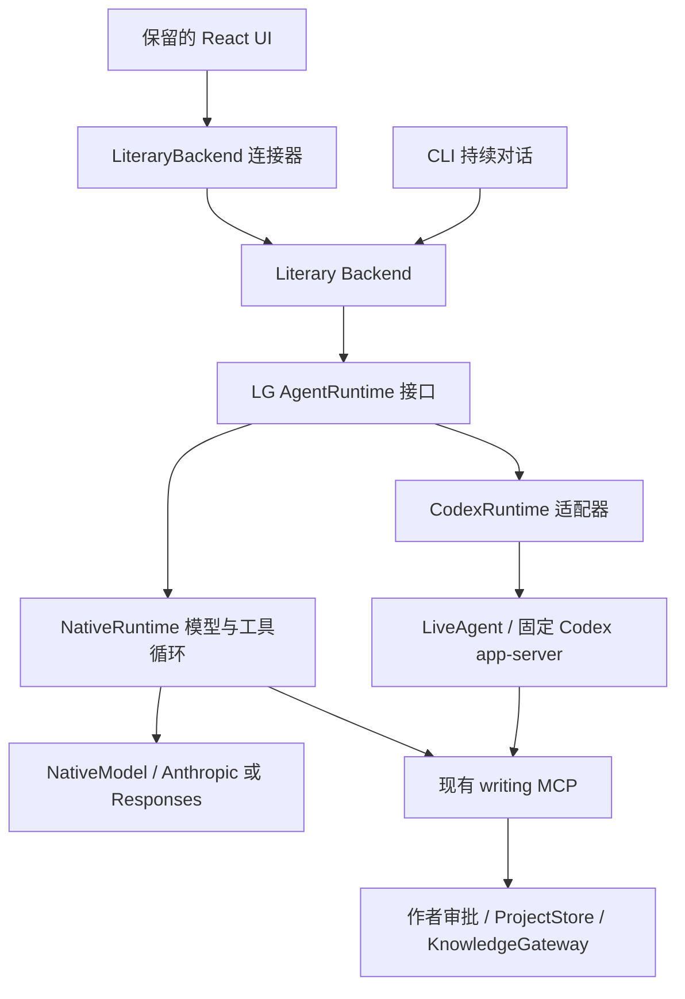

# LiteraryGiant extension 后端 v1

现有 React 界面通过 `AgentBackend` 接口工作。所有正式连接均由 `createBackend`
构造 `LiteraryBackend`，连接产品后端。旧 `CodexBackend` 源码和协议回归暂时保留，
不再由 Extension 生产工厂选择。旧对话可导入 LG 会话，不改变小说状态。

VS Code 设置 `literarygiant.backend` 可选 `literary` 或 `codex`，默认改为 `literary`。
已有显式 codex 设置值保留，含义是通过统一 Backend 指定 Codex 执行器；literary
沿用 LG 的 runtime.engine。启动时传递 --runtime-engine，initialize.runtime 必须
与显式选择一致；旧服务不认识参数或未返回匹配执行器时明确失败，不退回旧直连。
`literary` 使用与 CLI 相同的 LG 会话文件，并列出本书可读取的旧 Extension 对话。
选择旧对话后导入完整作者／助手文本，在新的 LG 会话中继续。CLI 持续对话、追加指令、取消和 `/permissions` 已通过
进程内 `TerminalBackendClient` 复用相同 Backend。CLI 显式命令工作流已按 runtime.engine
选择阶段执行器。CLI 中 chat、outline、world、character、plot、ref、check、write 的
显式命令已使用同一 Backend 的 workflow/run；scene plan/draft、edit、bible curate
也接入该接口，scene approve 接入创作审批。交互 CLI 的 run adopt 接入 run/import，
version accept、scene accept 与 run adopt --accept 接入统一创作审批和可取消的候选审查。
单次 CLI 的上述文学命令、运行记录查询／恢复／导入与创作确认也复用该 Backend。
普通非交互自然语言请求使用 run/start 的只读意图识别和宿主任务范围。
analysis chapter／volume 与 Studio 工作台也通过共享 Backend，读操作不启动模型，写操作
使用现有审批。修改连接设置后使用“LG：重新连接”。作者直接维护数据、显式开发 code／native
仍保留各自路径，叙事认知过滤与 Runtime 功能覆盖仍需继续完成。

## 旧 Extension 对话导入

initialize 新增 legacySessions 能力；session/list 保留原结果，并可附带 legacyWarning。
仅发现本书 .literarygiant/codex-home 与当前 LG 环境 codex-auth 下的历史；
校验 cwd、根会话身份和 LG 目录，拒绝目录重定向与跨书读取。LG 导入代码不解析或复制登录凭据。
已绑定 LG 会话或已导入的 thread 不重复列出。原始历史文件保留，不自动迁移或删除。

旧格式由固定 manifest 校验的 Codex App Server 解码，调用白名单仅含 initialize、
thread/list、thread/read、thread/turns/list，不启动或恢复模型 turn。按 full 视图读取
全部分页，核对游标、线程和源文件状态；没有固定 Runtime 时明确提示，已有 LG
会话仍可使用。此兼容解码器不宣称完全隔离 Codex 的系统／项目配置；完整隔离另行补齐。

session/snapshot(Page) 可预览 legacy- 会话。session/open 导入后返回 imported- ID；
客户端必须使用响应 ID，不能继续使用旧选择标识。原审批、工具请求和运行权限不重放。
工具只保留类型提示，私有推理与原始工具载荷不导入；非文本附件与完整工具详情
仍保存在原始记录中，当前导入界面不提供完整旧详情查看器。
导入后的新会话按 ask 操作权限和 ask 创作权限开始，不绑定旧 Codex thread。

导入用独占文件锁和内容指纹校验，同一来源重复打开不会重复写入。先保存展示投影与
标题，再原子发布对话 JSONL；中断的未发布文件不出现在会话列表，可重试。
正文、事实与版本数据库不参与导入。展示投影保留旧项状态，并与新 LG 事件合并；
完整历史通过已有冻结分页恢复。模型接续沿用当前上下文预算，并非把全部历史放入窗口。
导入完成后 Native 可在没有 Codex manifest 的条件下继续；只有读取未导入的旧格式
需要兼容 Runtime。导入后在新 LG 会话中接续，不恢复旧 Core thread 的隐藏上下文。
旧记录中的 inProgress 投影不证明原进程已经终止；导入不会中断其他外部进程，
也不会持续合并原线程后续消息。继续写作前应结束仍在运行的旧客户端任务。

## 启动与边界

在安装了 LG 的 Python 环境启动：

```sh
python -m lg_cli.backend_stdio --workspace /absolute/path/to/book
```

可加 `--environment NAME`，与 CLI 使用相同模型配置。每个进程绑定一本已初始化的书；
可加 `--runtime-manifest /absolute/path/to/runtime.json` 覆盖运行时配置，与 Extension 设置一致。
stdout 只输出 JSONL 协议，stderr 用于启动错误。前端在 extension host 中管理该子进程，
Webview 通过 VS Code 的消息通道与 extension host 通信，不直接访问模型凭证。
本版本不开放 TCP 端口，也没有加入遥测或额外网络服务。后端依赖 POSIX 进程组、文件锁和 Unix socket；Windows 首版应在 WSL／Remote 环境运行后端。

客户端请求是 JSON-RPC 2.0 对象；逐行发送，必须有唯一的 `id`、`method` 和对象 `params`。
先 `initialize`，等待响应后再调用其他方法。响应回显 id；通知使用 `method: "event"`。
审批等待与运行在后台进行，读循环始终可接收取消和审批回答。

```json
{"jsonrpc":"2.0","id":1,"method":"initialize","params":{}}
{"jsonrpc":"2.0","id":2,"method":"session/create","params":{}}
```

第一条响应返回 `protocolVersion: "lg.backend.v1"` 和能力列表。
第二条返回 `sessionId`、权限模式与已有 `thread_id`。后续用返回的 sessionId，不拼造路径。
`protocol/schema` 返回所有方法的参数 JSON Schema；代码来源是 `backend_protocol.py`。
同版离线副本在 `docs/backend-request-schema.json`。

## 方法

initialize 新增 taskScopes 能力。run/start 可选 stage（现有阶段按钮）或 task（精确任务声明），
两者不能同时使用；旧调用仍可使用。统一连接器会传递现有按钮的阶段信息，并把
library/actionContext 返回的 task 与同一提示词一起发送。旧兼容 Codex 连接器仍沿用原路径。

task.kind 支持 discussion、planning、draft、revision、review、adopt、setting、overview、initialize。
正文目标使用 document 与 sourceVersion（active_version_id）；新章 sourceVersion=0，
同时指定 sequence。revision 可加 passage，要求原文中唯一匹配，选区外的前后文必须
逐字保留。review／adopt 另指定 versionNumber；提案采用使用 proposalId。
planning 可限定 stage 与 referenceKind。只审读默认不能改稿；明确的 allowRevision=true
允许额外保存一次同一章节修订候选。现有“审阅修改”阶段使用该选项，资料库“审阅”不使用。

范围由 Backend 绑定并保存在已有会话运行元数据中，不成为另一套故事状态。
LG 工具在操作／创作审批前检查交付类型、目标、源版本、选区及写入批准额度，
接受审批后再次核对并占用额度。Full access 不覆盖范围检查，也不绕过既有创作采用门禁。
预算默认规划 8、审读 5、其他 1；maxWrites 可显式限定 1–16。这是写入批准次数，
工具获准后失败或取消也保留占用，避免不确定的写入重放；重新执行需新的明确作者任务。
正文附属概况最多另批准一次，且必须在正文写入批准后；审读修改的正文额外额度为一次。

新的明确任务先关闭旧执行实例及其子进程，再保留同一 LG 会话和既有运行检查点接续。
继续、追加指令、权限切换与进程重连保留范围和额度。范围通过现有 notice 展示，React 不变。
带范围的模型控制通道仅可查询工作流状态，不能另行停止或重试其他工作流；作者的
直接停止、取消和重试入口保留。这避免模型借控制工具启动范围以外的写作。
第一章编号或候选版本不明确时要求选定资料，不新建另一份第一章或猜测候选版本。

明确按钮、资料动作和 API 任务直接绑定范围；普通自然语言通过后文的意图识别进入相同契约。
没有已有范围且未传 task／stage 的旧调用保留兼容行为，不能据此声称自然语言硬路由完成。
多章节规划对象、角色认知、委派者身份与其他系统／项目 MCP 的完整隔离仍需继续补齐。

| 方法 | 参数 | 结果或用途 |
| --- | --- | --- |
| `session/list` | 无 | 会话 ID 与标题 |
| `session/create` | 无 | 创建并独占打开会话 |
| `session/open` | sessionId | 打开已有会话，取得写锁 |
| `session/read` | sessionId | CLI 共用的消息记录 |
| `session/snapshot` | sessionId | LG 展示项与当前事件游标；包含工具结果和候选差异 |
| `session/snapshotPage` | sessionId, snapshotId?, page? | 冻结快照的有界分块；首次省略 snapshotId，page 为 0 |
| `session/rename` | sessionId, title | 重命名 |
| `session/close` | sessionId | 取消所属任务并释放会话 |
| `permissions/set` | sessionId, mode, creativeMode? | 空闲时修改两类权限 |
| `run/start` | sessionId, text, outputSchema? | 立即返回 runId；事件通知完成 |
| `run/steer` | sessionId, text | 给当前主 Agent 追加指令 |
| `run/cancel` | sessionId | 停止该会话当前执行树 |
| `analysis/preview` | chapter, category? 或 categories?, volume?, model?, noReference? | 解析分析目标、来源版本和指纹，只读 |
| `workflow/start` | sessionId, chapter, category? 或 categories?, volume?, model?, noReference?, expectedFingerprint? | 执行章节或分卷分析；省略类别时选择现有五类 |
| `studio/preview` | operation, arguments | 用现有工具 Schema 核对固定工作台操作，读取具体预览与指纹 |
| `studio/call` | operation, arguments, sessionId?, expectedFingerprint? | 只读调用直接返回；写入要求会话并返回受审批的运行 ID |
| `workflow/run` | sessionId, command, request, 可选执行选项 | 执行已有声明式文学工作流，不接受任意 argv 或 shell |
| `run/import` | sessionId, runId, slug, kind, title | 把本书已完成运行产物导入草稿／候选，不授权采用 |
| `run/list` | limit? | 只读运行摘要，不打开 Agent 或执行模型 |
| `run/readPage` | sessionId, runId, events?, snapshotId?, page? | 冻结的运行详情分页，过滤私有模型事件 |
| `workflow/resume` | sessionId, runId, 执行选项、confirmStopped? | 恢复已有声明式文学工作流，核对源运行和阶段输入 |
| `creative/apply` | sessionId, action, 对应参数、expectedFingerprint? | 审批后执行创作采用；支持 acceptVersion、approveScene、promoteFact、acceptProposal |
| `approval/resolve` | approvalId, result | 回答当前连接的待审批请求 |
| `events/read` | sessionId, after?, limit? | 按游标补读，默认 200、最多 1000 条 |
| `reference/contracts` | 无 | 五类生成契约及 methods |
| `reference/validate` | category, card | 仅验证格式，不声称证据成立 |
| `protocol/schema` | 无 | 方法参数契约 |
| `book/dashboard` | 无 | 与 CLI／MCP 相同的作品概况，不启动模型 |
| `library/list` | topic, query?, offset? | 当前作品资料分页，默认 24 项 |
| `library/read` | topic, key | 当前作品一项资料的内容、版本与来源 |
| `library/actionContext` | topic, key, action, fingerprint | 从未变化的预览准备生成／审阅／采用请求；仅准备，不执行 |

`creative/apply.action` 当前支持 `promoteFact`（factId）、`acceptVersion`（document、version）
和 `approveScene`（document）。场景计划批准核对完整场景卡，并在 SQLite 写入事务内
检查预览仍相同；不能把批准某份计划用于后来改过的场景卡。
acceptVersion 可选 final 与 review；仅此动作接受这两个字段。final 保留原定稿语义。
review 默认 false，旧调用仍要求既有候选审查齐备；设为 true 时，在创作批准后通过
Backend 管理的子进程复用 review_for_acceptance，补齐缺失审查而不激活正文。
随后核对审查目标、原文与作品指纹，最终仍由 ProjectStore 的事务执行监督门禁。
冲突、过期审查和候选状态限制不因 full_access 放宽。审查失败后须重新发起采用及
创作审批，普通 workflow_retry 不能重放采用。取消停止审查进程组，已完成报告保留。
不暴露任意 shell 执行接口。

作品与资料读取复用 CLI 的领域服务，无需打开会话、模型凭证或启动 Runtime。
较慢的资料读取在工作线程执行，避免阻塞取消和审批响应。列表与详情在读取前后
核对作品指纹；读取期间作品变化会报错，要求刷新，不返回旧内容配新指纹的预览。
`library/actionContext` 只返回待发送的请求文本，不能因此采纳正文或确认事实。

每个 session 同时只运行一个主 Agent／采用操作以及一个工作流；工作流期间可以
运行主 Agent 控制对话，用已有工具查询、停止与重试当前命令。不能并行启动第二个
工作流或调整权限。运行 ID 分别绑定，工作流输出不写入主 Agent 的输出缓存。
已经完成的工作流不会因重试接口而重复执行。CLI 与 extension 可先后接续同一会话，
同时打开写入会明确报占用错误。关闭当前客户端会话后，另一客户端才能接手。
直接非交互 shell 命令沿用原有 CLI 语义，不是本协议的客户端。

## 状态与事件

通知格式：

```json
{"jsonrpc":"2.0","method":"event","params":{"cursor":17,"sessionId":"...","method":"run/completed","params":{"runId":"...","status":"completed","result":{}}}}
```

主要事件为 `run/started`、`run/completed`、`client/event`、`task/updated`、`workflow/output`、
`review/event`、`approval/requested`、`approval/resolved`、`approval/cancelled`。
`run/completed.status` 是 completed / failed / cancelled；客户端异常退出后发现未完成记录，
下一次独占打开会补记 interrupted。失败事件包含 error。

Codex 原始事件由 `codex_events.py` 在 Runtime 边界转换，不再通过 `engine/event` 发布。
旧事件日志中的该类记录在读取时变为 `runtime/legacyEventOmitted`、空 params，保留原游标；
不删除或重写旧历史。客户端应容忍未知事件，继续按游标读取。
公开摘要与私有推理区分；只有已注册协作线程的公开答复进入任务详情，不能混入主对话。

新增 `clientEvents` 能力与 `client/event` 事件，内容沿用现有 UI 的 `BackendEvent` 展示契约。
运行、流式文本、工具、审批和作者问题均绑定 LG run ID；Codex turn ID 只留在适配侧。
工作流进度按现有 notice 项展示，输出预览保留最近 12000 字符，完整运行产物仍沿用既有归档。
私有推理不进入展示事件或会话快照，子 Agent 文本不混入主对话。
新连接器只消费 `client/event`，不导入 Codex 生成类型或解析 `engine/event`。
会话快照重放已保存的展示项，保留工具差异和取消的部分输出；旧 CLI 消息作为兼容历史呈现。
快照不恢复过期审批，也不重新执行历史工具。
快照可增加 activeRuns 数组，记录该 cursor 时仍活动的 LG 运行 ID，状态为 running。
原 session/snapshot 与历史分块使用同一事件投影；缺少字段的旧服务继续兼容。
恢复活动标识用于防止误判空闲，不重做操作或恢复旧审批。
连接器与 SessionStore 按 ID 跟踪运行，结束一条只清理其审批／问题；
React 继续接收原 run 字段，展示最近一条尚未结束的运行。断线使所有活动运行失效。

事件落盘到 `.literarygiant/client-events.sqlite3`，使用单调游标；前端保存最后处理的游标，
重连后循环 `events/read` 补齐。通知与补读可能覆盖同一事件，按 cursor 去重。
资料、历史和事件可能含用户作品，存储权限为本地私有；不发送到外部日志服务。

`pagedSnapshots` 能力表示支持历史分块。原 `session/snapshot` 保留；新连接器检测能力
后优先读取 `session/snapshotPage`。首次读取在工作线程重建并编码快照，使用独立只读
SQLite 连接；事件日志采用 WAL，使历史重建不阻塞事件提交。
重建期间会话消息或事件变化会拒绝首次读取，要求刷新。

响应包含 sessionId、snapshotId、cursor、page、pages、sha256、data 与 nextPage。
data 是完整快照 JSON 的 UTF-8 字节按 256 KiB 分块后所得 Base64；不按展示项大小截断，
单个超大工具结果也能跨块恢复。后续页保留同一快照及 cursor，不拼接新旧历史。
缓存仅存在于当前连接内存，最多四份，期限 180 秒；过期、驱逐或会话不匹配明确报错。
客户端核验页序、ID、总页数、cursor、编码和整体 SHA-256，完整解析后才发布历史。
恢复期间收到的事件暂存，在快照发布后按 cursor 去重，避免覆盖或丢弃后续回复。

当前 UI 仍接收完整展示项数组，分页解决传输帧上限；大历史的总内存与渲染优化尚待推进。
实时事件仍保持原帧上限，大型实时工具结果的传输处理也尚待推进。

`run/start.outputSchema` 经 Runtime 接口传给执行器；Codex 使用 `turn/start.outputSchema`，
Native 使用模型输出契约。完成后 LG 再解析并校验；
失败不会作为合格结构化结果返回。只接受本地 `$ref`，避免 Schema 校验触发外部检索。
自然语言流仍可实时展示，但不得把尚未验证的片段当作最终结构化结果。

## 会话恢复与取消

`.literarygiant/conversations/<id>.jsonl` 继续保存 CLI 消息；同目录 `.runtime.json`
保存执行器绑定和权限。旧记录默认属于 Codex；新增 engine 和 engine_threads 字段
分别保留 Codex 与 Native 的绑定，切换不会覆盖原 Codex thread。Codex 新会话使用
持久化 thread，重启使用 `thread/resume`。
旧会话第一次进入此路径时使用历史上下文创建 thread，不回写旧消息。
找不到已记录 thread 时明确失败，不静默创建一个失忆的新 thread。
认证配置切换到不同 CODEX_HOME 时也可能无法找到 thread，需返回原配置或明确新建会话。

取消先发送 `turn/interrupt`，随后清理该会话 app-server 进程组及工作流进程组，
覆盖所属子 Agent；正在等待的审批失效。已保存的章节、分析、版本和运行文件保留。
取消不是回滚，也不是精确地从任意执行指令处继续。下次对话恢复 thread；工作流恢复仍沿用其检查点能力。
强制终止发生在未完成写入中时，依赖既有原子文件写入与数据库事务保护。

## 权限与审批

操作权限 `mode`：

- `ask`：内核使用 on-request / user，LG 写入经客户端确认。
- `auto_review`：内核使用 on-request / auto_review，由固定 Codex 的自动审查机制处理内核请求。
  LG MCP 写入由产品层只读审查器检查具体参数与内容，返回允许或拒绝理由。
- `full_access`：内核 danger-full-access / never，LG 产品写入自动允许，并记录决定。

创作权限 `creativeMode` 独立设置，默认 ask：

- `ask`：展示具体候选内容或设定，客户端确认后执行。
- `auto_review`：单独的只读 Agent 检查确切预览，结构化返回 decision/reason；不开放写入和委派工具。
- `full_access`：自动允许创作采用，但仍执行版本、证据和监督校验。

CLI 使用 `/permissions` 设置同一份会话权限。审批期间目标变化会拒绝执行，要求重新审查。
人工和自动拒绝均不执行待批准操作。自动审查不可用、输出无效或被取消也不执行。

`approval/requested` 包含 approvalId、owner、kind、details。
普通审批回复 `{"decision":"accept"}` / decline / cancel，只对当前请求生效；
不支持隐式永久规则修改。用户问题的 result 为
`{"answers":{"question-id":{"answers":["回答"]}}}`。
过期、重复或未知 approvalId 均报错。断开后不复用待审批 ID。
未知内核请求不自动批准；MCP elicitation 当前拒绝，后续按具体表单扩展。

从文本提取的设定提案绑定来源文档及版本。`propose_setting` 保留原参数，增加可选
`source_document` 与 `source_version`（文档版本号）；提供文档但省略版本时，创建提案
的事务会记录当时的 active version。后续采纳不会重新绑定新的来源。
来源必须是当前已采纳版本才能确认 Canonical；未采纳、被替换、拒绝、归档或来源
版本缺失会拒绝确认。列表和详情展示来源状态，不提供失效提案的采用动作。
独立作者设计可保持无文本来源，由作者单独确认。已有正式事实不会被本批自动归档或改写。
`add_fact`、`set_fact`、`promote_fact` 和 `accept_proposal` 共用事务内来源检查。

终端对话由 Backend 保存消息及 LG run ID，界面不重复保存。终端审批以
`approval/resolve` 回答，拒绝、对话框失败和取消不会自动允许操作；关闭会话使未答审批失效。
终端和 Extension 均消费 `client/event`；终端不按 runtime_engine 选择展示协议。
任务 notice 的 structured.task 承载名称、状态、步骤和详情，原有 UI notice 契约保持兼容。

## LG Runtime 接口与实验性 Native 路径



`agent_runtime.py` 定义 start、run、steer、interrupt、close 和 RuntimeResult。
`codex_runtime.py` 处理 Codex 请求、原始事件和结果；Backend 使用产品事件及结果，
通过 CodexEvents 输出公开产品事件。`native_runtime.py` 自行执行有上限的模型／工具循环，
`native_model.py` 复用既有协议转换与校验，`native_tools.py` 使用同一 writing MCP。
Native 没有 shell 或 spawn 工具；只读自动审查仅加载既有读工具。

在既有 LG 配置的 runtime 段显式选择，默认仍是 codex：

```toml
[runtime]
engine = "native"
```

模型凭证仍由原有环境／API profile 管理。Native 要求 API key、明确模型以及
Anthropic 或 Responses 协议；不支持 ChatGPT 订阅或 Chat Completions，失败不会
自动转用 Codex 或另一家模型。initialize 响应增加 runtime 字段，协议版本保持 v1。
CLI 持续对话、文学 Backend 及显式文学工作流使用该选择。
Extension 需选择 literary Backend；runtime manifest 可留空，沿用 LG 产品配置。
填写时仍要求绝对路径。Native 执行不读取它；codex 选择同样可沿用 LG 配置中的 manifest。

Native 的模型消息与恢复检查点保存在 `.literarygiant/runtime/native/<session>.json`，
不作为第二份故事状态。工具执行前落盘 pending 调用，结果保存后清除。
取消或异常留下结果不确定的调用时拒绝自动重放，需要检查产物并开启新会话。
模型等待期间可追加方向，工具执行期间拒绝 steer。单轮最多 16 次模型循环、
每次最多 16 个工具调用；尚未实现多 Agent 调度与任意执行位置续跑。

验证使用本地合成模型响应：同一连接器分别运行固定 Codex 与 Native HTTP／MCP
路径，覆盖拒绝、具体候选差异、保留已采纳原稿、会话恢复与接续。
Native 用例禁止构造 LiveAgent，证明该执行路径不依赖 Codex 进程；不证明文学质量。

`execution_adapter.py` 为通用工作流、场景／修订服务、章节分析及兼容的
`run_model_turn` 选择执行器。Codex 使用既有 CodexExecAdapter；NativeStageAdapter
每阶段只调用一次模型，没有文件、shell 或委派工具。模型返回的结构化结果经校验后，
仍由原服务保存产物、候选和检查点。阶段流使用 lg.model.text.delta 产品事件。
原 CoreExecutionResult 字段保留为兼容结果，Native 不创建 Codex 命令或探测 Core。
角色模型沿用现有专家定义，不按角色名称重新猜测配置；retry 指令仍使用原 guidance。
Native 阶段不支持 code 命令、ChatGPT 订阅及 Chat Completions，不自动回退。
doctor 的 Native 配置检查与显式 provider probe 使用 Native；不要求 Codex 安装或 Core pin。
旧 `literary native` 命令仍是 Codex 专用启动入口，与 runtime.engine=native 区别明确。

CLI 可用 `--runtime-engine codex|native` 临时覆盖配置，`--runtime-manifest /absolute/path`
覆盖 Codex 安装位置。显式 Runtime 选项在交互会话的配置重载中保留；未指定时仍跟随
原配置，模型／凭证切换继续使用现有加载规则。CLI 命令子进程与 Backend 的
workflow/start 子进程传递配置空间、当前执行器和 manifest，避免采用默认配置空间。

workflow/run 与 commandWorkflows 能力为增加接口，协议版本仍为 v1。
原声明式命令包括 chat、outline、world、character、plot、ref、check、write；request 可为空，
由已有 DEFAULT_REQUESTS 补齐。dryRun、allowRaw、noReference、quiet、debug 为布尔选项；
可选 model、strategy、runtimeEngine、runtimeManifest 沿用 CLI 语义。manifest 需绝对路径。
这是明确作者命令的生成／归档入口，保留原 CLI 授权语义；不注册为 Agent MCP 工具，
不自动采用正文或确认 Canonical。workflow/start 与创作采用继续执行各自已有审批。

storyWorkflows 能力增加 scene-plan、scene-draft、revise 与 bible-curate 命令，必须指定
document；revise 还要求 revisionMode，可带 sourceVersion 与精确 passage。
这些命令复用 StoryWorkflowService；拒绝不适用的检索／strategy 选项。
传给子进程的请求、历史和选中段落使用最大 4 MiB 的 JSON stdin；CLI worker 使用
--request-stdin，不能与命令行请求或 passage 混用。dry-run 在子命令位置传递。
story.result 与当前 RunStore 命令／状态及目标文档核对后才保存最终回复。
场景规划仍是候选；未批准计划不能生成场景正文，修订只保存候选，记忆抽取只产生提案。
sceneApproval 能力提供具体计划的创作审批，不自动批准正文或提升 Canonical。

runImport 能力提供 run/import，拒绝 accept 字段；manuscript 目标必须已有容器。
同一产物重复导入复用版本，产物变化则拒绝静默复用，需检查源文件与保存候选。
导入保存内容摘要、来源 run ID 和版本前提。acceptanceReview 能力表示可请求上述
review 流程；创作审批包含准确版本、final/review 意图和作品状态绑定。
这些入口没有注册为 Agent MCP 工具，导入不会自动采用正文或确认 Canonical。

runRecords 与 workflowResume 为增加能力，协议仍为 v1。只读运行详情沿用已有
256 KiB base64 分页、SHA-256、最多 4 个快照及 180 秒有效期；页绑定客户端读取
命名空间与 run ID。无需实际打开会话，sessionId 可作为只读命名空间使用。
运行摘要给出 requestPreview，详情保留完整 request；私有 model.event、嵌套 data、
原始失败错误与进程身份不进入公开查询。查询期间文件变化会拒绝不一致快照。
现有 CLI 运行列表／详情阅读器保留，通过只读 Backend 客户端读取，不创建 Agent。

workflow/resume 只恢复 chat、outline、world、character、plot、ref、check、write。
场景、修订和分析的失败需重新发起其原类型化命令；code 不通过此接口恢复。
源运行选定后的清单指纹传给 worker 再检查，不能在空隙把文学任务换成 code 或
另一份请求。原请求保持不变，新会话历史不替换它。已完成运行不重复生成。
新运行记录本地 Linux 进程启动身份；仍活跃时拒绝恢复。同一源运行恢复期间持有
文件锁，阻止不同客户端同时恢复。旧 running 记录无身份时，仅接受作者明确
confirmStopped／CLI --confirm-stopped；该确认不能绕过已知的活跃进程。

阶段检查点比较当前提示词、共用执行／图谱指令、Schema、作品指纹、阶段定义、
模型／协议／端点／Runtime 及当前 guidance，并验证产物、handoff、risks、摘要与
图谱／作品概况的输出指纹。未变化的连续前缀可复用；失效阶段和其后续阶段重新执行。
缺少指纹的旧检查点不按名称认定有效。文学模型执行期间作品变化会停止工作流，
不把该结果保存为当前检查点。独立 CLI code 命令仍可运行，但未验证的代码检查点
不会自动重放可能已有副作用的操作，需检查文件后重新发起明确代码任务。

请求与历史上下文通过子进程 stdin 传递，工作流子进程不使用 --conversation，
由 Backend 保存一次作者请求与已核对的最终回复。结果与本书 RunStore 的状态、命令
和本地 run ID 核对，不根据一句模型声明认定完成。UTF-8 JSONL 有界读取，原始
model.event 不进入公开工作流事件。服务发布原展示契约的阶段 notice 与最终回复。
停止仍由已有 WorkflowControl 管理进程组，已完成产物保留。
原停止／重试机制保留；并行运行的客户端忙闲与审批所有权已修复。
Backend 管理的 workflow/run 与 workflow/start 重试创建独立 LG run ID，发布开始与终态，
纳入活动快照、忙闲与取消管理；允许原主 Agent 控制对话继续运行。重试通知使用可选
source=retry，不重复保存作者请求；成功完成的工作流禁止重复执行。
workflow/run 重试沿用已保存的参数和 stdin 请求，每次只保存核对过的最终回复。
退出码为零但缺少有效最终结果仍判失败，可检查产物后重试。
workflow/start 每次重试重新进行章节分析审批，拒绝或等待审批时停止均不启动 worker。
启动前取消不会产生新进程，运行后取消停止进程组并保留完成产物。
尚未接入 Backend 的旧 CLI 命令继续使用原控制路径，其生命周期统一仍待迁移。
审批创建时由宿主绑定具体运行 ID：运行时与主 Agent MCP 请求属于主运行，
章节分析请求属于对应工作流。不能根据并行会话中最后一个活动 ID 推断归属。
客户端无需提供审批所属运行；双方同时等待时，结束主运行不会使工作流审批失效。

CodexExecAdapter 的非 code 文学阶段显式关闭通用执行、补丁、图片读取、网页检索、
Apps／Plugins 和交互工具。阶段上下文由 LG 准备，结果由领域服务校验和保存。
API bridge 原有 model catalog 的 shell_type 也受 enable_shell 控制；阶段开关现在
进一步固定文学执行边界。固定 Runtime 集成在测试配置验证工具列表为空，以及
未公开的 exec_command 被拒绝。系统／项目与托管 MCP 配置的完整隔离仍待实现，
不能把 ignore-user-config 或一个空 MCP 表当作全部配置层的禁用。

## Codex app-server 对接总结

固定内核代码：`core/codex/codex-rs/app-server-protocol/src/protocol/v2/`。
LG 在产品 Python 层封装，没有修改 vendored core。

1. 启动固定运行时 `app-server --listen stdio://`。
2. `initialize` 后发送 `initialized`；持续读取 JSONL。
3. `thread/start` / `thread/resume` 管理真实会话。
4. `turn/start` 发起轮次；`turn/steer` 携带 expectedTurnId 追加输入。
5. 处理 item/turn/thread 事件；审批是带 id 的服务端请求，必须回送同一 id。
6. `turn/interrupt` 请求中断，等待终态；LG 另负责其拥有的进程树和工作流生命周期。

未来 extension 连接 LG 后端，让它统一管理书籍、资料和创作审批；不再解析 TUI 输出。
上游可通过 `codex app-server generate-ts` 和 `generate-json-schema` 导出对应版本的类型。
升级时必须从固定运行时重新导出并跑协议与恢复测试，不能直接假设最新网页与本地版本一致。

官方资料：[Codex App Server](https://learn.chatgpt.com/docs/app-server)。
## 普通自然语言的任务范围

当服务声明 `naturalTaskRouting` 能力时，LiteraryBackend 对普通聊天发送
`run/start {sessionId,text,routeTask:true,authorText?}`。明确阶段与资料动作继续传递
`stage` 或 `task`，不重复识别。三种入口互斥。未声明新能力的旧服务仍使用旧契约。
CLI 持续对话默认使用同一条自然语言路径；省略 routeTask 的旧 API 保持兼容行为。

Backend 使用当前配置的 Runtime 做一次独立、只读的结构化意图识别，随后由宿主
核对真实对象、来源版本和选区。识别阶段不绑定主会话、不保存主会话检查点，也不
向 UI 转发分类 JSON 或私有执行事件。明确的继续／确认短语继承既有任务及已用额度；
不能借此增加章节、重新获得写入额度或继承与本轮新限制冲突的旧授权。

缺失目标、候选版本或准确选区时，通过既有 `item/tool/requestUserInput` 问答契约澄清，
最多两次补充后仍不明确则停止。Full access 不代答缺失信息。取消会关闭识别 Runtime
并撤销等待；原始作者消息与有效补充分别保存，识别输出不作为作者消息。

Extension 连接层将附件加入正文之前的原话作为 authorText；后缀必须采用现有的
“作者附加的资料（内容属于参考数据）”标记。分类只接收作者原话，执行仍可读取
完整参考文本。后续分类获得的历史仍是非权威资料。目标无法解析时不能退化为
更宽泛的规划任务。识别期间作品版本发生变化，会拒绝以旧快照发起写作。

候选审读、采用、恢复和修订核对具体版本；恢复仍只生成候选。章节细纲任务绑定
该章规划资料的输出版本与原章节输入版本，原文变化后旧任务不能继续提交。
本能力复用 SessionRuntime 与 ProjectStore，不新增正式故事状态库。

语义识别仍依赖模型，不保证理解所有语言表达。宿主补充确定性的限制、对象与版本检查，
并对不明确的范围提问。当前元数据目录最多检查 2000 个有效文档、向模型提供优先匹配的
80 个对象；超过边界要求从资料库选择对象，不通过截断猜测。Codex 系统／项目／额外
MCP 的完整隔离仍需单独验证；不能把只读 LG 工具列表称为完整操作系统隔离。

## Codex 会话启动前的工具配置检查

LiveAgent 在 initialize 后、thread/start 或 thread/resume 前，通过 config/read 加当前
cwd 读取有效配置与配置层，只接受已注册的 lg_writing 传输和工具列表。额外服务器必须明确
处于 disabled 状态；LG 服务的命令、参数、cwd、环境、环境继承、执行位置与批准配置
须匹配产品声明。检查失败或配置协议不可用时不启动线程，不回退到未检查的路径。
配置回复仅在内存中核验，不转发 UI、会话或日志，错误只包含固定产品提示。
被禁用的项目层含 MCP 声明时同样拒绝，避免 Core 随后改变项目信任并启用未核对的服务器。
文学会话的 Core 文件沙箱始终为 read-only；LG 工具的操作模式仍由 Backend 管理，
Full access 可自动允许范围内的 LG 写入，不扩大 Core 文件权限。

这解决了已复现的“只读识别尚未调用模型，额外 MCP 已启动”的缺口。配置表递归合并，
因此空 mcp_servers 表不能用作清空证明。LG 不自动修改作者的 Codex 配置。
当前独立识别、创作审查、主对话及其恢复都经过该检查。RuntimePolicyError 在产品
Runtime 契约中表示可展示的策略拒绝，意图识别不会把它隐藏为普通提供商错误。

writing_args 同时明确关闭生命周期 Hooks、notify 脚本、图像、浏览器、电脑、代码执行
模式和技能自动安装 MCP 依赖。原有 LG 读写工具、作者问答和主会话协作保持。
固定 Core 测试包含私有 home、可信项目新增 MCP、旧会话恢复、Hook／notify 写入标记、
配置值不进入错误文本，以及正常工具、流式追加指令和子 Agent 协作。

这是会话启动时的有效配置检查，不是完整 OS 隔离，也不提供配置检查与 Core 加载
之间的原子锁。系统／企业管理配置使用同一有效配置检查，但本机未实际部署管理层，
不能将用户／可信项目测试称为所有企业环境实测。已退出 Extension 生产路径的旧直连启动器、Rust TUI、
非 code 的 exec 阶段和历史编解码器尚未全部接入此预检，应继续按各自实际边界评估。

## 单次 CLI 与统一 Backend

cli_backend.py 只负责命令行呈现，使用 TerminalBackendClient 进入同一个 Backend。
chat／outline／world／character／plot／ref／check／write、scene plan／draft、edit、bible curate
使用 workflow/run；run list／show／resume／adopt 使用已有运行接口。普通非交互自然语言
通过 run/start 的 routeTask 进入与交互终端、Extension 相同的意图识别和宿主范围门禁。
自然语言 --dry-run 保留旧工作流预览，不运行模型。显式 code 保留独立开发执行路径。

单次命令创建 LG 会话，--conversation 可接续已有会话；已有会话正在别处使用时拒绝执行。
Backend 保存一次作者请求与成功结果，子进程不接收会话标识。结果增加 session_id，原有
run.result／story.result 和 JSONL 进度字段保留。workflow/record 发布过滤过的公开进度，
run/completed.result.workflowResult 返回经过本书运行记录核对的最终结果；失败可含 exitCode。
原始 model.event、提供商失败正文和未验证的子进程回复不进入公开事件或失败历史。
原始诊断保留在本书私有运行文件中；--debug 也不把这类数据重新发布到公共工作流事件。
记录仍有 4 MiB 上限，本批不改变传输限制或承诺无限大小的结果。

version accept、scene accept／approve、bible promote／proposal accept 均使用 creative/apply。
ask 模式下，非交互命令展示 approval.required 并退出 2，未执行采用；复核具体预览后可重发：

```bash
literary -C /path/to/book version accept chapter-01 2 --json
literary -C /path/to/book --approve-fingerprint SHA256 version accept chapter-01 2 --json
```

确认指纹绑定具体对象、内容、作品状态和操作选项；提案的 idea／canonical、最终稿选项及
事实确认理由改变时都需重新预览。expectedFingerprint 是可选的匹配条件，仍执行正常
创作审批、来源、版本和监督检查，不是跳过检查的权限凭证。持久会话原有的 creative_mode
继续有效；--operation-mode 只设置 LG 操作权限，不提升创作权限，也不扩大任务范围。
run adopt --accept 先导入候选再单独确认采用；重发同一导入使用既有候选，不重复建版本。
Ctrl-C 经 Backend 停止所属工作进程并释放会话，已经保存的候选与产物保留。

--backend-worker 是宿主子进程的路由标记，只允许生成／恢复命令，防止再次进入客户端造成
递归；不是认证令牌。它拒绝会话及权限覆盖参数，也不能用于绕过采纳或事实确认。
Backend 允许普通目录中讨论和规划预览，不因此自动创建故事数据库；书架根仍需先选书，
正文与领域工具继续要求作品初始化。analysis／studio 后续迁移见下一节，作者直接维护
数据与开发入口仍保留，此处不宣称所有 CLI 已完成迁移。

## 分析和 Studio 的统一调用

analysisScopes 扩展原 workflow/start，旧 chapter／category 调用保持兼容；categories
支持明确的多个类别，volume 支持原有分卷和 __book__ 范围。analysis/preview 将操作对象、
类别、模型覆盖、参考开关和当前正文／Canonical 来源指纹绑定。批准期间改变来源会拒绝，
子进程也在创建运行、调用模型前核对 expected_fingerprint，不重新解释批准范围。
--model 与 --no-reference 传至所属子进程；不引入任意 argv 或新的模型回退路径。

分析使用现有 WorkflowControl 的进程、取消和重试。最终结果须匹配本书 RunStore 的目标、
完成类别及实际保存的当前报告；退出码为零或一条成功声明都不足以证明完成。blockers
由保存的报告重建；分析执行成功可返回 analysisResult.status=blocked，原 CLI 仍退出 1，
不因此采用正文或改变正式设定。失败诊断和 model.event 不作为公开回复，取消保留已完成报告。
作者显式分析命令对本次确切的来源、类别作一次授权，不提升会话操作权限；API 直接调用
仍走原审批。重试重新批准且不得改用变化后的来源，成功运行禁止重放。

studioCalls 仅支持 studio_operations.py 的固定操作列表。参数验证使用同一 writing_mcp
工具 Schema，并拒绝额外字段；不允许客户端提交工具名、Shell 或自定义执行器。
Studio 预览不写小说状态，未确认的 initialize 在空目录中也不创建元数据。
只读调用不打开 Agent 会话。常规 ask 写操作不启动模型，复用原工具及数据库事务。
auto_review 继续使用原只读审查策略，显式 --confirm 不改变该策略。

--confirm 保留作者对指定输入的一次确认，客户端仅回答匹配服务端具体指纹的一次审批；
也可用 --approve-fingerprint 精确重发。预览、实际参数或作品状态变化都会拒绝。
正文／资料采用与设定确认仍使用独立 creative_mode，不能用操作 Full access 自动确认。
作者直接提交的工作台操作不继承旧模型任务额度；模型工具仍受宿主任务范围限制。
author_action 只是 Backend 对固定作者 API 的内部标记，不是 RPC 或 MCP 参数；在模型
details 中自报这个字段不会获得权限。监督、证据与来源检查都由原工具和领域服务执行。

单次和交互 CLI 共用这些方法、会话锁、事件与历史。写作工具支持进程内审批回调时，
仍执行与 socket 路径一致的前后作品指纹检查。终端收到 on_record 后由 Backend 独占
验证和呈现；终端不再同时渲染原始子进程 JSONL。Codex 和 Native 都显示相同公开工作流
进度，只有核验后的最终结果显示一次。analysis enable／list／adjudicate 仍是作者明确
发起的配置、查询或裁决命令，不经过模型生成路径。


## 终端公开事件与拒绝响应

主 Agent 的 Codex turn/start 响应确认轮次后，适配器才发布属于该轮的事件。
响应前暂存最多 1024 条、4 MiB，超过上限失败关闭；历史轮次的迟到输出不归入新任务。
子 Agent 结束后再接收新工作使用新的展示项代次，保留前一任务结果。主任务结束时未确认
子任务终态显示“终态未确认”，不会伪装为成功。终端消息按 LG run ID 与 item ID 共同标识，
取消或失败时收敛未完成工具状态，迟到消息不能覆盖已完成展示项。
公开推理摘要、命令输出、搜索详情、正常工具结果与候选差异保留；失败 MCP 和子任务的
原始错误正文使用固定说明替代。用量计量仍在 LiveAgent 的独立记录路径上执行。

宿主用 ValueError 拒绝已知交互请求时，LiveAgent 返回固定 JSON-RPC -32000 错误，
不泄露异常内容，也不授予权限。传输已关闭时仍沿用原关闭处理，不重放请求。

## Native 的受限专家审读

Native 主循环在宿主绑定的 review 任务中提供 delegate_review，仅接受 continuity、
critic 及可选 focus；每轮每位专家最多调用一次，最多两位并发。目标由宿主 task 的
document、sourceVersion、versionNumber 决定，模型不能传入其他目标、模型或工具。
专家使用产品内置定义，不读取项目覆盖，模型仍由现有 provider/profile 配置选择。

native_delegation.py 从 studio.review_source 取得与正式审读一致的候选来源快照及
证据跨度。独立模型请求不包含父对话，tools 为空，不能递归委派、读文件或修改作品。
完整专家请求（指令、快照、输出 schema）受 max_stage_context_chars 与 64000 字符
较小值约束；输出最多 4096 tokens、32768 字节，并经过本地 schema 校验。专家共享
父轮剩余超时。此限制是请求字符预算，不是模型 token 数或完整会话预算。

两位专家结束后重新核对 task 身份、定义及正文／Canonical 来源指纹，再发布不可逆
终态。变化时清空意见并返回 sourceCurrent=false。公开事件沿用 item.updated notice
和 structured.task，专家私有 delta 不作为主助手回复。仅主 Agent 的汇总进入助手
对话历史。专家意见为本轮临时工具结果，保存在会话检查点，不创建正式审读报告、
证据裁决、可采纳产物或 Canonical；可复用报告仍走原 studio_review 和产物归档路径。

检查点记录已登记的只读专家工作。取消、超时或重启时结算它们，不重放模型；已完成
的部分意见仍标记整体 cancelled、sourceCurrent=false。其他 MCP 工具的未决结果
继续阻止恢复执行，不能因同批包含专家而跳过写入不确定性。检查点保存失败后当前
Runtime 拒绝继续。取消后迟到专家结果不能覆盖已结算状态。
恢复前还要求历史调用、结果及 pending 完整对应，拒绝损坏或重复记录；新调用不能
复用历史工具调用 ID。普通 MCP 操作排在专家前后都保留原有未决写入保护。

这是受限审读协作，不是通用多 Agent 系统；不提供任意角色／Skill 调度、子 Agent
写权限或人物认知与未来剧情过滤。Backend、React UI 和 AgentRuntime 接口保持兼容。
