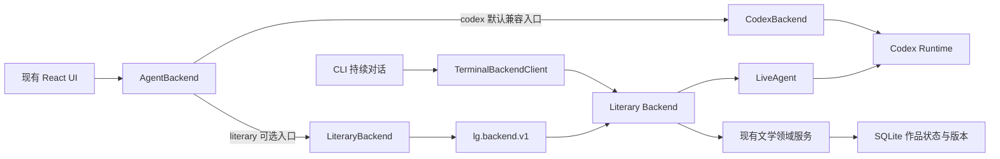
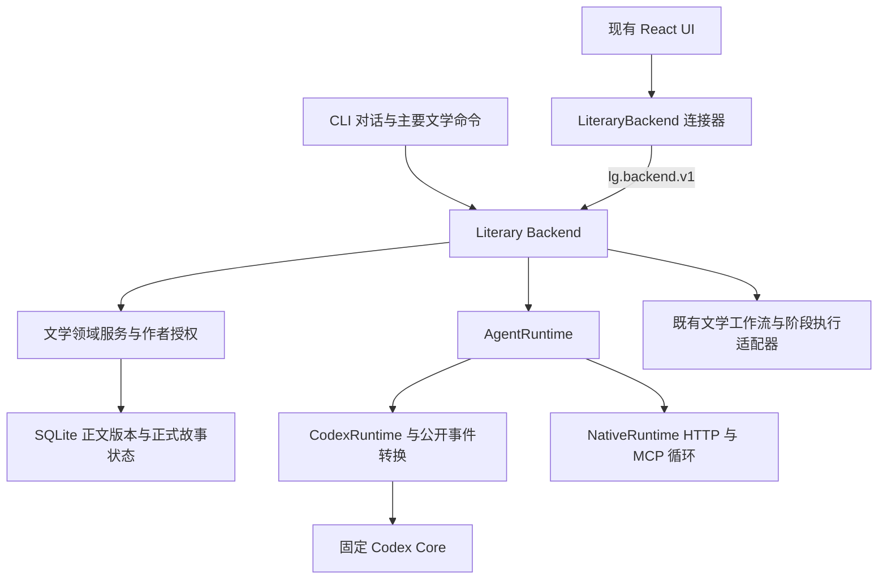

# Oh Story 第一阶段融合设计

LiteraryGiant 保持为唯一产品主体。第一批吸收任务范围、作者裁决和来源版本规则，
并优先修复 Agent 改稿与创作审批的边界。现有 React UI、SQLite 作品存储和 Codex
运行时继续使用；通过连接层逐步统一 Literary Backend，再隔离 Runtime。

## 本阶段验收结论（2026-10-16）

作者已明确选择：**保留 Rust TUI 与独立 app_server 为独立兼容入口，本次验收主 CLI／Extension。**
Oh Story 首轮能力拆解、选择性融合、作者控制修复、主入口 Backend 统一，以及
Codex 适配器／Native 独立执行路径均已有源码与测试依据，本阶段完成。
两个兼容入口保留现有命令、协议和文件，不计作已经统一，也不阻止本阶段结单。

最近完整验收：LitIsLand 与实际项目各 Python 982 项、Extension 单元 55 项／集成 14 项，
类型检查及构建通过，零失败、零跳过、零 OOM。结单时核对 597 个验收输入及兼容入口源码，
本次仅更新三份文档，不重新累计或宣称重跑上述测试。原始失败、中断和最终通过日志分别保留。

完整叙事输入隔离、通用 Runtime 能力对齐、独立 UI 及长期文学质量验证继续作为后续路线。
以下分批记录保留各自当时的能力边界，最终状态以本节和路线文档为准。

## 正式创作方向：方案、选择与撤回

本批借鉴固定上游 `skills/story-long-write/SKILL.md:46–57,88` 的作者确认与不扩范围原则，
以及 `skills/story/references/author-memory.md:41–62,81,114–116` 中明确接受、替换、撤回保留历史的语义。
后者原本针对作者偏好，不能据此宣称上游已有 LG 的方向状态机。恰好三个非空、内容不同的方案
是 LG 本批验收约定，不是 Oh Story 的硬性数量规定；结构校验也不证明三个方案的文学差异或质量。

`creative_decisions.py` 在既有 `documents`／`document_versions` 中管理新增 kind
`creative_decision`，没有新增数据库、表或重写旧资料。主题明确为作品／分卷／章节及其 key，
同一主题由一个记录管理；分卷／章节必须绑定真实对象及其确切来源版本。无文档来源的新构思保存
非空请求上下文与摘要，但不声称模型传入的请求就是已验证的作者原话。声明来源不等于模型全部实际依据。

| 操作 | 实际状态与门禁 |
| --- | --- |
| 保存三方案 | 初始 `selection=null`；再次生成保留原选择。活动版本只代表最新记录，所有普通版本保持 draft，不等于正式方向。 |
| 选择 | 显式指定方案集版本和 option ID，可选较旧方案集；独立 creative 审批，事务内核对当前决定 head 和该方案集的全部声明来源。 |
| 来源变化 | 当前选择继续保留，但读取显示 stale／待作者复核；不自动删除、换选或改写正文。新方案与旧选择的来源状态分别返回。 |
| 撤回 | 独立 creative 审批及当前 head 检查，来源已过期仍可撤回；新版本为 `selection=null`，读取不回退寻找历史选择。 |
| 通用文档写入 | 普通 create／edit／version add／accept／restore／reject／metadata update 拒绝受管理类型，不能绕过专用转换。 |

`studio.py` 注册 `studio_decision_options`／`studio_decision`／`studio_select_decision`／
`studio_withdraw_decision`；`studio_operations.py` 提供 CLI 与 Backend 共用的
`decision-options`／`decision`／`select-decision`／`withdraw-decision`。前者保存需操作许可，
后两者使用 `session_runtime.CREATIVE_TOOLS` 的独立创作权限和 `mcp_approval.operation_details`
读取的确切预览；操作 Full access 不提升创作权限。保留作者显式选择的 auto_review／full_access 策略。

Extension 沿用现有资料库、连接器和审批组件。`workspace_library.py` 为最新方案集提供精确 select 行，
为当前选择提供 withdraw 操作；不提供普通候选 adopt。`task_scope.py` 的单次 decision 任务绑定
文档、head、动作、方案版本及选项，运行中不能换选或转成正文修改。共享协议增加两种动作，
`WorkspacePanels.tsx` 仅补按钮文案与截断预览禁用条件。较旧方案集可通过显式 CLI／Studio 参数选择；
本批不让自然语言路由猜测“选 B”所指的记录和版本。

`ProjectStore.decision_context` 提供有界的当前选择投影，`context_snapshot` 和
`writing_mcp.project_memory` 共用；`story_context.py` 单列范围、选择状态和来源。默认上下文
不加载未选方案或请求原文；构思比较时可显式读详情。撤回停止的是方向生效，不回滚已写正文或 Canonical。
旧 profile、普通 outline 与历史候选保持原语义，不自动变成正式方向。此能力不是完整作者记忆、
依赖图、人物认知隔离或旧章影响分析；数据库提交与计划文件归档也不是跨文件原子事务。

新增验证使用 `creative-decision-*` 证据前缀。

本批最终验收：新增 37 项 Python、2 项 Extension 单元及 2 项集成测试；LitIsLand 与实际项目各 Python 812 项、Extension 单元 53 项／集成 14 项及类型检查、构建通过，零失败、零跳过。四个 Python 分片按模块分组无重复，最长分别 129.536／131.624 秒。核验 572 个输入，25 文件备份同步；OOM／oom_kill 均为 0，空白检查通过。

## 正式方向进入审读来源

后续只读实验复现：Live Runtime 与 Story 工作流都可能读到 A 方向、在执行期间由作者改成 B，
再保存旧 A 候选；候选目前没有统一的生成上下文 receipt。更直接的采纳缺口是，五类审读只绑定
正文与 Canonical，方向改变或撤回后旧报告仍有效。全局项目指纹只保护审批等待期间，不能替代
生成来源或审读来源。证据为 `decision-dependency-probe.py` 及其 actual/sandbox 日志。

本批先把正式方向接入已有审读契约，继续复用相同的报告存储、监督门禁与独立创作批准：

- `creative_decisions.review_context`／`ProjectStore.decision_review_context` 返回相关的当前已选方向：
  作品范围、当前章节、章节直接所属分卷。未选择、已撤回和其他章节／分卷的方向不进入本章证据。
  所有适用的作品级主题都会提供，不猜测某个主题与正文是否有语义联系。
- 投影包含具体选择、原方案集版本和声明来源有效性，不包含最新备选方案或决定记录 head。
  因此只重新生成备选方案不改变审读指纹；正式选择、撤回或其声明依据变化会改变相关快照。
- `BookAnalysisStore.snapshot`／`candidate_snapshot`／`volume_snapshot` 纳入该投影，既有五类报告、
  保存前复核、采纳事务内检查、卷级审读与有界专家 freshness 共用它。无适用已选方向时不添加空字段，
  原快照及报告指纹保持兼容。既有报告在适用正式方向加入后需要重新审读，不批量改写历史报告。
- 候选快照只投影实际候选目标，按 accepted／final 描述其采纳后的来源状态，其他文档保持真实原状态。
  本章 v1 是方向依据、待采纳 v2 会使该依据过期时，报告预先记录这个投影，避免采用后发布不匹配。
- 所选方向文本可以提供独立 `p` 前缀的 span，证据继续使用原 document_id／version_id／quote 格式；
  版本指向具体方案集，不能引用未选方案。计划不是已发生事实，仅凭计划引文不能判定 Canonical 冲突。
- `workspace_library` 的候选详情显示当前审读依据及“采纳此候选后的方向来源状态（审读投影）”。
  报告过期不等于文学不合格。作者可以按当前方向重新审读原候选，再独立批准采纳，无需丢弃原文或增加 force 开关。

上游固定源码 `workflow-revision.md:57–59,73,86,89` 要求列出后文受影响位置并交作者裁决；
`tracking-transaction.md:126–128` 和 `tracking_commit.py:1106–1146` 保留显式退役历史。
缓存实现没有完整语义反向依赖图，本批也不声称实现。没有监督策略的作品保持原采纳语义，不新增隐式硬门禁。
本批绑定的是实际审读输入，尚未给 Live／Story／RunStore 候选补齐生成 receipt；不得把当前计划展示
解释成已经证明生成时使用了它们。数据表、Runtime manifest 和既有 React 布局沿用现有形式。

本批验证使用 `direction-review-*` 证据前缀。

本批最终验收：新增 28 项 Python 测试；LitIsLand 与实际项目各 Python 840 项、Extension 单元 53 项／集成 14 项及类型检查、构建通过，零失败、零跳过。四个 Python 分片按模块分组无重复，最长分别 126.115／130.199 秒。核验 576 个输入，12 文件备份同步；OOM／oom_kill 均为 0，空白检查通过。

## 生成输入捕获：Live、Story 与 RunStore

沿用上一节已复现的 A 读取→作者改 B→保存候选缺口，本批捕获准备交付的真实输入，
不在写入时读取最新方向并冒充生成依据，也不接受模型自报来源字段。此为 LG 现有路径的补强，
不声称 Oh Story 固定源码已有相同 receipt 实现。

| 路径 | 捕获与保存 | 证据边界 |
| --- | --- | --- |
| Live Core／Native | 共享 MCP 读取前取当前 run lease；以实际返回结构计算 canonical JSON 摘要和来源标识，经控制 socket 归档；写审批入口冻结，批准后以 ContextVar 注入候选版本。 | 只证明宿主准备返回；旧历史及隐藏 Runtime 增补未知，无 Core 子线程精确归因。无本轮读工具时为 unknown。 |
| Story | 按实际保留的渲染 section 识别来源，截断不推定全部来源；最终准备的 prompt／instructions 取摘要；候选、stage、manifest 保持同一输入 receipt。 | 全量 snapshot 不等于交付；正文摘录、场景卡及选区上下文保留片段语义，其他来源保守标未知。 |
| RunStore 导入／恢复 | 原制品 hash 先核验，再继承原 receipt；输出摘要与输入 receipt 分开。旧 manifest 无 receipt 不补当前来源。Store 与 MCP 旧稿恢复同样继承原记录。 | 不证明原记录之外的模型历史；不改变旧导入状态、采用门禁或既有权限。 |

实现入口为 `lg-cli/lg_cli/generation_sources.py`、`project_store.py`、`writing_mcp.py`、
`workflow_control.py`、`backend.py`、`story_context.py`、`story_workflow.py` 和 `run_store.py`。
版本保留 `generation_sources` 与 `generation_output_sha256`，文档 metadata 不复制记录；普通调用者
不能通过 metadata 参数伪造。私有会话 ledger 有明确大小限制和截断声明，不把全部工具正文重复归档。
`workspace_library.py` 的候选详情分开展示生成捕获与当前审读依据；记录本身不授予创作权限，
方向改变后仍可按当前来源重审旧候选并独立批准，不自动否定候选或改写故事。

专项测试在合成作品与本地服务上验证，真实 SDK／Core／Native／MCP 往返不等于真实模型文学质量。
仍待完成完整依赖复核、人物／读者认知视图和故事时间过滤。证据前缀 `generation-sources-*`。

本批最终验收：新增 40 项 Python 测试；LitIsLand 与实际项目各 Python 880 项、Extension 单元 53 项／集成 14 项及类型检查、构建通过，零失败、零跳过。四个 Python 分片按模块分组无重复，最长分别 109.361／109.168 秒。核验 581 个输入，20 文件备份同步；OOM／oom_kill 均为 0，空白检查通过。

## 旧来源变化后的只读影响复核

固定上游 `workflow-revision.md:57–59,73,86,89` 要求修改旧章后检查后续受影响位置，并交由作者决定
是否一起修改。LG 采用这一机制目标，复用已有 SQLite、版本、声明来源和上一批捕获记录，
不运行上游 tracking 事务，不声称其代码已经自动推导文学依赖。

现状探针 `source-impact-boundaries-probe.py`／`source-impact-probe.py` 确认：同一未变来源在
Live／Story 的摘要不同；方向的 full／compact 投影还不同；公开 `list_versions` 最多 1000 项，
直接用它扫描历史会漏掉已有记录。事实来源过期仍保留 Canonical，正式方向也继续保留。

新增 `lg-cli/lg_cli/source_review.py` 按 producer 重建投影，提供 `ProjectStore.generation_source_review`。
返回当前、变化、不可用、未知、仅索引和历史来源；旧记录不补填、坏记录不修复。
活动正文替换可见，显式指定的旧候选仍可用时不误称被替换。同 ID 事实改值可检测；仅改 rationale
只影响实际提供过该字段的 Live 返回，不影响没有该字段的 Story 片段。所识别来源未变不代表完整上下文未变。

新增 `source_impact.py` 的 `ProjectStore.source_impact` 返回已知直接关联：事实／提案与正式选择的
声明来源、有效生成记录的实际输入暴露、明确的编辑基底。索引不算正文依赖；编辑基底不算已读证明。
文档版本状态与 is_active 分开；方向方案集不等于最新 head，场景卡不绑定正文版本，fact 来源不做二跳传播。
不指定版本查文档各版本，指定时匹配确切版本；所有查找在一个只读快照，流式扫描最多每表 5000 项，
结果 limit 与扫描上限分开。截断时已发现数量只是下界，未知旧记录和无关联结果不能证明后文没有影响。

`studio.py` 新增只读 `studio_source_impact`，`studio_operations.py` 的 `source-impact` 经现有 CLI／Backend。
`mcp_approval.py` 与 `native.py` 同步读工具注册，WRITE／CREATIVE 权限分类不变；Core 独立 review-only
仍保持四项。`studio_review_context` 在 snapshot／指纹之外附加 `generationSourceReview`，
`workspace_library.py` 为候选显示同一单版本摘要。诊断不改变报告、候选或 Canonical，不新增采用门槛，
不新增 React 布局或权威数据库。完整语义判断、传递闭包与作者重新裁决仍需后续能力。

工程验证仍使用本地合成模型与固定 Core／Native，不据此推定文学质量。证据前缀 `source-impact-*`。

本批最终验收：新增 43 项 Python 测试；LitIsLand 与实际项目各 Python 923 项、Extension 单元 53 项／集成 14 项及类型检查、构建通过，零失败、零跳过。四个 Python 分片按模块分组无重复，最长分别 111.679／112.449 秒。核验 587 个输入，18 文件备份同步；OOM／oom_kill 均为 0，空白检查通过。

## 已登记人物／读者认知基础

固定上游 `skills/story-import/scripts/tracking_commit.py` 中，characters.knowledge 是覆盖式字符串列表，
timeline 将 objective_fact／reader_knowledge／reveal_status／reveal_chapter 分列；
involving_characters 不代表人物获知，story_time 自由文本也未形成可排序的时间引擎。
LG 吸收信息分层的目标，独立实现版本化记录，不把上游字段名当成完整可见性门禁。

开发前的只读复现确认既有 Canonical、人物资料、规划和时间线仍可带入未来信息；
Story／Live 的历史、指令及工具输入也未绑定受限视图。独立证据分别为
`narrative-projection-input-probe.py`、`narrative-runtime-input-probe.py` 和
`narrative-information-boundaries-probe.py`。早期两个探针曾同名覆盖，已从各自原始调用重建为
独立命名并复跑；不以有歧义的同名文件作为验收依据。探针不调用真实模型，不推断文学质量。

新增 `narrative_knowledge.py` 和 `narrative_view.py`，复用 story.sqlite3 文档／版本，
实现提案、精确历史提案确认、撤回和已登记记录的只读双轴投影。所有版本保持 draft，
确认保存在专属指针中；重提案不覆盖旧确认、撤回无回退。人物按 story 位置，读者按 reading 位置，
作者显式整数坐标与半开区间独立于章节号。不同观察者可误信或持有相反信息，
knows／believes／uncertain 不建立世界事实。确认区间同观察者／主题不可交叠；来源过期保留确认，
投影仅返回待复核 ID 和状态，隐去正文／rationale；未登记数据仍为未知。

`project_store.py` 暴露领域接口，`managed_documents.py` 防通用编辑、采纳、恢复绕过。
`studio.py`／`studio_operations.py` 接入已有 MCP、CLI 与 Backend；确认／撤回使用独立创作权限，
`task_scope.py` 绑定精确动作、head、提案及单次提交。`workspace_library.py` 复用现有详情和审批流，
Python `backend_protocol.py` 与 TS `shared/protocol.ts` 新增两个动作，React 只增加标签与禁用条件。
`source_impact.py` 只追踪当前 confirmed.sources；未确认的新提案不替代正式认知依赖。
新认知读取的生成捕获目前仅有返回摘要，尚无对应的类型化来源重建，按 unknown 处理，
不宣称已能从认知变化追溯所有候选。交叉审查复现最长合法正文和理由重复嵌入后超过
Extension 的 30000 字符限制，且 JSON 转义和 UTF-16 计数不能忽略。现操作提示只携带
精确目标身份、参数和内容摘要哈希，完整正文／理由仍在资料详情及服务端独立创作审批中展示。

scope=registered_records_only、model_input_isolation=false 是本批明确边界。
尚未限制作者全局资料、Runtime 历史、路由、通用工具、指令或专家；不得据投影测试宣称无全局信息泄漏。
后续先验证宿主绑定的全新无工具阶段，并检查实际供应商请求，再逐步覆盖交互式路径和恢复。
Core／Native 使用真实 SDK 与 Runtime、合成本地模型测试权限和状态，不验证文学表现。
证据前缀 `narrative-knowledge-*`，输入基线为 `narrative-view-inputs.json`。

首次实际项目完整回归中，13／14 项 Extension 集成通过，澄清路径出现 WAL FileNotFoundError。
合成作品事件记录确认该轮实际 failed，不能修改 UI 等待来掩盖。`mcp_approval.py` 对来源消失
有限重算整个指纹，重读数据库；持续变化明确失败，其他 I/O 错误不吞掉。
`tests/test_project_fingerprint.py` 控制真实 SQLite 最后连接关闭，验证重试、预算与错误语义。
首次完整运行和冻结记录保存在 `narrative-knowledge-before-wal-race/`；修复按独立备份和应用记录落地，
随后重新运行沙箱和实际项目全部检查，不把首轮失败算作通过。

本批最终验收：新增 59 项 Python 测试；LitIsLand 与实际项目各 Python 982 项、Extension 单元 55 项／集成 14 项及类型检查、构建通过，零失败、零跳过。四个 Python 分片按模块分组无重复，最长分别 143.539／149.180 秒。核验 597 个输入，30 文件备份同步；OOM／oom_kill 均为 0，空白检查通过。

## 来源与比较基线

Oh Story 固定为 [2cf7be61b139f3852c82f981a7ff4eed2aaf5926](https://github.com/zenstory-ai/oh-story-claudecode/tree/2cf7be61b139f3852c82f981a7ff4eed2aaf5926)，
LG 基线为 `3a8b6d8d8d12f5dda5e9662521f37970f8b0a262`。
来源路径和 SHA-256 见 [oh-story-source.json](oh-story-source.json)。源码快照只用于阅读，
没有安装上游插件或执行其部署脚本。上游许可证为 MIT；本批以独立 LG 代码适配机制。

隔离环境为 LitIsLand，Runtime 为固定的 codex-cli 0.154.0。合成作品用于写入测试，
真实作品不参与实验。基线七组测试共 57 项通过。现状回归与新增目标验收分别记录，
不将已有数据库计数或提示词规则作为真实创作可靠性的证明。

## 核心能力比较

| 上游能力及源码 | LG 现有对应 | 判断与实施边界 |
| --- | --- | --- |
| `skills/story/SKILL.md` 的意图分发 | `main.py`、`intent_router.py`、`task_scope.py`、`workspace_library.py` | 借鉴对象、范围和停点；保留 LG 命令和 UI 消息格式。自然语言先提案，再由宿主绑定真实对象与权限，不能只靠关键词。 |
| `skills/story-long-write/SKILL.md` 的规划与正文分离 | `workflows.json`、`runtime_context.py`、主控提示词 | 借鉴规划请求优先、指定范围结束、确认不扩权。当前请求优先于通用模板。 |
| 同一 Skill 的新增元素分级 | 事实提案、正文候选、Canonical | 借鉴一次性细节、持久新增、重大决定的区别。持久新增在 LG 中先成为带来源的候选；主会话检查不等于 Canonical 批准。 |
| `references/workflow-revision.md` 的范围与级联检查 | `StoryWorkflowService`、版本与分析指纹 | 保留局部修改边界和影响分析思路。上游会直接改正文；LG Agent 改稿先保存候选，作者手工编辑仍直接版本化保存。 |
| `references/workflow-chapter.md` 的单章检查与交接 | 场景卡、正文工作流、五类审读 | 保留现有单章闭环。网文细纲九字段、固定批量章数和句式清零不设为 LG 通用硬门禁。 |
| `scripts/build_writer_prompt.py` 的按任务组装 | `story_context.py`、`prompt_builder.py`、`KnowledgeGateway` | 借鉴最少必要材料和统一文风裁决；不使用上游路径与写手文件协议。实际章节位置和认知过滤仍待实现。 |
| `tracking_commit.py` 的预期修订检查 | `ProjectStore` 的版本与事务 | 借鉴事务内检查。候选记录基础版本，采纳时再核验；不另建 `_tracking-state.json`。 |
| 同一脚本的派生视图一致性 | `story_index.py`、`ChapterSync` | 保留数据库为权威，索引与章节文件为投影。上游先写派生文件、最后替换状态文件，也不是多个文件同时原子提交。 |
| 同一脚本的 append 与 revision | 章节版本、事实来源、审读失效 | 借鉴新章与历史修订的区别。全书事实撤销和受影响章节分析应独立设计，不把覆盖旧事实伪装成续写。 |
| `skills/story/references/author-memory.md` | 写作偏好与作品指令 | 借鉴作者明确表达、适用范围和可撤回历史。一次性要求与小说事实分开；不新增另一套偏好数据库。 |

上游状态提交代码实际检查 `expected_state_revision`，限制新章追加顺序，
并用独占创建的锁文件串行写入。它的事实、读者认知和揭示位置分离具有参考价值，
但不能据此认为它已有任意历史位置的完整知识查询引擎。

## 专项角色比较

来源目录为 `skills/story-setup/references/templates/agents/`。
工具声明描述宿主期望，LG 必须通过自己的运行路径与服务约束验证实际权限。

| 上游角色 | 可保留的方法 | LG 对应及决定 |
| --- | --- | --- |
| narrative-writer | 已批准内容与表达自由分开；新增信息交接给主控 | chapter-writer、manuscript-editor、style。增强现有交接，不赋予直接激活正文或修改事实权限。 |
| consistency-checker | 引文、规则前提、触发事件与矛盾链；不替作者做创作裁决 | continuity、五类分析与监督。保留 LG Schema、证据校验和作者裁决。 |
| story-architect | 限定规划层级；结构与情绪设计；报告范围风险 | director、plot、worldbuilding、scene-planner。按任务组合现有角色。 |
| character-designer | 人物动机、关系和声音区分；与宏观规划分工 | character。补充有价值的方法时保留候选输出和来源。 |
| story-explorer | 有来源和缺口的结构化查询，不补猜测 | book_library、book_entry、KnowledgeGateway。查询能由程序完成时无需增加 Agent。 |
| chapter-extractor | 分块、避免跨批遗漏、明确事实与推断、保留定位证据 | 章节分析和参考资料管线。只按明确任务提取，不将参考书内容写入本书 Canonical。 |
| story-researcher | 外部事实与小说事实分开；来源质量与缺口可见 | reference、KnowledgeGateway。保留现有检索入口，不引入浏览器登录、CDP 或额外网络工具。 |

## Hook 与工具采用边界

上游 `guard-outline-before-prose.sh` 基于文件路径、工具负载和 Node/Bash 解析判断写入。
部分解析失败、依赖缺失和不可读情况实际返回放行，不能用它替代 LG 的作者授权。
`validate-story-commit.sh` 是 Git 提交格式提示，最终退出码为 0，与小说采纳审批不是同一事件。

会话起止和压缩 Hook 的部署方式依赖宿主。LG 可借鉴检查目的，但由自己的会话、
上下文服务和测试完成。保持写作 Runtime 的 shell 限制，不安装上游 Hooks。
新检查应封装为确定性领域工具，声明输入、输出、错误和是否写入；文学偏好提示
与影响正式状态的门禁分别处理。

## 统一任务与授权契约

任务至少描述请求来源、操作对象、范围、交付类型、停止条件和读取的版本。
宿主负责保存这些信息；模型不能自行扩大授权，也不能自报“作者手工编辑”身份。

| 行为 | 状态变化与批准 |
| --- | --- |
| 讨论与建议 | 不产生正文采纳或 Canonical 变化。作者要求归档时才保存对应资料。 |
| 大纲或细纲规划 | 保存所请求范围的规划；不自动写正文。 |
| Agent 新章、改稿和恢复 | 保存 candidate。生成或保存批准不等于采纳批准。 |
| 作者在编辑器直接修改 | 沿用 `edit_active_document`／`edit_chapter_documents`，保留历史与冲突检查。 |
| 候选正文或资料采纳 | 使用 `creative_mode`；展示服务端读取的版本与差异；在数据库事务内核对基础版本。 |
| 设定提案确认 | 使用 `creative_mode`；展示确切提案；正式事实仍由 ProjectStore 管理。 |
| 更新阅读索引 | 只更新派生投影，不能采纳正文或确认事实。 |

`ask` 由作者作具体决定；`auto_review` 是作者预先选择的只读自动审查；
`full_access` 是作者选择的自动允许模式，仍受版本、证据与监督检查约束。
操作权限与创作权限独立；操作 Full access 不能隐式提升创作权限。

首批从 CLI 与产品 Backend 的 MCP 采纳建立独立创作权限，随后接入 Extension。
任务边界最初仅进入共享主控提示词；后续已补宿主门禁、明确任务与普通自然语言路由，
具体实现和验证见后文相应章节，不能仅根据提示词变化判定强制约束成立。

## 第一批实现

- 保留 `create_chapter`、`edit_manuscript`、`restore_manuscript` 名称和参数。
  新建章节标为 candidate；Agent 改稿和恢复不激活已有正文。
- `edit_manuscript` 保留 DocumentVersion 返回字段，增加 `applied=false`。
  状态从立即激活改为候选是有意的授权修复，旧调用方必须按返回状态汇报。
- `create_version`、`accept_version` 增加可选 `expected_version_id`，在事务内检查。
  候选的 `base_version_id` 使用现有 metadata，不迁移数据库 Schema。
- `studio_accept`、`studio_adopt_reference`、`studio_accept_proposal` 使用创作权限。
  两种 MCP 审批路径共享服务端预览；批准期间作品变化会拒绝写入。
- 原生终端启动 MCP 时要求 elicitation，缺少确认支持不会自动执行写操作。
- 共享主控提示词补充请求范围、新增信息分级与候选汇报规则。

## Backend 连接层首批实施与验证

现有 React UI 与 `AgentBackend` 接口保留。Extension 增加可选的 `literary`
连接器，使用 `lg.backend.v1` 的作品资料、LG 会话、展示事件和审批。
本节记录首批连接器验收时默认仍为 `codex`，旧 Extension 独立 threads 通过原入口读取。
后续默认切换与历史导入见末节。

- 作品资料读取不启动模型，复用既有领域服务。慢读取不阻塞取消和审批。
- 预览在读取前后校验指纹；期间修改作品会拒绝返回混合版本。
- 新客户端只消费 LG 展示事件，不导入 Codex 生成类型。
  私有推理不进入展示事件，子 Agent 文本不混入主对话。
- 展示项绑定 LG run ID，保留工具结果、候选差异、部分输出和工作流进度。
  历史恢复不重做工具或复活审批；迟到的运行事件不能覆盖完成结果。
- 取消后审批回调和主线程识别使用当前 Agent，替换执行实例后的流式回复可继续保存。

本批文件：

| 分类 | 文件 |
| --- | --- |
| 产品服务 | `lg-cli/lg_cli/backend.py`、`backend_events.py`、`backend_protocol.py`、`backend_stdio.py`、`approvals.py`、`workspace_library.py` |
| Extension 连接与契约 | `lg-vscode/src/backend/LiteraryBackend.ts`、`RpcTransport.ts`、`lg-vscode/src/host/DesktopHost.ts`、`lg-vscode/shared/protocol.ts`、`lg-vscode/package.json` |
| 测试 | `tests/test_backend_library.py`、`tests/test_backend_events.py`、`tests/test_workspace_library.py`、`lg-vscode/tests/literary-backend.integration.ts`、`lg-vscode/tests/fixtures/app_server_fixture.py` |
| 文档 | `docs/backend-request-schema.json`、`docs/extension-backend.md`、本设计 |

2026-10-14 验证：先在 LitIsLand 副本测试，再应用到项目并运行实际项目源码。
项目两组 Python 测试分别为 34 与 22 项，通过；Extension 既有单元测试 29 项通过；
沙箱与项目的类型检查、构建通过。新旧连接器都在实际项目源码上运行固定 Runtime
集成测试，分别验证 7 次和 9 次审批、拒绝写入、取消与跨进程恢复。
模型响应为本地合成数据，未调用付费模型。这些结果证明对应工程行为，不证明文学质量。

在本节记录的连接器首批验收时，旧 Extension 历史导入、完整命令编排接口及独立 Runtime 尚未完成。
后续 Runtime 进展见本文最后一节。
`literarygiant.backend=literary` 是渐进接入选项，不能据此宣称统一 Agent 已全部完成。

## 来源校验与 CLI 持续对话接入

沿用 Oh Story 的预期版本提交思路，LG 在 SQLite 事务内检查提案来源。
提案创建时记录确切文档版本；省略来源版本也不会在后续采纳时自动重绑。
只有当前已采纳的来源能用于确认 Canonical。候选需先采纳来源，再单独确认事实；
被替换、拒绝、归档或缺版本的旧提案不能被一个新的 UI 指纹重新视为有效。
无文本来源的独立作者设定保持单独确认路径。已有正式事实不被本批自动修改。
`add_fact`、`set_fact`、`promote_fact`、`accept_proposal` 使用同一来源门禁，
审批或 Full access 不绕过该检查。提案预览显示来源状态，失效提案不提供采纳动作。

CLI 自然语言持续对话通过 `TerminalBackendClient` 调用相同 Backend，统一
会话锁、运行 ID、保存、审批、追加指令和取消。`/permissions` 也使用该服务，
无需启动模型即可设置权限。共享控制器保留终端命令任务的停止与重试行为。
对话由服务保存一次；已有 UI 消息显示与模型配置切换保留。
CLI 显式命令仍保留原调用方式，其编排接口尚待统一；终端仍通过兼容原始事件
保留子 Agent 进度，尚未完全隔离 Codex 事件。

本批文件：`lg-cli/lg_cli/project_store.py`、`writing_mcp.py`、`workspace_library.py`、
`mcp_approval.py`、`backend.py`、`main.py`、新增 `terminal_backend.py`；
`tests/test_project_store.py`、`test_bookshelf.py`、`test_provider_profiles.py`、
`test_workflow_control.py`、新增 `test_proposal_sources.py`、`test_terminal_backend.py`、
`test_terminal_runtime.py`；本设计与 `docs/extension-backend.md`。

来源检查 40 项、CLI／Backend 63 项测试先在 LitIsLand 副本通过，再应用到项目，
在实际项目源码上通过。固定 Runtime 的实际 CLI 入口与 Backend 接续用例通过，
确认同一 thread、历史完整且不重复保存；Extension 集成也在实际项目上通过。
完整测试命令为 `python -m unittest discover -s tests -t . -v`，需保留包顶层以支持相对导入。
LitIsLand 完整集为 386 项：380 项通过，6 项按测试条件跳过，无失败。
模型响应是本地合成数据，仍不作为文学质量证明。

## 长会话历史分块恢复

实际复现旧快照响应为 4,500,222 字节，超过连接层 4 MiB 上限。
新 `session/snapshotPage` 与 `pagedSnapshots` 能力保留旧契约，按字节分块，
允许单个超大展示项跨页恢复。缓存是连接内临时数据，不新增正式故事状态。
重建和编码在工作线程执行，事件日志使用 WAL；读取期间变化会拒绝混合版本。
连接器核验同一快照的页序、cursor、总页数和 SHA-256，全部收齐后发布现有 UI 快照。
读取中收到的新事件在发布后处理，不重做工具或恢复旧审批。

本批文件：新增 `lg-cli/lg_cli/backend_history.py`、`tests/test_backend_history.py`、
`lg-vscode/tests/literary-history.test.ts`、`large-history.integration.ts` 及两个对应 fixture；
修改 `lg-cli/lg_cli/backend.py`、`backend_protocol.py`、
`lg-vscode/src/backend/LiteraryBackend.ts`、`docs/backend-request-schema.json` 和两份设计文档。
项目 Python 测试 32 项、Extension 单元测试 39 项及类型检查通过。
真实 Python 服务的超大历史恢复与固定 Runtime 的审批、取消、历史集成在沙箱通过，
并在项目源码上复核。模型响应为本地合成数据。

现有 UI 仍使用完整展示项数组，后续需优化总内存与渲染。
实时事件仍使用原帧限制，超大实时结果处理留待后续。

## Backend 与 Runtime 后续迁移

保持 React UI 的展示契约与 `AgentBackend` 能力。
先为 `lg.backend.v1` 补齐当前 UI 必需的作品概况、分页资料、版本、工具结果和审批事件，
再实现 TS 的 LG Backend 连接器。对照同一组端到端任务验证后再切换正式入口。
现有 Codex 历史应提供明确的读取或导入路径，不能因更换连接器静默失去会话。

CLI 持续对话已复用同一 Backend 的会话、运行、权限和取消服务。
文学命令仍保留已有调用方式，由 Backend 封装其编排，不删除已有工作流。
协议采用增加方法或能力协商；需要破坏性变化时单独设计版本与迁移。

Runtime 接口及第二条执行路径已在后续批次实现，见本文最后一节。
继续补齐显式工作流与多 Agent 路径的覆盖，逐步移除终端兼容事件依赖；
基础文学服务保持独立于模型厂商或 Codex 类型。
这些迁移以复现的差异和实际需求为依据，按小批次测试，不按目录美观重组项目。

## 验收与剩余工作

工程验收分别覆盖候选不覆盖、作者手工保存、具体批准、拒绝和取消、独立权限、
过期候选、并发保存、监督门禁、流式事件、会话恢复和索引来源。
文学验收固定规划、单章写作与局部修订任务，保持模型与主要参数可比，
由作者比较人物行动、因果、节奏、信息越界与修改负担。

第一批授权测试见 `tests/test_authorization.py`、`tests/test_writing_mcp.py`、
`tests/test_backend.py`；已有监督、同步和场景创作测试继续运行。
真实 Runtime 集成使用本地模型替身，不把工程用例作为文学质量证据。

尚待完成：宿主强制任务范围、已确认事实的来源失效审计、按章节与人物过滤知识、
完整状态与派生投影恢复、UI 默认迁移和旧历史导入、大历史内存与超大实时结果、
完整命令编排接口和 Runtime 功能覆盖。第一批通过不能代表完整目标已完成。
通用工作流旧阶段失效与运行恢复在后续批次修复，见“运行查询、恢复与检查点输入验证”。

## Runtime 接口与第二条执行路径

LG 已用 `agent_runtime.py` 的产品接口封装运行、追加指令、取消与结果。
`codex_runtime.py` 将现有 LiveAgent 保持为默认执行器；`backend.py` 不再直接处理
Codex 轮次记录。终端原始事件作为适配器兼容输出保留，React UI 未修改。

实验性 `native_runtime.py` 通过 `native_model.py` 的异步 HTTP 模型调用和
`native_tools.py` 的现有 writing MCP 客户端执行相同文学工具，不启动 Codex。
候选、作者审批、版本与来源门禁仍由原产品服务控制，不增加正式故事库。
只读自动审查也使用 Runtime 工厂，Native 审查不加载写入或委派工具。
默认配置仍为 codex；只有明确设置 `[runtime].engine = "native"` 才进入新路径。
Native 仅支持有明确模型的 API key Anthropic／Responses 配置，不自动回退。

会话 sidecar 按 engine 保存绑定，旧 Codex thread 不被 Native ID 覆盖。
Native 私有恢复检查点不是 Canonical 状态；工具前后记录 pending，未完成调用不重放。
工具执行期间不可追加指令，多 Agent 调度与不确定工具结果续跑尚未实现。
Extension 的 literary 连接模式允许省略 runtime manifest，沿用产品配置；
Native 不使用它。旧 Codex 连接入口的 manifest 要求保留。
后续阶段执行器选择已覆盖显式文学工作流；旧 Codex 连接入口与专用启动命令仍保留，
不能声称整个产品已经摆脱 Codex。

本批文件：新增 `lg-cli/lg_cli/agent_runtime.py`、`codex_runtime.py`、`native_runtime.py`、
`native_model.py`、`native_tools.py`；调整 Backend、config、main、terminal_backend、
creative_review、runtime_context、session_runtime、writing_mcp、live_view。
新增 `tests/test_native_runtime.py`、`test_native_model.py` 和 Extension Native 集成 fixture／测试。
配置方式和架构图见 `docs/extension-backend.md`。

LitIsLand 完整 Python 测试 403 项，397 项通过、6 项跳过；Extension 类型检查通过。
同一 LG 连接器分别通过固定 Codex 与 Native HTTP／MCP 集成，用例覆盖批准／拒绝、
候选保留、差异展示与跨进程恢复。Native 测试禁止构造 LiveAgent。
模型响应为本地合成数据；工程兼容证据不等于文学质量或完整迁移验收。

应用到项目后，在 LitIsLand 环境运行实际项目源码：Python 分组覆盖全部 403 项，
6 项跳过。并行运行时旧终端登录用例出现 10 秒启动期限失败；其完整模块 4 项
单独复测通过。Native 集成曾在并行负载下超过原有 30 秒等待期限，单独复测
通过，未放宽测试时限；首轮失败记录保留。
固定 Codex 集成通过，包含 7 次审批、候选、取消与恢复。
Native 的同一连接器集成与实际 `backend_stdio` 无 manifest 启动用例均在项目通过，
项目 Extension 类型检查、构建通过。

manifest 调整涉及 `lg-vscode/src/backend/LiteraryBackend.ts`、`src/host/DesktopHost.ts`、
`package.json`、新增 `tests/literary-launch.test.ts` 及已有 Native 集成 fixture／测试。
LitIsLand 的 Extension 单元测试共 42 项通过，覆盖省略 manifest、绝对路径校验和旧
Codex 连接器原有要求。该调整保留 React UI 与默认 codex 入口。

## 显式文学工作流的执行器选择

`execution_adapter.py` 让 WorkflowRunner、StoryWorkflowService、ChapterAnalysisService
和兼容的 run_model_turn 遵循同一 runtime.engine 配置。Codex 默认路径保持原
CodexExecAdapter；NativeStageAdapter 使用已有 NativeModel 的 Responses／Anthropic
传输，以 workflow-stage.txt、原专家／Skill 提示词与 Schema 完成单一阶段。
阶段没有外部工具，产物及候选仍由现有服务校验、归档；失败与恢复沿用 RunStore。
角色模型、作者 retry guidance、上下文预算与文档版本门禁保留。
doctor 的配置检查及显式 provider probe 同样使用所选执行器。

Native 对缺少凭证、订阅、未支持协议、未配置模型与 code 阶段明确拒绝，
不静默启动 Codex。Schema 只允许本地引用；无效最终结果不发布合格阶段或产物。
本批保留 CoreExecutionResult 的兼容字段，未在 vendored Core 添加文学逻辑。
CLI 交互命令的调用编排尚未全部经 Backend，仍是接下来的工作。

本批文件：新增 `lg-cli/lg_cli/execution_adapter.py`、`tests/test_execution_adapter.py`；
调整 `workflow_runner.py`、`story_workflow.py`、`book_analysis.py`、`core_adapter.py` 的
默认执行器，以及 `doctor.py` 和两份架构文档。

59 项相关测试先在 LitIsLand 副本通过，再在项目源码通过。
本地 HTTP 用例禁止创建 Codex，覆盖 Responses 与 Anthropic 结构化最终结果、
角色模型、无效结果拒绝、Schema 本地引用、阶段期限、规划失败后恢复、修订候选、
章节分析，以及实际 CLI 子进程的文学命令。凭证加载仅替换为本地合成配置，
没有调用付费模型，也不将测试结果作为文学质量证明。

随后修复子进程配置传递：Backend 的章节分析原先未传递 environment，
会落入默认配置空间。`main.py` 新增可选 runtime-engine／runtime-manifest 参数，
CLI 与 Backend 工作流显式传递当前配置空间、执行器及安装位置。
交互会话保留作者明确选择的 Runtime 覆盖，同时保留原模型／凭证重载行为。
这部分涉及 `backend.py`、`main.py`、`tests/test_backend.py`、
`tests/test_terminal_backend.py` 与 `tests/test_execution_adapter.py`。
LitIsLand 参数与菜单、权限、配置空间回归 74 项通过；追加的交互重载用例及相关
Backend／Native 阶段用例 32 项通过。拒绝分析操作不会启动工作流子进程。
应用到项目后，含新增交互用例的 75 项相关回归通过；固定 Codex Runtime 的实际
CLI 与 Backend 同一 thread 接续用例通过，确认默认执行路径保持可用。
这批没有调整 React UI 或安装依赖；显式 CLI 工作流的统一 Backend 编排接口仍待完成。

## 声明式文学命令接入统一 Backend

新增 workflow/run 与 commandWorkflows 能力，保留协议 v1 和 workflow/start。
支持现有 chat、outline、world、character、plot、ref、check、write 文学工作流，
参数限制为请求与既有执行选项；不提供任意 argv、shell 或跨作品入口。
CLI 的这些显式命令通过 TerminalBackendClient 工作，复用同一服务及控制器。
保留明确作者命令的生成／归档语义；接口不开放为 Agent MCP 工具，不自动采用
正文或确认事实。原章节分析审批与创作采用门禁继续执行。

Owned CLI 子进程通过 stdin 接收历史与请求，不在 argv 放入这些文本，
不自行保存 conversation。Backend 将请求及核对过的最终回复保存一次，事件和
历史使用同一 LG run ID。现有 RunStore 继续保存领域工作流的阶段、产物与恢复数据。
生成回复仍是暂定材料，归档不是 Canonical 批准。

主 Agent 和工作流分别记录活动 ID，保留命令运行期间的指挥能力。
取消停止所属进程组，保留已完成文件；不能同时启动第二条工作流或修改权限。
公开事件不透传原始 model.event。原异步 retry 控制保持可用，其独立运行终态与
多运行 UI 状态在后续批次修复；场景／修订／采用子命令和旧 Extension 历史迁移尚未完成。
当时审计发现 CodexExecAdapter 的 _exec_args 没有显式限制文学阶段的通用工具。
后续追踪确认 API bridge 的模型目录会按 enable_shell 设置 shell_type，
因此不能据启动参数缺少开关就认定所有 API 阶段都暴露 Shell。
阶段层修复及实际工具可见性验证见下一节；readonly 或提示词不是检索范围门禁。

本批修改 backend.py、backend_protocol.py、terminal_backend.py、terminal_input.py、
workflow_control.py、main.py、离线协议 Schema 和两份架构文档；
新增 workflow_io.py 与 tests/test_backend_workflows.py。
LitIsLand 副本相关回归 77 项通过，追加的实际 TUI 命令入口用例通过。
真实 Native HTTP 工作流通过 4 个阶段，验证 stdin 请求、历史不重复、原稿保留；
另验证真实 dry-run 恢复、无效调用拒绝、UTF-8 分帧及主 Agent／工作流共同取消。
模型数据为本地合成，不作为文学质量证据。
应用到项目后，含 TUI 新用例的 78 项相关回归通过；固定 Codex Runtime 的实际
CLI／Backend 同一 thread 接续用例通过。React UI 与默认连接入口未修改。

## Codex 文学阶段通用工具门禁

_exec_args 对非 code 阶段显式关闭 Shell、unified exec、apply patch、view_image、
Apps／Plugins／推荐插件、sleep 和 web search，并关闭 tools 中的交互提问与计划工具。
原命令、结果字段和 code 模式保持兼容；文学上下文检索与结果保存由已有 LG 服务执行。
Native 阶段本来没有外部工具，本批未扩展其工具列表或改变正式故事库。

固定 Core 依据：features/src/lib.rs 的 ShellTool、ViewImage 默认值；
core/src/tools/spec_plan.rs 的 add_shell_tools、add_core_utility_tools；
core/src/config/mod.rs 的 resolve_experimental_request_user_input_enabled。
这些路径均位于 core/codex/codex-rs，本批只阅读，没有修改 vendored Core。

实际 codex-cli 0.154.0 集成以 enable_shell=True 对比修复前后请求：原请求包含
exec_command 和 view_image，修复后测试配置的模型 tools 列表为空。
另让本地合成模型主动请求 exec_command 读取私有测试 canary；Core 回报
unsupported call，后续模型请求和输出均未出现 canary 内容。
测试请求经过真实 Core 进程与本地 bridge，不访问付费模型。

本批修改 core_adapter.py、tests/test_adapter.py 与两份架构文档，新增
tests/test_stage_tool_gate.py。LitIsLand 的参数、固定 Core 及文学服务回归 50 项通过。
不把当前测试配置的空工具列表推广为任意外部配置均已隔离：ignore-user-config
不表示跳过所有系统／项目层，mcp_servers 空表也会与低层配置合并。
系统／项目或托管 MCP 的统一隔离，以及按作者任务限制实时 Agent 工具，仍需补齐。
同步到项目后，相同 50 项参数、固定 Runtime 与文学服务测试通过，git diff --check
通过。本批未修改 vendored Core、React UI 或模型配置空间中的凭证。

## 并行运行的客户端状态与恢复

实际源码只保留最后一条运行，且 LiteraryBackend 收到任意 run.finished 后清空
全部 pending 请求。主 Agent 提前结束时会错误解除工作流占用并使其审批无法回答。
SessionStore 与连接器改为按运行 ID 跟踪；结束一条只清理其所有权范围，剩余
运行保持忙碌，断线使全部活动标识失效。React 所用 run 字段保持原结构，
显示最近一条未结束的运行，未重做 UI。

session.snapshot 展示事件与 Python 快照增加可选 activeRuns。普通与冻结历史
分页从相同 cursor 的展示事件重建活动 ID，不保存另一份任务或故事状态。
旧快照缺少该字段时继续兼容；不恢复旧审批、不重新执行历史工具。

本批修改 shared/protocol.ts、SessionStore.ts、LiteraryBackend.ts、backend.py、
backend_events.py、backend_history.py、tests/test_backend_history.py、state.test.ts
与两份设计文档；新增 literary-concurrency.test.ts 及 concurrent-server.cjs fixture。
LitIsLand Python 34 项、Extension 47 项单元测试及类型检查通过，覆盖两种结束
顺序、匹配审批保留、问答、断线、活动快照与旧服务恢复。
当时异步 retry 的独立运行生命周期仍待办，后续修复见下一节；剩余子命令、
任务范围和旧历史迁移继续待办。
应用到项目后，Python 34 项及并行状态／历史 21 项 TS 回归通过；项目类型检查、
构建通过。Native 两项集成与固定 Codex 集成通过，后者包含 7 次审批、取消与恢复。
模型响应仍为本地合成数据，原 React 组件未修改。

## Backend 工作流重试的独立生命周期

原 WorkflowControl.retry 在自己的后台集合中执行，未进入 Backend.tasks；首轮结束后
重试仍可能运行，但客户端已认为空闲。workflow/start 重试还会直接复用旧 argv，
跳过首轮章节分析审批。这两条路径已通过可选 retry_executor 回调交由 Backend 调度。
每次重试创建新的 LG run ID，纳入活动快照、权限忙闲检查和共同取消；原主 Agent
控制对话可以继续运行，第二条工作流仍被拒绝。旧 CLI 控制路径保持兼容。

workflow/run 沿用原参数与 stdin 请求，作者请求只保存一次。每次重试清除旧结果，
重新核对 RunStore 后保存最终回复；退出零但缺失或无效的最终结果仍判失败。
成功任务不能重试，避免重复已完成修改。公开 run.started 增加可选 source=retry，
快照与 SessionStore 将其显示为通知，而非新增作者发言；协议版本仍为 v1。

workflow/start 每次重试重新进行原分析审批。拒绝不会启动 worker；等待审批时停止
也会取消等待，防止控制请求超时。启动前取消不创建进程，运行后取消停止所属进程组，
已完成文件保留。没有新增 Canonical 授权或第二份故事状态，没有修改 React 组件。

本批修改 lg-cli/lg_cli/{workflow_control,backend,backend_events}.py、
lg-vscode/shared/protocol.ts、lg-vscode/src/host/SessionStore.ts、
tests/test_backend_workflows.py、lg-vscode/tests/state.test.ts 与两份架构文档。
LitIsLand Python 53 项相关回归通过，含真实 Unix 控制接口重试、真实 dry-run、
审批拒绝、等待中停止、主 Agent 并行、启动前取消及运行后保留文件。
场景／修订／采用等剩余 CLI 子命令、任务范围、旧 Extension 历史迁移与默认入口切换
仍需后续完成；不能据本节认定全部命令已经统一或所有授权边界已经闭合。
应用到项目后，同一 Python 53 项和 Extension 48 项回归、类型检查、构建及固定
Codex Runtime 的 CLI／Backend 同一 thread 接续用例通过，git diff --check 通过。

## 并行审批的生产端归属

随后用真实 Backend 调度复现：主 Agent 尚未结束时，章节分析重试的审批事件
会被 emit 默认选到主 Agent run ID。前述客户端按 ID 清理虽正确，生产端 ID
仍有歧义。ApprovalBroker.request 新增可选 run_id，由 Backend 的调用方明确传入；
章节分析使用 workflow_run_id，运行时、主 Agent MCP 与创作操作使用各自 run_id。
客户端协议与 pending 的既有保存结构保持兼容，客户端不能指定授权所属运行。

修改 lg-cli/lg_cli/approvals.py、lg-cli/lg_cli/backend.py、
tests/test_backend_workflows.py 与两份架构文档。LitIsLand 相关 Python 回归 60 项通过；
增强用例让主 Agent 与工作流同时等待各自审批，验证两者的 ID、主 Agent 结束后的
工作流活动快照、审批继续可回答，以及拒绝不启动子进程。
等待审批时停止后的旧审批回复明确被拒绝。未增加新的授权模式或自动采用路径。
同步到项目后，同一组 60 项回归通过，git diff --check 通过；Extension 沿用此前
48 项单元测试、类型检查和构建结果，本批没有再次修改 TS 或 React 源码。

## 场景、局部修订与记忆提案接入 Backend

workflow/run 增加 scene-plan、scene-draft、revise 与 bible-curate，能力协商增加
storyWorkflows。前两者映射现有 scene plan/draft，revise 映射 edit，bible-curate
映射 bible curate；均复用 StoryWorkflowService，不复制故事库、专家或 Schema。
指定 document，修订明确 revisionMode，可指定 sourceVersion 与唯一精确 passage。
拒绝不适用的检索和 strategy 参数。CLI 交互入口通过 TerminalBackendClient 调用；
独立 CLI 原命令保留兼容。

请求、历史与选中段落使用有界 JSON stdin，--request-stdin 不能与命令行请求／passage
混用；无效载荷在领域写入前拒绝，错误不回显载荷。dry-run 放在故事子命令位置，
避免该子命令默认值覆盖顶层值。最终 story.result 核对 RunStore、状态和目标文档，
随后保存一次结果；重试继续采用此前统一的 Backend 生命周期。

creative/apply 增加 approveScene，能力协商增加 sceneApproval。CLI scene approve
经同一创作审批；预览包括完整计划与场景卡，批准时 ProjectStore.approve_scene 在
SQLite 写入事务内比较预览，变化则拒绝。原方法新增可选 expected_scene，直接作者
命令仍兼容。计划批准不等于正文采用，未批准计划仍不能调用场景正文生成。
正文及局部修订保存候选；记忆抽取只保存来源关联提案，不自动提升 Canonical。

本批修改 backend.py、backend_protocol.py、main.py、story_cli.py、terminal_backend.py、
workflow_io.py、project_store.py、tests/test_backend_workflows.py、tests/test_cli.py、
离线请求 Schema 与两份文档。LitIsLand 100 项相关回归及新增 CLI stdin 用例通过，
覆盖候选、拒绝、审批过期、事务版本条件、监督、阶段执行与真实子进程。
本地合成 Native HTTP 模型完成规划、正文、精确段落修订和记忆提案四条路径：
原稿不变，未选中前后文保留，作者请求与 passage 不进入 argv。
这些用例验证工程边界，不能作为文学质量证据。React UI 与 vendored Core 未修改。
运行产物导入、正文采用、剩余运行命令、宿主任务范围和旧历史迁移仍待后续完成。
追加交互入口用例覆盖 scene approve 的实际 Backend 审批；命令菜单、终端控制与
直接编辑回归 15 项通过，离线请求 Schema 与实际 contract 一致。
同步到项目后，合并的 116 项相关回归通过，固定 Codex Runtime 的 CLI／Backend
同一 thread 接续用例通过。12 个同步文件的哈希核验及 git diff --check 通过。

## 运行产物导入与正文采用接入 Backend

交互 CLI 的 run adopt 通过 run/import 导入草稿／候选，--accept 再对具体保存版本
发起 creative/apply.acceptVersion。version accept 与 scene accept 也使用同一路径。
之前 run adopt --accept 未进入会话创作审批；迁移后继续遵守该会话的独立创作权限。
导入与采用分开，不注册为 Agent MCP 工具，不自动生成或确认 Canonical。

RunStore.adopt 保留原接口，校验运行清单及产物在本书内，记录内容摘要，并在创建
候选时使用当前 active_version_id 作为事务前提。相同运行与相同内容复用版本，
内容后来变化则拒绝静默采用旧候选。已有手稿容器要求和监督门禁继续有效。

acceptVersion 增加可选 final、review，协议仍为 v1。旧调用 review=false 语义保留；
交互采用设为 true，经创作批准后启动 acceptance_review.py 工作进程，只复用
review_for_acceptance 保存候选分析，不调用 accept_version。Backend 核对完成记录的
文档、版本及 final，然后在再次验证具体目标和作品指纹后，调用原数据库事务采用。
已保存且当前的报告可直接复用。缺失报告沿用当前 Runtime 的阶段执行器。
有依据的冲突、来源变化、失败和取消均不激活正文；full_access 不能绕过监督。
取消停止所属进程组，完成报告保留。失败审查不能经普通 workflow_retry 重放采用，
需重新发起采用与创作审批。方法参数在调度时复制，不能在等待审批时改为另一个版本。

本批修改 backend.py、backend_protocol.py、main.py、terminal_backend.py、run_store.py、
tests/test_backend_workflows.py、离线 Schema 与两份文档；新增 acceptance_review.py 和
tests/test_backend_adoption.py。LitIsLand 109 项相关回归通过，覆盖导入幂等、拒绝、
具体预览、定稿、已有监督、真实进程取消、过期 Canonical、错误审查目标与请求变更。
真实 Native HTTP 路径使用本地合成响应补齐五个维度审查，再激活已批准版本，
禁止构造 CodexExecAdapter；不证明文学评判质量。TUI 用例实际执行三种采用入口，
拒绝后保留导入候选且原稿不变。React UI 与 vendored Core 未修改。
剩余运行命令、单次非交互 CLI 的完整接入、任务范围、旧历史导入与默认入口迁移仍待办。
同步到项目后，同一组 109 项相关回归、固定 Codex Runtime 的 CLI／Backend 同一
thread 接续用例、11 个文件哈希与请求契约核验、git diff --check 全部通过。

## 运行查询、恢复与检查点输入验证

run/list 与 run/readPage 从同一 RunStore 提供公开运行摘要和冻结详情，保留完整请求，
过滤 model.event、嵌套原始数据、私有失败内容和进程身份。复用已有 SHA-256 与有界
base64 分页缓存，不另建运行或故事库。查询在工作线程执行，读取前后检查文件状态。
run_browser.py 保留原列表与详情界面，改为使用只读 Backend 客户端；无会话、模型
凭证或 Agent 构造要求。带选项的 CLI 查询也读取同一产品契约。

workflow/resume 封装现有 WorkflowRunner.resume 与控制器，沿用忙闲、取消与重试。
原请求从源运行保留，不被当前对话替换。源清单在选择与 worker 启动之间核对指纹，
返回结果核对 resumed_from；已完成任务不再生成。新记录保存本地 Linux 进程身份，
仍活跃的运行不能恢复；同一源运行恢复期间使用独占文件锁，防止多个客户端并行重放。
旧 running 记录无身份需作者明确确认停止；确认不覆盖已验证的活跃身份。
只支持原声明式文学命令，场景／修订／分析恢复用原类型化入口，code 不由 Backend 恢复。

旧实现只按 completed_stages 名称复制文件，未验证实际输入或文件内容。
WorkflowRunner 现在逐阶段重建输入指纹，包括当前提示词、共用执行与图谱指令、
Schema、作品状态、阶段、模型／协议／端点／Runtime 和 guidance；输出指纹绑定
正文、handoff、risks、摘要与图谱／概况。验证通过才恢复连续前缀；某阶段失效后，
该阶段及后续阶段重算。旧无指纹检查点仍可阅读，恢复时重新计算文学阶段。
文学执行过程中作品状态变化会停止，不发布该模型结果为当前检查点。
未验证的代码检查点不自动重放文件副作用，须检查已有修改并重新明确发起代码任务。

本批修改 backend.py、backend_protocol.py、main.py、terminal_backend.py、run_store.py、
workflow_runner.py、run_browser.py、tests/test_workflow_runner.py、tests/test_backend_workflows.py、
离线 Schema 与两份文档；新增 backend_runs.py 和 tests/test_backend_runs.py。
LitIsLand 139 项相关回归及新增缺失记录／代码恢复用例通过，覆盖巨大中文请求完整
分页、私有事件过滤、冻结、活跃进程、实际中断、重复恢复锁、源清单变化、原请求保留、
Skill／Schema／记忆／模型／guidance／Canon／产物变化和 TUI 阅读器。
本地合成 Native HTTP 恢复用例复用两个已验证阶段，只生成剩余五个，禁止创建 Codex
执行适配器；不作为文学质量证据。查询不启动 Agent 或子进程的原用例继续通过。
React UI 和 vendored Core 未修改。单次非交互入口、任务范围、旧历史与默认迁移仍待完成。
同步到项目后，合并的 140 项相关回归、固定 Codex Runtime 的 CLI／Backend 同一
thread 接续用例、14 个文件哈希与请求契约核验、git diff --check 全部通过。

## 旧 Extension 历史导入与默认连接迁移

React UI 和 AgentBackend 接口保留，Extension 默认连接改为 literary；已有显式
codex 设置不覆盖，旧入口继续保留。WebviewController 在旧对话打开后刷新列表，
使返回的 LG 会话 ID 与选择器一致，不要求重新制作 React 界面。

LegacySessions 仅发现 LG 管理目录中属于当前作品的根会话，排除已经绑定或导入的
thread。CodexHistoryReader 使用固定且校验过的 Runtime 解码旧格式，不发起模型
turn；按完整分页和源状态校验读取。工具与审批不执行，原始运行权限不继承。
此前初始化失败复现为固定版本不支持 --ignore-user-config；去掉该无效参数，并将
thread/list.modelProviders 设为空列表，避免历史被当前 provider 的默认过滤漏掉。
兼容进程仅允许历史读取请求，使用无认证的本地 provider 配置，不传递模型 API key。
系统／项目配置的完整隔离仍是独立待办，不由空 MCP 配置或请求白名单证明。

ConversationStore 按来源生成稳定会话 ID，保存完整作者／助手文本及安全展示投影，
校验内容指纹和对应关系，在独占锁内最后原子发布 JSONL。中断未发布、重复打开、
已有权限文件碰撞与投影篡改均有验证。不会创建、采纳正文或确认故事事实。
旧推理不导入，工具载荷以类型提示代替，非文本附件与完整旧运行细节保留原入口。
新会话从 ask／ask 权限开始，并以当前 Runtime 接续，历史不会重绑定到旧 Codex thread。
已导入或已有 LG 会话的 Native 接续不需要启动兼容 Core，模型上下文继续有预算限制。

新增 codex_history.py、legacy_sessions.py、test_legacy_sessions.py 及 Extension
旧历史集成 fixture／测试；修改 Backend、会话存储、展示快照、连接设置与列表刷新。
回归还复现了原 TUI 测试仍断言旧执行接口、缺少目标文档的问题，改为验证当前
Backend 的类型化修订／资料整理委托。已有两参数快照调用方式保持兼容。
工程验证使用临时作品、真实固定 Core／Native HTTP 和本地合成模型输出；不证明文学质量。
LitIsLand 的 61 项 Python 相关回归、48 项 Extension 单元测试、5 项新旧连接器集成、
类型检查与构建通过。集成覆盖超大历史导入、ID 映射、Native HTTP 接续、固定 Core
的工具审批／拒绝／取消与新旧进程恢复；旧格式解码另由真实固定 Core 的 Python 用例验证。
任务范围的宿主强制门禁、非交互 CLI 完整接入、叙事认知过滤与 Runtime 功能覆盖仍未完成。
同步到实际项目后，95 项 Python 相关测试（40＋21＋34）、48 项 Extension 单元测试、
5 项连接器集成、类型检查与构建通过。实际项目保留原 React 源码与 vendored Core；
16 个同步文件逐项核验 SHA-256，来源快照 32 个文件的哈希与固定清单一致。
执行环境中断而缺失终态的检查不计为通过；上述结果来自重新取得明确退出码的检查。

## 明确入口的宿主任务范围门禁

继续吸收 Oh Story 的规划／正文分离、当前请求优先、局部修订不扩范围与完成后停止，
将明确入口从提示词落实为产品契约。新增 task_scope.py；run/start 可选 task 或 stage，
协议增加 taskScopes 能力，保留旧调用。现有 React 不改，AgentBackend.run 的可选阶段参数
由 LiteraryBackend 传递；资料动作返回的任务随准确匹配的提示词发送。

Backend 在已有 SessionRuntime 保存宿主绑定的任务及批准计数；不引入第二个故事库。
LG 写工具在审批前后检查操作类别、文档、当前 active_version_id、候选版本与额度，
Full access 也不能越界。规划限制 profile 阶段及字段、资料类型，不能写／采用正文；
正文指定目标和新章序号；局部修订唯一匹配 passage 并保留前后原文。候选与 Canonical
仍复用既有服务。正式采用仍需要独立创作权限和监督，不因任务声明自动允许。

预算数值用于限制工具批准次数，不是文学标准。获准后失败或取消仍保留额度，避免
不确定的副作用自动重放。并发审批在返回准许前重新读取额度，不能超额批准。
继续、追加指令、权限切换及重连保留任务。新的明确任务关闭旧 Runtime 实例和子进程，
保留 LG 会话与已有历史／检查点再接续，减少旧执行者沿用新范围的机会。
本轮范围使用现有通知项显示，不新增 React 组件。
补充检查发现控制工具不走正文审批：为 WorkflowControl 的模型控制通道加入可选守卫，
带范围的创作任务仅能查询状态，不能借 stop_workflow／retry_workflow 操纵其他任务。
作者直接停止、取消与重试路径不经过此模型守卫，原行为保持。

“审阅修改”阶段明确允许一次同章节修订候选；只审读资料动作不授予该能力。
编号不明确的既有章节、多个并存候选必须选择具体对象，不能自动另建第一章或猜版本。
沙箱正向生成测试复现了旧章节无 sequence=1 的情况，增加此门禁及回归，测试夹具
也明确声明首章编号，分别验证禁止越界与允许指定范围内的候选生成。

本批文件：task_scope.py、backend.py、backend_protocol.py、session_runtime.py、
workspace_library.py、workflow_control.py、AgentBackend.ts、LiteraryBackend.ts、WebviewController.ts；
新增 test_task_scope.py，扩展 Native 与固定 Core 的连接器集成及两个模型夹具；
同步离线请求 Schema 与两份文档。Core、React 源码与小说数据库 Schema 不变。

普通自然语言范围提取尚待接入；未绑定范围的旧调用保留兼容行为。本批不能宣称
通用自然语言路由、任意章节规划边界、所有委派者身份或额外 MCP 的隔离已经完成。
后续在此契约上继续补齐作者意图澄清、CLI 明确入口与叙事位置上下文。
LitIsLand 最终验证：62 项 Python 相关测试、48 项 Extension 单元测试、4 项连接器集成、
类型检查、构建与请求 Schema 一致性通过。集成包含实际固定 Core 的规划越界拒绝、
资料候选生成／采用，以及真实 Native HTTP／MCP 的越界拒绝和指定章节正向候选保存。
全部使用临时作品和本地合成模型响应，不作为文学质量证明。
额外的任务范围／模型控制守卫与既有工作流控制回归共 15 项通过；同步范围扩展至 17 个文件。
收尾回归另复现了空 task 字典会被当作无范围旧会话的问题；改为拒绝损坏元数据，
对应范围／控制测试扩展为 16 项并通过。同步后的实际项目分批通过 100 项相关 Python
测试（其余相关模块 51、范围与控制 16、工作流与采用 33）、48 项 Extension 单元测试、
4 项连接器集成、类型检查、构建和请求 Schema 核验。17 个文件逐项核验 SHA-256，
React 源码及 vendored Core 没有修改。该批完成明确入口的门禁，整体目标继续进行。

## 普通自然语言进入统一任务契约

本批继续适配 `skills/story/SKILL.md` 的意图分发与长篇 Skill 的当前请求优先、
规划／正文分离及指定范围停止。保留现有任务门禁，新增只读意图识别，再由 Backend
核验实际对象并绑定范围。上游提示词的流程约定在 LG 中不直接成为写入权限；
未完整移植上游 Agent、Hooks、目录或 tracking 状态。

CLI 持续对话和现代 LiteraryBackend 的普通聊天选择 routeTask；明确阶段／资料动作
沿用已有 task／stage。能力协商与可选协议字段保留旧连接器、旧服务和原始 API。
不能因此宣称单次非交互 CLI、所有旧调用与额外 MCP 已经统一或隔离。

识别使用现有 AgentRuntime 的短期只读实例，兼容 Native 与 Codex，不绑定主会话。
当前作者原话、真实文档元数据、既有范围和非权威历史分别传入；附加参考资料不作为
作者原话授予权限。分类 JSON、私有执行事件和临时推理不进入用户展示及主对话历史。
作者补充通过既有问答界面收取并单独留痕，不改 React。缺失信息不会由 Full access
或自动审查代答。失败／取消时不启动写作；取消同时关闭所拥有的只读实例。

明确的继续／确认短语继承范围与额度，含新要求的消息不能由模型声明 inherit 来
沿用旧写权限。新任务核对章节、文档、候选版本、用户选区与来源，解析失败不能降为
更宽泛的任务。未编号的旧章需选择对象，不能猜测并另建第一章。提案采用必须指出
具体提案，且仍走独立创作权限与来源检查。普通审读不隐式授权修订。

章级规划输出绑定该章的 outline 资料及原文来源版本；原文变化时拒绝旧规划提交。
增加 restore 任务，只允许指定文档／历史版本恢复为候选。修订候选版本时按指定版本
的选区核对前后原文。以上使用现有 SessionRuntime／ProjectStore，不迁移数据库 Schema。
当前资料选择有明确上限；超过边界要求通过资料库选定，不能用部分目录猜测新对象。

作者明确的工作流状态／停止／重试由 Backend 直接处理，核对当前工作流身份，
不通过写作模型的控制 Socket 扩权。终端也展示宿主范围及直接控制回复。

代码：新增 intent_router.py、元数据查询 ProjectStore.task_catalog，扩展 backend.py、
backend_protocol.py、task_scope.py、terminal_backend.py；Extension 只修改 AgentBackend、
LiteraryBackend 与 WebviewController 的连接参数。协议离线 Schema 同步更新。
测试新增 test_intent_router.py 与仅用于合成响应的 intent_fixture.py，并扩展 CLI、
工作流控制、Native／固定 Core 连接器测试与两个模型夹具。

回归先复现并修复了 inherit 绕过本轮限制、未编号旧章重复创建的缺口。实际 Core
集成还暴露合成夹具错误拼接环境与请求文本块，修正为读取当前请求块；未因此放宽
生产门禁。固定 Core 和 Native 均使用临时作品、本地合成响应，不证明真实模型的
通用意图识别质量或文学质量。后续仍需作者创作评测、叙事位置／认知上下文、已确认
事实的历史修订失效策略、单次 CLI 完整接入以及 Codex 额外工具隔离。

验证记录：LitIsLand 收尾 68 项相关 Python 测试通过；48 项 Extension 单元测试、
类型检查、构建、4 项 Native 集成、固定 Core 统一连接器及真实 CLI 接续通过。
按基线哈希核对并同步 21 个文件后，实际项目 93 项相关 Python 测试、48 项 Extension
单元测试、6 项连接器集成、1 项固定 Runtime 的真实 CLI 接续、类型检查、构建、
请求 Schema 一致性和 git diff --check 通过。React 源码与 vendored Core 未修改。
期间一次无具体诊断的 RPC 拒绝未复现；增加夹具方法级诊断后，沙箱和实际项目的
完整统一连接器集成都通过，不能将该次现象归为已定位并修复的生产缺陷。

新任务通常增加一次只读模型调用；明确继续及已有阶段／资料动作不重复分类。
章级规划当前要求明确章节编号，仅按既有章节标题定位的体验仍需完善。
已有范围的继续、资料选择与版本门禁已经覆盖，不等于任意自然语言都能正确路由。

## Codex 会话工具配置边界

继续落实“规则由宿主执行”，核对额外 MCP 与本地 Hook 的实际路径。固定 Core 的
config/src/merge.rs 递归合并表，清空表声明不能隔离未知服务器。LitIsLand 复现：
私有 Codex home 新增的合成 MCP 在只读识别调用模型之前就写出启动标记。

新增 codex_policy.py。LiveAgent 初始化后先使用 config/read 与当前 cwd 校验有效配置，
在启动或恢复线程前拒绝启用的额外 MCP、继承到 LG 服务的额外环境、被替换的传输、
工具或执行位置。只在内存核验配置，固定错误不复制环境、请求头或其他配置值。
检查失败不运行模型，不恢复旧线程，不修改现有配置；取消时关闭已有 Core 与桥接资源。

writing_args 关闭 Hooks、notify、图像／浏览器／电脑工具、代码模式及技能自动安装
MCP 依赖。主控的 LG 工具与既有协作仍保留；审查保持四个 LG 读工具。接入共用的
RuntimePolicyError，使意图识别能展示固定策略拒绝，提供商原始错误仍不透出。
这也明确了未来外部工具的入口：须经 LG 注册、适配和授权，不能靠继承 Core 全局
配置自动成为文学工具。SQLite、React 和 vendored Core 不变。

新增 test_runtime_policy.py，覆盖私有配置、可信项目／旧会话恢复、继承环境、Hook
与通知脚本、配置保密、取消、缺失／损坏配置与正常白名单。扩展意图识别错误回归。
共用有效配置检查覆盖系统／管理层的返回形状，但未对真实企业管理部署作运行证明；
配置快照检查不等于原子配置加载。旧直连连接器、Rust TUI、exec 阶段和历史编解码器
仍需继续处理，不将本批会话检查称为全部 Codex 工具隔离完成。

收尾又从 thread_processor.rs 确认并复现了隐式信任路径：Core 在可写线程启动时可
信任原本未信任的目录，重新加载其 MCP；只查当时有效配置会漏检。改为同时核对
未启用的配置层，并将文学会话的 Core 文件沙箱固定只读。LG 的操作权限和创作权限
保持独立，固定 Core 正向测试证明 Full access 仍能通过 LG 工具保存请求内的概况，
而 thread/start 返回的 Core 沙箱为 readOnly。未信任项目的 MCP 启动标记不再出现。

验证：先在 LitIsLand 完成相关回归、固定 Core 正反向测试与 CLI／连接器集成。
按基线哈希同步 9 个文件；最终实际项目 71 项相关 Python 测试通过，包含真实 CLI
接续、取消、正常写入与协作。统一连接器在只读文件沙箱与配置层检查补齐后再次通过，
覆盖 9 次审批、候选、差异、恢复、取消及跨进程历史；旧兼容连接器在本批共享启动参数
更新后也通过。git diff --check、逐文件 SHA-256 核验通过，React 与 vendored Core
无变更。全部模型响应为本地合成数据。已运行的后端须重启／重新连接才能加载新检查。

## 单次 CLI 接入及事实确认合流

继续保留 React 与领域服务，将单次文学 CLI 命令接入现有 TerminalBackendClient。
cli_backend.py 是呈现适配层；显式文学工作流、场景／修订／记忆提案、运行记录查询／恢复／
导入和正文／场景／事实确认复用 Backend 的既有方法。普通自然语言请求通过 routeTask
识别并绑定任务，不再根据一个关键词直接执行正文工作流。自然语言 dry-run 保留不运行
模型的工作流预览。本节验收时 analysis／studio 仍待迁移，后续实现见下节；显式开发
code 继续保留独立路径。

Backend 独占父会话并保存一次历史，子进程以 --backend-worker 执行已有领域工作流，
阻止客户端递归启动。该标记只区分进程职责，不作为授权；不允许借它执行创作采用、
指定会话或覆盖权限。普通目录可以讨论和预览，但不自动初始化 SQLite 小说状态。
公开 workflow/record 与经过运行记录核验的 workflowResult 保留 CLI JSONL／最终结果和
退出码；原始模型事件和失败正文不公开。子进程仍执行原有候选、来源及监督检查。

creative/apply 新增 acceptProposal 和可选 expectedFingerprint，并保留现有调用。
提案目标状态、事实确认理由进入预览与指纹。非交互 ask 展示 approval.required 并返回 2；
作者复核后用 --approve-fingerprint 精确确认。即使会话已有创作 Full access，提供的旧
指纹也不能跳过内容、版本或来源改变。--operation-mode 不改变独立的创作权限。
交互终端的 bible promote／proposal accept 也通过 Backend，补齐原本先审批再运行本地
命令的分叉。导入与采用分开，重复确认不重复导入候选。
提案通过 ProjectStore.get_proposal 精确读取，不受最近 1000 条浏览列表的上限影响；
显式确认旧提案 ID 的能力保持兼容，正式事实仍受原有事务与来源检查约束。

新增 tests/test_cli_backend.py 使用临时作品和隔离配置，覆盖会话占用、历史去重、规划
恢复与已完成运行不重放、精确确认、状态变更、候选来源不能转正、幂等导入、stdin
局部修订、普通自然语言、交互事实审批、真实 Native HTTP 子进程、失败退出码与 Ctrl-C。
测试夹具明确绑定本地合成服务，不依赖或修改作者已有模型档案。这些是工程验证，
不作为实际文学质量或长篇认知一致性的证明。
另在迁移前源码上复现了两项旧模型切换夹具失败：假 Agent 没有只读识别响应。
仅更新 test_provider_profiles 的夹具，明确给出合法识别结果，并验证识别器与主 Agent
都收到切换后的模型配置，保留真实识别和范围门禁的独立测试。

验证记录（2026-10-15）：先在 LitIsLand 分组验证，再按哈希白名单同步 12 个文件。
实际项目完整相关 Python 回归 162 项通过，包含固定 Core 的 CLI／Extension 会话接续，
没有跳过项；Extension 单元测试 48 项通过，实际连接器集成 5 项通过。
固定 Core 连接器覆盖 9 次审批、候选、差异、拒绝、取消与跨进程恢复；Native 连接器
覆盖真实 HTTP／MCP、无 Codex 启动、任务范围、澄清与取消。新 CLI 的真实父／子进程
也验证了 HTTP 阶段、候选保留、退出码、重复导入和 Ctrl-C 后释放会话。
Schema 与运行契约一致，逐文件 SHA-256 与 git diff --check 通过。
本批未修改 React 或 vendored Core，原始文件备份和应用清单留在隔离审计目录。

## 分析与工作台通过相同服务

在现有单次 CLI 适配上继续收敛 analysis chapter／volume 和 Studio。backend_analysis.py
承接原 workflow/start 的审批／取消／重试，增加多类别、分卷、来源版本绑定及模型覆盖
传递。最终结果核对当前报告及 RunStore，blockers 依据已保存证据重建，不信任子进程
的一句“成功”。ChapterAnalysisService 增加可选来源指纹，先核对再开始，原调用保持兼容。
分析保存的是可失效的解释和报告，不是 Canonical；取消后已完成报告保留。

studio_operations.py 只声明现有固定操作并使用真实工具 Schema 校验。
backend_studio.py 将它们接入相同的 Backend 会话、审批、历史和事件，writing_mcp 增加
可选进程内审批回调，原 MCP／控制 socket 路径继续工作。作者 --confirm 只回答本次匹配
预览的一次审批，不设置会话 Full access，不跳过创作权限、监督或版本条件。
作者明确操作与模型工具的范围校验分开；模型不能通过参数自称作者，也不能借新 API
注册任意执行工具。提案按准确 ID 查询，不受浏览列表上限影响。

集成测试还实际复现终端重复渲染原始记录：on_record 已交给 Backend，但终端仍显示
模拟提供商错误正文。修复为 Backend 独占该数据流，终端只呈现公开进度和核验结果。
对应回归在修复前失败，修复后通过；原有工作流正文仍显示一次。
保留 React、SQLite 小说权威状态与 Codex Core，通过现有连接契约继续验证兼容性。

验证记录：先在 LitIsLand 验证，再按逐文件哈希同步 21 个文件，原文件保留备份。
实际项目相关 Python 测试 160 项通过，没有跳过；Extension 单元测试 48 项、Codex／
Native 连接器集成 5 项全部通过。覆盖原 Studio 全流程、候选与审读采纳、交互和单次
CLI 同会话、来源改变、模型覆盖、重复类别去重、阻断结果、取消后保留报告、审批与
模型自报作者身份被拒绝。固定 Core 的 CLI／Extension 接续同一线程仍通过。

扩大回归时在迁移前源码上也复现了旧 Native CLI 工厂夹具失败：只有父进程被绑定到
合成配置，所属子进程未隔离。复用已有隔离夹具并验证所有实际 HTTP 请求使用指定
native-cli 模型，复验通过；没有为迁就夹具放宽生产配置或权限。
所有模型响应来自本地合成服务；这些结果证明工程行为，不证明长篇文学质量。
离线 Schema 与运行契约一致，最终 SHA-256 和 git diff --check 通过。
终端主 Agent 仍保留 engine/event 兼容呈现及 runtime_engine 分支，后续需要继续收敛
产品事件；不能把本批入口合流视为整个 Kernel／Runtime 独立化完成。

## 公开事件收敛与并行复核（2026-10-15）

当前主要执行结构如下；前文首批连接器图是历史验收状态，当前 Extension 默认已为 literary。

只读并行审计实际复现了两个缺口：compat.event 在线程过滤前广播并进入事件数据库；
宿主策略抛出 ValueError 后没有回复 Core 的交互请求。修复前，真实子进程协议夹具会等待
到超时；补固定错误回复后，五类拒绝均恰好一次响应，后续正常请求仍可完成。

新增 codex_events.py 集中处理 Codex 协议；backend_events.py 保留通用产品事件和快照。
终端只呈现 lg.event，保留公开摘要、工具结果和协作任务。旧原始事件读取时屏蔽内容，
保留游标并保留磁盘上的原历史。轮次由 turn/start 响应绑定，避免旧输出抢占新轮；
同一协作 Agent 再接收任务使用新代次。取消后工具状态与历史快照一致。
未修改 React、Codex Core、小说数据库结构或外部项目；Oh Story 仍只提供选取的设计机制。

本轮并行全量基线为 566 项：542 通过、1 失败、1 错误、22 跳过。
bookshelf 的 NoneType 错误、conversations 的退出码变化仍需独立复现；不能判定为已解决。
large-history 夹具仍 patch 已迁移的 backend.LiveAgent，legacy-history 合成模型缺少新路由
响应，导致两项集成未通过。Binary 补测另有两项工具/schema 用例未解决，不能据工具列表
为空就认定产品正确。这些问题与本批验收分开跟踪，不把局部通过记为全项目通过。

当前仍有旧 Extension codex 模式和 Rust TUI 的独立入口，Native 尚缺少完整委派能力，
按章节位置及人物认知过滤上下文仍未实现；本批不代表全部 Kernel/Runtime 独立化完成。

本批实际项目验证：Python 相关回归 103 项、Extension 单元测试 48 项、Codex／Native
连接器集成 6 项全部通过，没有跳过。模型均为本地合成响应，使用固定 Core 运行真实
子进程、HTTP／MCP、并行子 Agent 与会话恢复。先在 LitIsLand 验证再按哈希同步；
旧日志过滤、轮次乱序、排队消息、重复协作任务、取消状态均有针对性回归。
这些结果不代表全文基线无失败，也不证明文学质量或长篇叙事认知正确性。

## 并行全量基线修复（2026-10-15）

上一节记录的六项失败已逐项复现，修复范围限于测试和夹具，没有改变产品权限。
`tests/test_bookshelf.py` 的只读路由 Agent 不再创建空会话锁；恢复历史后的讨论请求
使用明确文本，不把没有可继承任务的 `continue` 当作新任务。
`tests/test_conversations.py` 通过 Native 主循环验证自然语言入口的历史传入及一次保存；
两个 Mock 界面补齐真实界面原有的 finally 关闭流程，消除会话锁 ResourceWarning。

`tests/test_cli_backend.py` 补充显式 chat 的真实父／子进程及本地 HTTP 回归，保留两种
入口覆盖。它核对旧历史传入、原始请求和回复只保存一次、同一会话，以及历史记录的
Backend run_id 与 workflow_run 到最终 Workflow run ID 的关联；两层 ID 不要求相等。
`lg-vscode/tests/fixtures/large-history-backend.py` 修正已迁移的 patch 路径，仍禁止读取
历史时启动模型；创建尚未启动的 Runtime 对象是 session/open 的正常行为。
`lg-vscode/tests/fixtures/legacy_backend_fixture.py` 为识别器返回有效路由结果，生成
回复仍必须实际收到导入的历史。

`tests/test_anthropic_bridge.py` 的两项旧 Shell 假设改为文学模式实际允许的 MCP 工具。
无效 create_chapter 参数仍验证一次模型调用、拒绝执行、文档不变及错误信息隐私；
project_memory 验证真实工具结果、原调用 ID、成功状态和两轮模型交互。结构化输出
分支保留。Shell 继续关闭，这不构成 Shell 兼容性验证。

隔离环境验证：Python 全量 579 项通过，无跳过；追加显式 chat 用例后，其 CLI 模块
18 项通过；锁清理复验 18 项通过，开启 ResourceWarning 与 tracemalloc 后无锁警告。
Extension 单元 48 项、集成 8 项及 TypeScript 检查通过。使用固定 Core 与本地合成
模型，不把这些结果视为文学质量验证。

实际项目最终复验：Python 580 项通过（185.942 秒），Extension 单元 48 项、集成 8 项
及 TypeScript 检查全部通过，没有失败或跳过，Python 日志没有 ResourceWarning。
先在 LitIsLand 验证，再按哈希白名单同步 6 个测试／夹具文件及本文件；原文件保留
备份。检查按 Python、TS 单元、TS 集成和类型检查分组并行，cgroup 的 oom、oom_kill
计数均为 0。完整日志及逐文件哈希保存在隔离审计目录的 baseline-repair-* 文件中。

本轮关闭的是旧测试基线问题。旧 Codex／Rust TUI 入口的策略一致性、Native 委派、
章节位置与人物认知过滤仍属于后续架构工作，不能由全量测试通过推定已经完成。

## Extension 写作入口统一（2026-10-15）

旧 codex 设置此前直接使用 CodexBackend，虽然有逐次 MCP elicitation，但未经过
统一 Backend 的任务范围、会话所有权及独立创作权限。仅增加旧启动器预检不能实现
入口统一。本批保持 React、AgentBackend 和用户操作接口，将 DesktopHost 的所有
正式连接交给 createBackend → LiteraryBackend → backend_stdio。

literary 设置沿用 LG runtime.engine；codex 设置值保留，表示通过统一 Backend 显式
选择 Codex Runtime。LiteraryBackend 传递 --runtime-engine；backend_stdio 在创建
服务前覆盖配置，握手必须返回指定 runtime。旧 Python 包或不匹配执行器明确失败，
不退回旧直连。manifest 可沿用 LG 配置。CodexBackend 源码及旧协议回归暂时保留，
生产工厂不再引用；本批没有删除文件或修改 Core。

现有历史列表和 legacy-* → imported-* 映射承担旧会话接续，WebviewController
启动时重新读取列表，不持久化原始 Core UUID，因而不新增第二套会话 ID 别名。
新增固定 Core 集成验证从 Native 默认配置显式选择 Codex，导入长历史后以 ask/ask
权限开始、生成新回复、重连并恢复同一 LG 会话；Native 对照保留。

兼容变化明确记录在 Extension README 和 Backend 文档中：旧会话导入后在新 LG
会话继续，不恢复原 Core thread 的隐藏上下文；原始文件保留，完整工具载荷和附件
不出现在导入视图。导入不会中断仍在其他客户端运行的旧任务，也不持续合并旧线程
后续内容。旧历史错误提示不再建议切到 codex 绕过同一导入路径。

Rust TUI 和独立 app_server 外部协议仍为兼容代码路径，本批不能证明其拥有统一
任务授权。Native 委派与叙事认知过滤仍待推进。

验证记录：LitIsLand 相关 Python 36 项、Extension 单元 51 项、集成 9 项通过；
类型检查和构建通过后按哈希白名单同步 14 个文件，已有原文件保留备份。实际项目
Python 全量 581 项通过（189.544 秒），Extension 单元 51 项、集成 9 项均通过，
无跳过；类型检查、构建、逐文件哈希及 git diff --check 通过。实际 extension.cjs
包含 lg_cli.backend_stdio，不包含 lg_cli.app_server 启动路径；宿主脚本、Webview
JS/CSS 与沙箱构建逐字节一致。验证使用本地合成模型与固定 Core，不证明文学质量。
本批未安装／发布 VSIX，未修改 React 或 vendored Core。日志、源码哈希和构建哈希
保存在隔离审计目录的 extension-unified-* 文件中。

## Native 受限专家协作（2026-10-15）

在已有 Native 主循环中增加宿主绑定的 delegate_review，复用 continuity／critic
角色、输出 schema、模型 profile 和 studio.review_source。没有新增正式故事状态，
没有复制 Oh Story 执行器，也没有增加通用角色数量。项目自定义定义不能扩展本能力。

该工具只在确切候选的 review 任务开放；两位专家并发执行，各自只接收固定来源，
没有工具或父对话。模型不能指定新目标、执行器、Shell 或额外权限。各专家每轮一次，
请求总字符数、输出 tokens／字节数及父轮剩余时间均有限制。结构化意见只供主 Agent
综合，不等同于五类正式审读、作者批准、正文采用或事实确认。

并行代码审查发现并修正了两处问题：来源失效时仍返回 sourceCurrent=true，以及
过早发送 completed 后终端无法反映失效。现在全部专家完成后统一重验任务和来源，
再发布终态；失效结果被清空。完整请求预算包括指令和 schema，而非只计算来源。

取消和崩溃恢复只结算已登记的无工具委派，不清除其他未决 MCP 操作。迟到输出有
live／state 双重保护，检查点保存失败后禁止当前实例继续。用例覆盖独立真实 HTTP
并发、来源变化、非法目标、项目定义覆盖、重复专家预算、隐私、取消、超时、恢复、
混合未决写入和检查点失败。Extension 使用原连接器验证专家任务与主助手消息分离。

实现路径：lg-cli/lg_cli/native_delegation.py、native_runtime.py、definitions.py、
runtime_context.py 与 studio.py；回归位于 tests/test_native_delegation.py 和
lg-vscode/tests/native-runtime.integration.ts。模型响应均为本地合成数据，工程
验证不证明文学质量；人物认知／读者揭示范围、Rust TUI 统一授权及通用委派仍待实现。

补充审查复现了损坏检查点遗漏 pending 时历史工具调用可能再次派发的问题。恢复前
现已校验调用、结果和 pending 的对应关系，并拒绝历史 ID 复用。另修正 Extension
backend-lifecycle 单元测试的接收时序：等待数字 0 与字符串 "0" 两个请求都到达，
再检查过期与 ID 区分，不改变 RpcTransport 产品行为。

最终验证：LitIsLand Python 全量 598 项通过（203.305 秒）；按原文件哈希白名单同步
12 个实现、测试和文档文件并保留备份后，实际项目 Python 全量 598 项通过
（211.194 秒）。两侧 Extension 单元 51 项、集成 10 项和 TypeScript 类型检查均
通过，无跳过；实际仓库 git diff --check 通过。没有改动 React、vendored Core 或
用户作品数据，也没有安装／发布扩展。日志及哈希保存在隔离审计目录的
native-delegation-* 文件中。以上仍为合成模型工程验证。

## 作者上下文与来源状态（2026-10-15）

在最新 598 项基线上重新复现了三项读取问题：project_memory 的 facts 同时含
canonical/idea/archived/rejected；旧来源事实仍被描述为已确立真相；早期场景可选入
第 20 章正文。复现证据保存在 context-provenance-before.json，没有使用真实作品。

ProjectStore.fact_sources 只读返回来源有效性，不改变事实确认状态或历史。默认 MCP
记忆保留原 facts/summary/documents 字段，facts 收窄为 Canonical，ideas 单列且最多
30 条，附 source 与 view 元数据。旧来源需要作者复核，不能据此自动删除或降级事实。

场景 context_snapshot 在 FTS、LIKE 回退和最近文本查询的 LIMIT 前过滤正文位置。
同章只选明确更早场景，前章只在同一父级内比较章号；当前章整体正文可能含后续场景，
因此不直接加入。未知／相同顺序不以 ID 推断，跨卷顺序与当前章片段边界明确标缺。
归档／拒绝父章的场景排除；非空前文优先，空卡仅补余量。修订使用宿主选择的
scene_version，返回选中版本 ID 与当前活动版本 ID，避免混淆候选稿与正式稿。

来源说明增加上下文开销，因此渲染按事实、想法、时间线、伏笔、正文分预算；小预算
减少展开文档数，保留首篇有效片段并注明省略。测试同时检查禁止后文与必要前文召回，
包含 80 条 Canonical、30 条想法、三篇长文及 2000/4000/24000 字符预算。

这是 author_global／author_scene_support 读取契约，knowledge_filter_applied=false。
全局设定、规划、事实和时间线仍可能含未来信息，不能推断人物或读者已知。全工具
可见性、历史隔离、人物信念、读者揭示和故事时间投影仍需后续实现；不新增权威数据库。
测试在 tests/test_context_provenance.py，实际阶段输入通过 StoryWorkflowService
的合成 adapter 检查；该证据不等同于真实模型文学质量验证。

补充审查复现了渲染层召回回归：四类设定排在前文之前时，固定最多展开三篇文档，
即使 24000 字符预算也丢掉已经检索到的前章。取消固定三篇上限，按预算选择展开数；
场景任务先保留一篇已选前文。新增用例在修复前失败，修复后覆盖三档预算、全部短设定
与实际 plan_scene 输入；相关 52 项定向测试通过。

期间按输入哈希合入同期 API-only／Runtime R1，保留其 28 文件批次和 R1–R5 文档，
本批只同步 8 个实现、测试和文档文件。最终 LitIsLand Python 619 项通过
（204.821 秒），实际项目 Python 619 项通过（211.380 秒）；Extension 单元 51 项、
最终实际集成 10 项及 TypeScript 检查通过，均无失败或跳过。早期 611 项运行中的
三个工具描述匹配失败、618 项中间验收及召回回归的失败复现分别保留，不作为最终结果。

文件清单、原文件备份、同步哈希与验证结果位于 context-provenance-applied.json、
before-context-provenance/、before-context-render-recall/ 和 context-provenance-validation.json。
未修改 React、vendored Core 或用户作品数据；未安装依赖、提交或发布。人物／读者
认知投影、故事时间、来源依赖失效闭环和真实文学质量验证仍未由本批完成。

## R2 会话上下文与公开展示（2026-10-15）

审计确认主会话文学输入原在 LiveAgent._start 和 NativeRuntime._run 构造，Native 的
助手、工具与专家任务展示也在执行／委派循环拼装。本批复用 agent_runtime 的工厂，
注入 RuntimeContext；默认 LiteraryContext 集中准备文学指令与历史引导。工厂不提前
读取作品，任务绑定和控制端点建立后才求值。直接使用 LiveAgent 的入口保留产品包装，
底层 CodexSession 与 NativeRuntime 必须接收外部上下文提供器。

Codex 保留启动／跨进程恢复刷新指令，Native 保留每父轮刷新一次；steer 和工具迭代
不重建指令。是否追加历史仍由实际线程／检查点判断。审查模式只读、Core 策略核验、
工具白名单、作者批准、取消与未决写入恢复不下放到提示词。NativeEvents 只转换公开
展示，原始工具结果仍进入检查点；专家通知不发布其结果正文或私有错误。

新增 tests/test_runtime_boundary.py 覆盖固定真实 Core 的启动／恢复与供应商请求，
真实 Native MCP 循环、同轮指令稳定、后续轮更新、历史仅注入一次、后绑定控制端点／
任务及最新作品概况。另覆盖审查不加载主会话指令、工具结果差异／制品显示与专家通知
隐私。初次测试错误假设 Native 审查只有四项读取工具，已按实际十一项白名单修正；
Codex 审查仍为四项，该差异属于后续能力契约，不宣称已对齐。

本批未迁移阶段提示、专家来源与请求策略，也未统一预算或裁剪 Core。源码仍有上述
产品耦合；完整 R2 与 Runtime 独立化仍待继续。保留 React 与既有 Backend 协议。

最终验证：既有定向 51 项、新边界 6 项通过；LitIsLand 全量 Python 625 项通过
（210.355 秒），实际项目全量 625 项通过（215.014 秒）。两侧 Extension 单元
51 项、集成 10 项和 TypeScript 检查均通过，无失败或跳过；最终差异空白检查通过。
11 个文件按原哈希白名单备份同步，另核验 538 个相关输入；内存事件 oom/oom_kill
均为 0。完整记录位于 runtime-boundary-baseline.json、runtime-boundary-applied.json、
runtime-boundary-validation.json、before-runtime-boundary/ 与 runtime-boundary-* 日志。
未改动 React、vendored Core 或作品资料，未安装依赖、提交或发布。测试模型响应为
本地合成数据，本批不提供真实文学质量结论。

## R2 阶段输入与恢复（2026-10-15）

本地 HTTP 修订复现保存 prompt 与发送内容不一致：保存 5244 字符、发送 6177 字符，
图谱规则和作者指导由适配器在保存后追加。原始合成证据为 stage-input-before.json。

新增 stage_input.StageInput／prepare_stage_input，在产品层读取文学阶段指令、按既有
Schema 名称补图谱规则并绑定本次指导。WorkflowRunner、StoryWorkflowService、
ChapterAnalysisService 和 run_model_turn 显式传递准备结果；doctor 使用独立连通性指令。
底层 CodexStageExecutor／NativeStageExecutor 不追加产品输入，旧适配器名称保留
省略 instructions 时的兼容默认行为。显式空字符串不触发产品准备；Native 接受，
Codex 在发现或启动 Runtime 前明确拒绝，保持固定 Core 的非空要求。

RunStore 保存每个阶段的最终 prompt 和 instructions。恢复指纹 lg.stage-input.v2
直接绑定最终文本，保留 Schema、作品、阶段、模型、端点、协议和 Runtime 条件；
旧政策指纹重新计算阶段，已验证复用阶段也保存当前输入。分析证据修复从原始 prompt
重建并仅追加一次指导，最终 prompt 预算在发送前检查。Core 指令文件通过独占创建、
0600 权限保存，路径进入 argv，指令正文不进入 argv；stdin 不额外添加换行。
保存文本与执行器输入一致，固定 Core 内部仍会去掉 instructions 首尾空白。

tests/test_stage_input.py 通过本地真实 Native HTTP 捕获请求，覆盖保存后指导变化、
候选与 dry-run、修复重试、超预算拒绝、恢复输入、指令改变失效、显式空指令及 doctor。
固定真实 Core 使用本地合成桥接验证自定义 instructions 和私有指令文件。原有工具门禁、
code 差异、作者控制与恢复测试继续执行。

首轮全量发现 dry-run 展示额外规则后，会在连续预览中挤掉有限对话历史中的作者约束。
修复为完整输入仍保存到阶段文件，对话预览保留原先追加图谱／运行指导前的文本；
Backend 连续 dry-run 的原有回归与新增预览／记录分离断言共同验证。

本批保留专家请求策略、启动工具装配和跨 Runtime 能力／预算的后续边界。Schema 仍由
既有路径传递，没有解决执行期间 Schema 文件变化；也未将 prompt 字符预算扩展为整个
供应商请求预算。没有修改 React、vendored Core 或作品资料，也未安装依赖、提交或发布。

最终验证：修复后定向 24 项通过；LitIsLand 与实际项目按模块划分四个独立 Python
进程，各完整覆盖 636 项，分片无重叠，均无失败、错误或跳过。最长分片分别
66.614／69.199 秒；本轮首次串行全量为 212.087 秒，含上述已修复预览失败。
两侧 Extension 单元 51 项、最终集成 10 项、TypeScript 和差异空白检查通过。
15 文件按基线哈希备份同步，另核验 540 个输入；oom／oom_kill 均为 0。证据为
stage-input-baseline.json、stage-input-inputs.json、stage-input-applied.json、
stage-input-validation.json、before-stage-input/ 和 stage-input-* 日志。

## R2 专家输入与来源策略（2026-10-15）

只读追踪确认 NativeDelegations 同时读取宿主任务、ProjectStore、共享审读快照、内置
专家定义并构造文学提示。临时场景复现：真实版本 candidate，专家快照却标 accepted，
且无独立 target。证据在 expert-policy-before.json；未调用模型，未据此推断文学质量。

agent_runtime 新增 ExpertInput／ReviewInput 与 ExpertPolicy 契约。runtime_factory
为 Native 注入默认 LiteraryReviewPolicy；策略构造不读作品，prepare 才绑定当前宿主
任务及精确版本。产品策略负责来源、内置角色、文学指令与输出 Schema；项目定义仍不能
扩大专家能力。显式向 Codex 注入当前策略会报不支持，不静默忽略或切换 Runtime。

专家 payload 增加 target 的文档 ID／slug／kind、版本 ID／版本号、真实状态和活动版本。
专家证据视图只修正选中文档的实际状态，正文及 span 身份保持；正式 review_source 的
采纳投影与 sourceFingerprint 不变。目标候选和同章上下文由产品明确区分。

只读审查补充两处边界：专家 taskFingerprint 绑定 definition 与 target，防止同一活动
版本 accepted→final 时正式采纳投影不变而误判为当前来源；执行器及恢复检查独立强制
名称唯一、单次和每父轮累计最多两位，避免更宽松的注入策略扩大原来的隐含枚举预算。
分别用同版本状态变化、宽松策略重复／第三位专家及跨记录恢复伪造进行回归。

NativeDelegations 将准备结果绑定所选模型配置并序列化，work 消费冻结请求，只有剩余
超时随执行更新。执行侧仍检查本地 Schema、请求预算、无工具、最多两位专家、每轮每位
一次、4096 token／32768 字节输出上限及联合发布前来源复核。原 pending／records、
私有错误、终态事件和不重放恢复保留；旧检查点及 tool 常量导出兼容。

新增测试覆盖替代策略驱动真实 Native 循环而不读取产品来源／定义、准备后配置变化、
惰性构造、只读审查不得嵌套专家、场景目标真实状态、共享指纹兼容、Canonical 变化和
候选拒绝后两位专家结果失效。既有本地 HTTP 并发、项目覆盖隔离、取消、迟到返回、
崩溃恢复、未决写入保护及完整请求预算测试继续执行。

本批不建立新的故事状态库，不修改 React 或 vendored Core。专家输出仍是通用结构化
handoff，未新增引文事实校验，不具备正式审读／采纳效力。Codex 委派尚未消费新策略，
Native 调度仍是特定审读协议；启动工具装配和跨 Runtime 能力／预算仍未完成。

最终验收：既有定向 31 项通过；新增策略定向首轮 28 项通过，审查补充后同 ID 状态
用例曾因缺少正式采纳报告而被正确拒绝，补齐五类合成报告后修补专项 6 项通过。
LitIsLand 与实际项目各完整覆盖 645 项 Python 测试，四片无重叠，均无失败、错误或
跳过；最长分片分别 82.390／84.779 秒。两侧 Extension 单元 51 项、集成 10 项、
TypeScript 及差异空白检查通过，oom／oom_kill 均为 0。9 文件按原哈希备份同步，
核验 542 个相关输入，保留其他工作树改动。证据位于 expert-policy-baseline.json、
expert-policy-inputs.json、expert-policy-applied.json、expert-policy-validation.json、
before-expert-policy/ 及 expert-policy-* 日志。模型响应为本地合成数据，不证明真实
文学质量。本批未安装依赖、删除文件、提交或发布。

## R2 Codex 会话启动策略与命名环境（2026-10-15）

`agent_runtime.RuntimeLaunchPolicy`／`RuntimeLaunchPlan` 将产品装配与 Core 会话传输分开。
工厂默认注入 `codex_policy.WritingLaunchPolicy`；LiveAgent 保留默认策略兼容入口，
CodexSession 接收显式策略。启动时冻结 JSON 设置，同一 plan 提供 overrides 和有效配置校验，
不再反解析参数后重新读取产品设置。普通策略异常统一输出固定错误；取消和资源清理保留。

发现并复现 `native.writing_args` 未传递所选 environment：父进程使用命名环境，
writing MCP 经实际 argparse／load_config 却读取默认用户配置。现由 writing_settings
加入显式 environment，writing_args 保留兼容序列化。测试使用隔离 home 和合成模型名，
同时验证旧参数失配与修复后的正确加载，不读取真实凭据或请求外部模型。

新增 `tests/test_launch_policy.py` 覆盖嵌套配置冻结、校验不重复准备、命名环境、
Native 拒绝 Core 专用策略、开发 command 兼容、后绑定控制端点、启动／恢复门禁和错误隐私。
固定 Core 配合本地合成供应商核对实际工具映射：四项 LG 读取工具，另保留 Core 的资源
列表／模板列表／资源读取及用户输入工具；没有增加执行、编辑或子 Agent 工具。

范围限制：Rust TUI／独立 app_server 得到环境参数修复，但未纳入会话 config/read 门禁；
显式 command 仍绕过生产装配；受信任策略接口不是不可信扩展沙箱，RuntimePolicyError
要求调用者提供安全消息。冻结 plan 不承诺后续 Core 配置重载原子性。跨 Runtime 委派、
能力及总请求预算仍待完成，React 与固定 Core 本批不变。

本批验收：新增专项 8 项通过；合并并行的订阅兼容裁剪与架构规则后，LitIsLand 与
实际项目各 Python 653 项、Extension 单元 51 项／集成 10 项及类型检查通过，无失败
或跳过。Python 四片按模块分组、没有重复，最长分别 86.187／93.451 秒。
核验 544 个输入，10 文件按哈希备份同步；保留外部删除，本批未安装依赖或新增删除。
OOM／oom_kill 均为 0，差异空白检查通过。模型使用本地合成响应，不代表文学质量。

证据目录为 `/opt/conda/envs/LitIsLand/audits/oh-story-c47h5zea/`：
launch-policy-baseline.json、launch-policy-inputs.json、launch-policy-rebased.json、
launch-policy-applied.json、launch-policy-validation.json、before-launch-policy/
以及 launch-policy-* 日志。合并前首轮记录保存在 before-launch-policy-rebase/。

## R2 Codex 父子执行生命周期（2026-10-15）

对齐专家委派的只读审计确认 Core 通用子 Agent 克隆父有效工具配置，并不具备 Native
专家的无工具请求、冻结来源、两位预算与结果复验。其写入仍受 LG 任务范围和作者审批，
不把工具继承误报为已证明的授权绕过。Core dynamicTools 只在 thread/start 注册，
恢复从 rollout 元数据读取，thread/resume 没有注册参数；该接口尚未接入 LG 生产路径。

先复现更直接的生命周期缺口：父轮完成后 CodexEvents.finish 仅发布取消展示，
慢子任务继续调用真实 project_memory，并再次请求本地合成模型。新增
tests/test_codex_lifecycle.py 在修复前对此明确失败。

CodexRuntime 现从原始 subAgentActivity／collabAgentToolCall 跟踪子线程；有子线程
的父轮结束，或异常／超时／取消退出时，先完成执行清理再结束展示。清理任务受 shield
保护，重复取消不能使其提前返回。普通无协作成功轮仍复用连接。CodexSession 将
stop_execution 与 close 分开：前者保留会话排他锁，stdin EOF 触发固定 Core 的
线程关闭及历史刷新，五秒超时后强制终止进程组；后者再释放会话。强制终止时不能保证 Core 已刷新历史。

Backend 为 MCP 宿主审批绑定当前 Agent run，拒绝空闲轮请求；开始停机前由同步宿主
回调撤销审批资格和等待的人工／自动审查，关闭旧 socket 后再等 Core 停机。审批
返回前也复核 run 身份。Backend 自身的端点与历史收尾同样受 shield 保护，测试主动
阻塞停机和收尾，验证旧批准已过期、两次取消仍完成持久化。显式 author_action／run_id 调用仍
使用原有领域权限，不由模型传入；独立工作流与其审批保留。原审批、领域、任务范围及
终端测试改为先启动等待中的 Agent 轮，保留权限分离、额度、越权拒绝及自动审查断言。

真实固定 Core 测试覆盖：父结束后的迟到子工具不再执行；父 root ID、最后回答与
completed 状态跨进程恢复；会话锁仍阻止第二持有者；已提出的子写审批过期后不能
放行，版本未增加；独立工作流审批仍可回答。合成模型验证工程行为，不证明文学质量。

本批只解决执行归属和收尾。Core 子线程仍不是产品 ExpertPolicy 专家；跨 Runtime
委派、能力及预算对齐仍未完成。未修改 Core、React、故事状态结构或增加外部依赖。

最终汇总时发现并行构建批次新增 7 项构建测试及 2 项独立 App Server 测试；首次实际
回归有 2 项因缺少 LG_TEST_APP_SERVER_BINARY 而跳过，未按零跳过验收。核对已有派生
产物 SHA-256 后设置该变量补测，沙箱同步三个新增源码／测试文件后重跑全部 Python
分片。常规 Codex 测试仍使用原固定 musl Runtime；独立入口测试使用已有 GNU 派生构建，
未切换产品默认清单。原始结果与来源保存在 before-codex-lifecycle-build-rebase/ 和
codex-lifecycle-build-rebased.json；并行构建文档合并记录为 codex-lifecycle-rebased.json。

本批验收：新增生命周期专项 7 项；最终定向 37 项通过。首轮完整回归发现旧审批
夹具没有运行中 Agent，现补齐真实 Backend 等待回合，原权限和任务预算断言保留。
最终 LitIsLand 与实际项目各 Python 669 项、Extension 单元 51 项／集成 10 项及
类型检查通过，无失败或跳过。Python 四片按模块分组、没有重复，最长分别
91.889／94.644 秒。核验 548 个输入，12 文件按哈希备份同步，保留既有外部
改动与删除；本批未安装依赖或删除项目文件。OOM／oom_kill 均为 0，差异空白检查通过。

证据目录为 `/opt/conda/envs/LitIsLand/audits/oh-story-c47h5zea/`：
codex-lifecycle-baseline.json、codex-lifecycle-inputs.json、codex-lifecycle-applied.json、
codex-lifecycle-validation.json、before-codex-lifecycle/ 与 codex-lifecycle-* 日志。
修复前真实 Core 反例见 codex-lifecycle-before.log；首轮夹具失败保留在
codex-lifecycle-sandbox-python-part-*-before-fixtures.log；最终定向记录为
codex-lifecycle-fixtures-targeted-final.log。合成模型测试不证明真实文学质量。

## R2 共用有界专家执行与只读协作门禁（2026-10-15）

Codex 专家接入审查确认 NativeDelegations 原来同时持有调度与 Native 消息／待决调用。
直接复用会要求 Codex 模拟另一种 Runtime 的历史。现抽取 bounded_reviews.BoundedReviews，
使用配置、scope、parent、enabled、模型、保存及展示回调；请求固定无工具，模型和
序列化证据在 prepare 时冻结。Native 适配仍保留 lg.native-delegation.v1、native-review
子 ID、MCP 返回、历史 ID 检查、pending 结算和原 restore 验证；未新增故事数据库。

共用服务必须先 begin 绑定父轮，同父轮不能再次 begin 清空预算；prepare 同步预留，
每专家一次、累计最多两位。finish 不清 seen/used，不可重放已执行调用；准备和结果均
核对父身份。单专家来源检查与联合终态检查保留；取消先撤销 live 再取消请求，迟到
输出不能变成成功结果。模型主动吞掉取消并返回时，共用服务返回 cancelled 且
sourceCurrent=false；Native 父任务取消与原恢复结算语义保留。

另由真实固定 musl Core 复现：同 root 先创建 V2，再按旧只读策略恢复，两个 feature
均为 false，但模型请求仍有 spawn_agent/send_message/followup_task/wait_agent/
interrupt_agent/list_agents。新增 agents.enabled=false 后消失。源码依据为
core/codex/codex-rs/core/src/config/mod.rs 的 multi_agent_version_override／
multi_agent_version_for_model；WritingLaunchPolicy 同时设置与验证该键。新增回归从
普通→只读→普通恢复同一 root，检查协作收缩恢复、LG 四读工具和历史保留。

独立反例保存在 review-only-gate-probe.py／.log；新增正式回归在修复前失败，记录为
expert-execution-gate-before.log。7 项共用服务测试覆盖脱离 Native 历史的执行、冻结、
并发预算、未绑定父轮、父轮改变、联合来源、拒绝工具与取消迟到结果；既有 Native
恢复、来源与审批测试继续保留。最初新增取消测试把主动撤销误设为必须抛取消异常，
现改为检验实际的 cancelled 返回、sourceCurrent=false 和零迟到成功；原失败日志保留。

本批并未接入 Codex 动态专家工具。Core 的 dynamicTools 只在 thread/start 注册并在
rollout 持久化；旧 root 无法经 thread/resume 追加工具。后续须绑定可信根线程、父轮
和 callId，明确旧会话迁移，并处理 turn/start 回复前到达的工具请求；不能从模型
arguments 接受这些身份，不能静默换线程或伪造 Native pending。Core 通用协作仍是
独立能力，未宣称已经满足产品 ExpertPolicy。独立 app_server／Rust TUI 的会话门禁
差异仍保留。此批不修改 React/Core，也不增加依赖或删除项目文件。

本批最终验收：新增 9 项专项测试；LitIsLand 与实际项目各 Python 678 项、Extension
单元 51 项／集成 10 项及类型检查通过，零失败、零跳过。四片按模块分组无重复，
最长分别 96.031／98.530 秒。核验 549 个输入，10 文件备份同步，保留既有
并行构建和产品裁剪；已设置 LG_TEST_APP_SERVER_BINARY 验证独立入口，无隐式跳过。
OOM／oom_kill 均为 0，空白检查通过。合成模型测试不证明真实文学质量。

证据位于 `/opt/conda/envs/LitIsLand/audits/oh-story-c47h5zea/`：
expert-execution-baseline.json、expert-execution-inputs.json、expert-execution-applied.json、
expert-execution-validation.json、before-expert-execution/ 及 expert-execution-* 日志。

## R2 Codex 有界专家接入（2026-10-15）

CodexRuntime 已消费 ExpertPolicy／BoundedReviews，通过产品 CodexReviews 执行冻结来源的
continuity／critic 审读；每真实父轮每位一次、累计最多两位，专家无工具、无父对话。
专家使用已有 NativeModel 客户端，父会话仍由 Codex 执行，不发生隐式 Runtime 回退。
独立意见仍是 provisional，保存正式审读、候选修订或采纳必须继续经过原领域权限。

live_agent.py 在新 root 的 thread/start 注册动态工具，同时保存工具契约摘要与根身份。
Core 线程恢复没有动态工具补注册接口，因此旧无 marker 会话保持原线程和历史，并提示
独立专家需要新会话；不修改 rollout。marker 是创建时提交契约的记录，不是 Core 工具
读回证明。已有注册线程冷恢复通过实际工具往返验证。review_only 不创建专家工具；
恢复已注册线程时 Core 可能仍展示旧工具，宿主禁止它执行，不能宣称已从模型列表移除。

review 主任务通过 WritingLaunchPolicy 关闭并核验 agents.enabled 与协作 features；
不使用 review_only 的四工具收缩，保留 allowRevision 对应的原 LG 工具与审批路径。
其他任务仅有工具注册不构成专家授权。工厂现实际传入并消费自定义 ExpertPolicy。

CodexReviews 验证 root／真实 turn／工具名／namespace／callId。真实 lg.turnBound
初始化预算，早到请求等待该绑定；返回前与传输写锁内复核轮次和进程。SessionRuntime
的 codex_delegations 保存调用摘要、预算、临时结果及中断状态，请求前与返回前均保存；
保存失败不给成功结果，恢复只结算，不重跑模型。不新增小说状态库或存储凭据／提示。

父轮完成、取消与关闭均撤销宿主专家资格并等待清理。交叉审查发现初版把 Core 中断 ack
也放入 shield，导致 Backend 的 2 秒取消期限失效；修复后 ack 保持可取消，只有 drain
和最终进程关闭受重复取消保护。回归包含吞取消的迟到 provider、重复取消、早到调用、
同轮预算、错误身份、终态保存失败以及模型前／模型后崩溃窗口。

真实固定 Core 经 Backend 完成两专家并行审读和同 root 冷恢复，验证无通用协作工具、
LG 修订工具保留、原稿／Canonical／版本／权限额度未改变、父历史未进入专家输入；
另验证取消后模型不重放、旧会话历史保留与非 review scope 拒绝专家。公开展示沿用现有
事件与 React UI，动态工具只显示状态，专家结果仍由主 Agent 综合。

本批不改 Core、React 或 Runtime manifest，不安装外部项目。跨 Runtime 的通用工具、
总请求预算、Rust TUI／独立 App Server 门禁，以及真实模型文学质量仍是后续边界。

全量回归还发现未注册能力的兼容会话不应创建专家恢复记录；现仅对已注册会话或确有旧
专家记录的会话执行恢复，取消后续聊与模型配置切换回归通过。另两项红绿测试修复：
原始紧凑 JSON 在持久化序列化后超过 32 KiB 时，当轮即拒绝，避免成功后无法恢复；
自定义策略的 focus 为必填时，恢复只验证已保存的专家字段，不拿不完整参数验证完整
调用 Schema，也不保存 focus 原文。上一轮 drain 未结束时禁止新父轮进入。

本批最终验收：新增 35 项专项测试；LitIsLand 与实际项目各 Python 713 项、Extension
单元 51 项／集成 10 项及类型检查通过，零失败、零跳过。四片按模块分组无重复，
最长分别 96.660／99.124 秒。核验 551 个输入，18 文件备份同步，保留既有
并行构建和产品裁剪；设置 LG_TEST_APP_SERVER_BINARY 验证独立入口，无隐式跳过。
OOM／oom_kill 均为 0，空白检查通过。合成模型工程测试不证明真实文学质量。

证据位于 `/opt/conda/envs/LitIsLand/audits/oh-story-c47h5zea/`：
codex-experts-baseline.json、codex-experts-inputs.json、codex-experts-applied.json、
codex-experts-validation.json、before-codex-experts/ 及 codex-experts-* 日志。
首次全量失败保存在 codex-experts-first-full/，恢复缺陷红绿日志为 codex-review-recovery-*。

## R2 阶段输出 Schema 的执行边界（2026-10-15）

离线进程夹具确认：schema 要求 result=A，进程退出码为 0 却返回 result=B，旧
CodexStageExecutor 仍报告 ok=True。core-schema-contract-probe.py／.log 保留反例。
该实验证明 Python 宿主缺少最终契约验证，不证明真实固定 Core 已输出违规 JSON。

core_adapter.py 现在在发现 Runtime／启动供应商前读取并冻结 schema，验证本地引用；
传入 Core 的是唯一 core-schema-*.json 快照，O_EXCL 创建、权限 0600，与现有临时
指令文件一样保留。最终响应在成功退出后按同一内存 schema 验证，不符合时返回固定
错误，保留进程真实退出码，不把无效响应复制到失败结果。没有 schema 时保留普通文本。
布尔 true／false schema 仍是有效契约，不能因 false 的假值退化成无约束。

公共 output_schema: Path | None 与兼容产品包装保持；原 schema 名称仍用于选择图谱
指令。内部候选接收已冻结契约，不重复读取源文件。output_schema.py 提供共用本地
引用校验，Native 保留原单次读入后同对象请求／验证行为及 _local_schema 兼容导出。
本批未修改 Core、React、Runtime manifest、作品存储或外部项目。

另一个本地 HTTP 实验已确认工作流恢复缺口：先按 schema A 计算指纹，adapter 入口把
源文件改为 B；请求和保存 summary 均为 B，随后恢复源 A。第二阶段失败后 resume
仍把首阶段 direction-brief 当作 verified 恢复，总请求从 2 增至 8。反例保存在
stage-schema-workflow-probe.py／.log。执行器只能冻结它收到调用时的契约，不能替代
更早的产品输入冻结，因此本批不声称修复上述恢复缺口。

下一批应让 StageInput 与 RunStore 保存同一原始 schema 文本、执行器消费其快照，
宿主结果和恢复也验证同一契约；旧 v2 记录没有这项来源保证，应明确迁移与拒绝重放
策略。继续保留 code 的不可信检查点拒绝规则，以及 scene／analysis 不支持通用重放
的现有边界。分析响应、参考卡转换与最终存储 schema 不能混为一项保证。

本批最终验收：新增 9 项专项测试；LitIsLand 与实际项目各 Python 722 项、Extension
单元 51 项／集成 10 项及类型检查通过，零失败、零跳过。四片按模块分组无重复，
最长分别 74.474／77.422 秒。核验 556 个输入，7 文件备份同步，保留既有
并行构建和产品裁剪。独立 App Server 测试仍显式使用已有固定产物；OOM／oom_kill
均为 0，空白检查通过。沙箱全量后补齐临时目录创建失败分支，专项 9 项再次通过；
实际项目全量使用最终实现。合成响应测试证明执行契约，不证明真实文学质量。

验收目录 `/opt/conda/envs/LitIsLand/audits/oh-story-c47h5zea/` 保留 stage-schema-baseline.json、
stage-schema-inputs.json、stage-schema-applied.json、stage-schema-validation.json、
before-stage-schema/ 与 stage-schema-* 日志。

## R2 工作流 Schema 冻结与检查点恢复（2026-10-15）

针对上一批 A 指纹／B 请求／恢复 A 误复用反例，WorkflowRunner 现在一次读取并验证原始 Schema，保存 stages/<stage>.schema/<原文件名>。恢复指纹升级 lg.stage-input.v3，模型收到当前 run 的阶段快照路径；结果必须通过同一内存契约和原有领域校验后才能保存产物。快照在调用前后比较，变化时拒绝检查点。

成功 metadata 保存完整 response_text 并纳入输出指纹。恢复重新验证完整响应、领域结构以及正文／摘要等投影；自定义必填字段不再因只保存已知 metadata 而丢失。旧 v2 失配后文学阶段重算，code 不自动重放。恢复后的 run 保存自己的输入与完整响应，不引用旧 run 的 Schema 路径。失败错误不公开无效模型输出。

严格校验同时揭示内置 Director Schema 禁止 book_overview、最终 write 阶段却要求它的冲突。本批增加与 bundled Schema 一致的字段定义并列入 required，保持执行器 strict 请求的结构约束；非正文阶段可返回空字符串，最终 write 仍要求有效概述。通用假模型只在契约允许时返回该字段，生产校验不为测试夹具放宽。

范围限制：现有 StageInput、适配器 Path 接口、Core、React、Runtime manifest 与采纳权限保持。Schema 文件比较不构成不可变文件系统或抗恶意本地修改的保证；本地合成模型验证工程契约，不证明文学质量。Story 的准备时点与 Analysis 的响应后转换／存储契约仍待独立收敛；不增加 scene／analysis 通用恢复。

首轮全量暴露 Director 新字段设为可选与严格结构测试冲突；核对 Native 请求 strict=true 后，将该字段列入 required 并保留非正文空值语义，原严格结构断言保持。首轮日志保存在 workflow-schema-first-full/。

本批最终验收：新增 13 项测试；LitIsLand 与实际项目各 Python 735 项、Extension 单元 51 项／集成 10 项及类型检查通过，零失败、零跳过。四个 Python 分片按模块分组无重复，最长分别 77.467／79.252 秒。核验 558 个输入，11 文件备份同步；OOM／oom_kill 均为 0，空白检查通过。

证据目录 `/opt/conda/envs/LitIsLand/audits/oh-story-c47h5zea/` 保留 workflow-schema-inputs.json、workflow-schema-baseline.json、workflow-schema-applied.json、workflow-schema-validation.json、before-workflow-schema/ 及 workflow-schema-* 日志。独立 App Server 仍显式使用已验证固定产物，默认 Runtime 未切换。

## R2 Story 与 Analysis 领域契约（2026-10-15）

只读反例确认 Story 的完整 Schema 不合法响应仍能生成候选；准备后切换资源和角色还会令实际请求使用另一套契约及模型。原稿与 Canonical 没有被覆盖，缺口位于候选验收。现在内部冻结准备输入保存 Schema 文本、当前 run 的快照路径和 model_profile；公开 StageInput 和 adapter Path 参数保留。模型前后核对快照，返回结果按冻结契约完整校验，再进入原有领域解析和候选／提案逻辑。四类操作的准备失败正确 finalize，dry-run 与场景计划审批保持。

Analysis 的旧路径可在响应按 A 验证后，用 B catalog 或报告 Schema 继续转换，错误消耗第二次请求；也可在保存时才发现契约变化。新路径一次准备分析资源快照，派生方法说明、响应和存储 Schema，修复复用同一契约。资源或请求文件变化在模型修复分支之外拒绝。BookAnalysisStore.save 新增可选 expected_contract_fingerprint，由存储层自行读取可信资源并比较；未提供该值的现有调用仍走当前资源完整验收，不接收任意自定义 Schema。来源、证据、候选归属和 Canonical 当前性检查保留。

合成错误响应还证实 jsonschema 异常会将模型内容带入 RUN_FAILED 与 run.error。现公开错误使用固定摘要；既有一次有界修复及被拒绝响应记录保持，响应只作为明确不可信数据进入修复上下文。

本批不切换 Runtime、不修改 React、不增加自动采纳或 scene／analysis 通用恢复。资源读回及指纹检查不构成全文件系统原子部署保证；旧报告仍按现有读取政策验收。合成模型测试验证工程契约，不证明文学质量。跨 Runtime 总请求预算继续保留为后续工作。

交叉复核另证实候选报告预检没有传入类别：资源 Schema 新增必填字段后仍通过，accept_version 先提交激活，发布报告时才失败。本批在激活前按 reference-card.v1 的类别完整验收，并对带 contract_fingerprint 的新报告核对可信当前资源；旧报告无新指纹时保持其历史格式验证。不得以发布阶段捕捉异常代替激活前拒绝。

明确剩余范围：Story 的 context_snapshot 以及 dry-run 归档发生 I/O 异常时，部分旧路径仍可能留下 running 状态；本批保证的是 Schema 输入准备／模型调用／Schema 验收失败收尾，不宣称所有业务写入事务化。Analysis 沿用逐类别保存；后续类别或 run 归档失败不会自动回滚已保存报告。后续应独立处理失败状态与存档事务边界。

本批最终验收：新增 28 项测试；LitIsLand 与实际项目各 Python 763 项、Extension 单元 51 项／集成 10 项及类型检查通过，零失败、零跳过。四个 Python 分片按模块分组无重复，最长分别 97.405／99.928 秒。核验 560 个输入，10 文件备份同步；OOM／oom_kill 均为 0，空白检查通过。

证据目录 `/opt/conda/envs/LitIsLand/audits/oh-story-c47h5zea/` 保留 domain-contract-inputs.json、domain-contract-baseline.json、domain-contract-applied.json、domain-contract-validation.json、before-domain-contract/ 及 domain-contract-* 日志。独立 App Server 仍显式使用已验证固定产物，默认 Runtime 未切换。

## Story 上下文与预览失败终态（2026-10-15）

先行故障注入复现：run 已创建后，上下文读取或 dry-run 归档抛异常会遗留 running；原 `_fail` 又先写事件后保存终态，诊断故障同样可能阻止收尾。`story_workflow.py` 现将四类操作的上下文准备与预览保存失败转为固定配置错误；`_new_run` 在启动事件失败后保存 failed，再以固定异常沿原调用方错误出口退出。

`_fail` 先保存权威终态，再独立尽力记录阶段失败、运行失败和 agent 日志。终态存储故障继续抛出，不能承诺已经保存失败状态；planned 终态保存也不藏在宽泛捕获中。失败预览和已完成写入保留，不执行删除或回滚。新增 `tests/test_story_failure_state.py` 在修复前失败，再验证固定错误、零模型与领域副作用、事件／日志故障、失败预览不可采纳及正常 dry-run。

范围限定为本批可复现的准备与预览边界：不改变候选、记忆提案、采纳、版本或审批语义，不保证中途其他事件及模型成功后的所有业务 I/O 均能转成统一结果。后者与领域事务设计分开。跨 Runtime 请求预算继续独立设计，旧上下文字符配置不改义；Core、React、默认 Runtime 与第三方依赖均未修改。

本批最终验收：新增 9 项测试；LitIsLand 与实际项目各 Python 772 项、Extension 单元 51 项／集成 10 项及类型检查通过，零失败、零跳过。四个 Python 分片按模块分组无重复，最长分别 109.709／111.114 秒。核验 563 个输入，5 文件备份同步；OOM／oom_kill 均为 0，空白检查通过。

证据目录 `/opt/conda/envs/LitIsLand/audits/oh-story-c47h5zea/` 保留 story-failure-inputs.json、story-failure-baseline.json、story-failure-applied.json、story-failure-validation.json、before-story-failure/ 及 story-failure-* 日志。独立 App Server 仍显式使用已验证固定产物，默认 Runtime 未切换。

## CLI／Extension × Codex／Native 产品任务验收（2026-10-15）

此前单元与领域测试已有选区边界，但部分端到端夹具选择的是整篇单句；Extension 的既有采纳例主要是人物资料，不能代替正文候选和监督报告验收。本批在 `tests/test_cli_backend.py` 及两份 Extension integration 中加入四条任务链，保留旧用例。两份 Extension 供应商夹具通过显式测试标志隔离新脚本；供应商只返回确定性模型响应，实际状态、授权与报告保存仍走产品服务。

每条链保存真实规划制品，再对含非空前后文的目标章生成不同的 v2／v3；原稿、无关章与 Canonical 不变。审读明确选择 v2，通过真实 `studio_review_context` 获得来源，再经 `studio_review` 保存五类带证据的报告；核对候选目录、内容、来源版本和指纹，不保存 v3 报告。审读中尝试改正文被任务范围拒绝。历史可出现 v3，保证的是所选审读证据，不宣称整个会话的信息隔离。

操作许可和创作许可分别验证。CLI 无批准指纹时输出预览并拒绝采纳，作品变化后旧指纹拒绝；Extension 验证拒绝、作者并发添加笔记后的旧批准失效、刷新批准后采纳及重复批准回答无效。采用 v2 后仍保留 v3 候选，并检查已发布报告的准确来源。并发笔记是夹具模拟的独立作者行为，与模型副作用分开。

两 Runtime 使用实际会话记录与模型请求作为身份佐证。CLI 在测试进程内调用真实 `main(argv)`；Extension 经现有连接器和测试启动入口进入真实 Backend。两者不等于验证所有产品启动方式或 Rust TUI 接入。运行使用固定 Core／Native 与本地合成供应商，不访问真实凭据，不证明真实文学收益；文学业务、React、Core 和默认 Runtime 本批不变。

四条旅程的首轮全量已归档于 `task-matrix-before-proxy/`：Python 774 项、Extension 51 项单元／12 项集成及类型检查通过，零跳过。真实 CLI HTTP 实验同时发现代理行为差异，不能用清空测试代理环境代替产品修复。`anthropic-proxy-local-probe.py/.log` 在两个本地服务间复现：当前 Anthropic 0.125.0／httpx 0.28.1 中，原桥接代理请求 1／供应商请求 0；Native 为 0／1；显式 transport 对照为 0／1。原因是 SDK 默认 transport 初始化无条件使用环境代理，而 LG 已明确设置 `trust_env=False`。

最小产品修复位于 `anthropic_bridge.py`：为现有 DefaultHttpxClient 提供 `HTTPTransport(trust_env=False, limits=DEFAULT_CONNECTION_LIMITS)`。端点、API 认证、超时、零重试、禁止重定向和客户端关闭路径保留，不修改全进程代理变量。新增 `tests/test_anthropic_proxy.py` 使用本地代理与真实 SDK／供应商 SSE，覆盖大小写 HTTP／ALL 代理配置；修复前进入代理，修复后请求直达供应商。回归不访问外部端点，不声称覆盖 TLS CONNECT。显式 transport 跳过 SDK 私有 TCP keepalive 设置，连接池复用仍保留；长时间静默流的 OS 探测差异作为已知边界记录。

本批最终验收：新增 2 项 Python 旅程、2 项 Extension 旅程及 1 项代理隔离回归；LitIsLand 与实际项目各 Python 775 项、Extension 单元 51 项／集成 12 项及类型检查通过，零失败、零跳过。四个 Python 分片按模块分组无重复，最长分别 146.637／148.868 秒。核验 564 个输入，9 文件备份同步；OOM／oom_kill 均为 0，空白检查通过。

证据目录 `/opt/conda/envs/LitIsLand/audits/oh-story-c47h5zea/` 保留 task-matrix-inputs.json、task-matrix-baseline.json、task-matrix-applied.json、task-matrix-validation.json、before-task-matrix/ 及 task-matrix-* 日志。独立 App Server 仍显式使用已验证固定产物，默认 Runtime 未切换。
