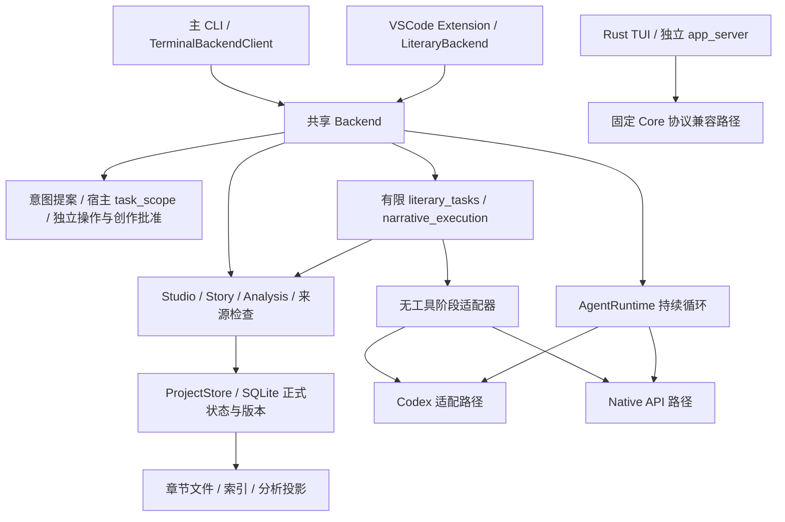

# 接手审查后的有限实施与验证记录

本文件保留提交前的审查快照；当前 Git 交付与可复现命令见 [2026-10-22版本记录](releases/2026-10-22-bounded-tasks.md)。其中43文件未提交等状态不作为提交后的实时状态。

日期：2026-10-22（Asia/Shanghai）。本文件记录本轮接手审查后获准实施的产品层改动，覆盖十二组问题及六条任务案例。它不是“全部长期目标已完成”的声明，也不把未取得的原附件逐题编号补写成已回答。代码位置以本仓库路径和函数为准；历史路线说明只作背景，不能替代本轮证据。

[逐组详细答复、六条完整调用链及下一批建议](review-answers.md) 补充每组的输入、状态、权限、故障和验证边界。修复前审查与本轮最终证据分开保存。

## 一页接手结论

现在可以依赖的产品路径是：主 CLI／Extension → 共享 Backend → LG 任务、授权和领域状态服务 → Codex 或 Native 执行适配器。本轮在此基础上补了候选基础版本、章节导入提交后恢复、正式操作提交收据、运行身份查询、作品工作区 code 门禁、两类有限文学任务，以及 Native Responses 的有限认知推演。没有改动 vendored Core 来实现文学逻辑。

本轮能复核的是确定性版本／权限／状态行为、真实产品函数与进程链，以及本地合成模型服务的协议交互。**没有付费模型调用、人工文学质量评估、长期连续写作实验，也没有证明当前系统能可靠完成任意长篇小说。** 专项数量不相加，完整回归另列。

最重要的边界：

- 新方向任务可以“提案 → 等作者选择 → 单章候选 → 待审读／采用”，但不是任意动态工作流引擎。简单润色只走一次修订阶段。
- 方向与认知确认仍由独立创作授权控制。候选仍需既有审读／采用流程；任务结束不自动成为正式正文。
- `narrative_view` 仍只过滤登记记录。新增 `narrative_execution` 在**限定的全新 Native Responses 请求**中排除聊天历史、全局资料、工具及自由文本问题；不承诺所有旧入口、所有 Runtime 或模型自身知识的隔离。
- operation receipt 证明受支持正式操作的数据库效果。它不证明整个工具返回成功、全部派生文件同步完成，也不能授权重复执行。
- code 工作区门禁是产品入口检查，不是 OS 全盘隔离。通用工具仍保留，已批准保留的 Rust TUI 与独立 app_server 不删除。
- 下一批可批准的工作应依据真实入口的失败和缺口；当前没有证据支持大规模删除 Core、把 Kernel 目录打包等同于规则收敛，或继续移植另一套权威故事状态库。

交付封账项（由主 Agent 完成后填写）：

| 项目 | 状态 |
| --- | --- |
| 父仓库分支／完整提交／工作树 | `main`／`a9a84393d99041ddd95979d78dd00f893607dfcc`；仅产品子仓库 dirty，父仓库文件未改 |
| 产品子仓库完整提交／工作树／父仓库 gitlink | `review-delivery-20261022`／`6b22bc47c87aecac99593ca61a1341f1c7e0c720`＋43个未提交变更文件；未暂存、未提交、未推送；父gitlink仍固定此HEAD |
| Codex 源码 pin 与实际 Runtime 清单 | `6b9826e3aa83b1a5947db50f4332cb9c65f1b340`；Core树 `74ba48a4b6b086beb9226a79ffe0f3d9f6d40f52` 原样；本轮只实跑Native合成HTTP，没有配置／执行固定Mac Core产物 |
| 隔离副本 → 正式项目输入一致性／实际入口复验 | 630个输入逐文件SHA256一致；原606文件基线核对后同步43文件，零删除。实际项目108项Python、前端61项＋真实连接1项、类型与构建通过；安装的`lg`导入实际源码 |
| Python 四个分片结果 | 128模块无重复；1070项中1027执行通过、43条件跳过、零失败。各分片241／268／252／309，跳过12／13／15／3；旧Linux结果不计入本轮 |

## 架构与实际入口



| 正式入口 | 实际调用链 | 共享的强制规则与例外 |
| --- | --- | --- |
| 交互 CLI／Extension 持续对话 | `terminal_backend.py`／`lg-vscode/src/backend/LiteraryBackend.ts` → `backend.py` → `intent_router`／`task_scope` → `agent_runtime.runtime_factory` | 精确对象、版本、写入范围和授权；普通对话历史仍含作者讨论，不具完整认知隔离 |
| 既有 `write/outline/...` | `cli_backend.py`／`Backend.workflow` → owned Python worker → `WorkflowRunner` → `execution_adapter` | 共享启动、事件与宿主写结果；内部仍是固定阶段或配置选择的 single-pass |
| `edit`／场景服务 | `story_cli.py` → `StoryWorkflowService` → 阶段适配器 → `ProjectStore` | 候选基础版本与来源记录；单次局部修订有宿主拼接边界，不是全书流程 |
| Studio／正式采用 | `backend_studio.py`／`Backend.creative` → 既有权限与新 `operation_receipts` → `ProjectStore` | 批准、版本、精确对象和事务提交证据；receipt不涵盖任意工具或外部文件效果 |
| `task/*` | `task_cli.py`／Extension bounded command → `backend_tasks` → `literary_tasks` | 两种有限策略、请求／字符预算、方向停点、候选；不替代既有创作选择与审读 |
| `narrative/*` | 同一 Backend → `narrative_execution` → `NativeStageExecutor` | 本批仅 Native Responses；全新、无历史、无工具、固定用途请求 |
| 运行身份／来源／操作查询 | `runtime/identity`、`sources/check`、`operation/read` | 只读。身份声明、文件核验、实际运行验证分别表达 |
| 显式 `lg code` | `main._run_task` → `WorkflowRunner` → `CodexStageExecutor` | 不经共享 Backend；CLI 与适配器均检查解析后的当前目录和祖先中的完整作品标记；不扫描子目录，不限制任意其他绝对路径 |
| Rust TUI／独立 app_server | `native.py`／`app_server.py` → Core 协议 | 保留兼容入口；不得把主 Backend 新任务和事件保证外推为已经全部覆盖它们 |

## 十二组审查结论

| 问题组 | 本轮已落实且有证据的行为 | 剩余限制／下一步 | 源码与证据入口 |
| --- | --- | --- | --- |
| 1. 审查代码与实际运行代码 | 新身份查询报告实际解释器、导入包位置、磁盘包内源码摘要、distribution版本和Runtime选择；可显式验证manifest对应二进制hash/pin | 摘要不是Git提交或完整产品树，不证明旧常驻进程已加载同版字节码；`declared-only`不是已运行，文件核验不是签名或可复现构建。旧Linux验证不能替代当前Mac／新改动 | `runtime_identity.runtime_identity/verify_manifest`；`tests/test_runtime_identity.py`；Backend initialize及`runtime/identity` |
| 2. Backend统一与旁路 | 主CLI／Extension的新任务、推演、查询共用Backend，正式写入复用已有领域服务 | 统一入口不等于每条内部策略一致；旧workflow、live循环、typed服务仍有不同上下文与恢复方式 | `backend.py`、`backend_tasks.py`、`task_cli.py`、`LiteraryBackend.ts` |
| 3. Native独立与能力 | Native本地HTTP集成执行了主Backend任务；严格认知阶段不构造Codex、无工具、无历史 | Native不是Rust `lg native`；不宣称复制全部Codex委派／预算。严格认知本批拒绝Codex和Anthropic，不静默回退 | `native_runtime.py`、`execution_adapter.NativeStageExecutor`、`narrative_execution.py`、`test_review_delivery.py` |
| 4. Kernel正式写入 | 修补Story候选错误绑定新active head；章文件导入在DB提交后投影失败可识别并修复基线，不重放正文；方向候选采用核验精确selection | 正文、文件、索引并非一个跨文件原子事务；Kernel仍是产品领域模块，不是独立发布包 | `project_store.create_version/accept_version/edit_chapter_documents`、`story_workflow`、`chapter_sync`；A1/A2回归 |
| 5. 异常下作者控制 | 正式操作绑定operation ID与请求／书指纹，事务内留数据库效果；重复ID不能执行；丢返回或取消后可查询 | 未覆盖工具、外部程序和派生文件不在收据证明范围；pending／缺失须为unknown。工作区code门禁不是OS隔离 | `operation_receipts.operation_scope/record_transaction/lookup`、`core_adapter.ensure_code_workspace`、`mcp_approval` |
| 6. 完整模型输入 | 新有限推演用固定operation、观察者、story/reading坐标；仅可见确认登记记录进入新请求；缺记录、截断、失效来源、超预算拒绝 | 普通对话、旧workflow仍可含未来秘密。模型先验、事实真假、文学推理质量未被证明；不是任意自由问题模式 | `narrative_execution.prepare/run`、`narrative_view.project`；完整HTTP载荷测试 |
| 7. 来源／旧章／恢复 | `sources/check`把已知直接影响和候选来源复核接入产品；`reviewCandidates`连接既有review/adopt动作；事实来源过期不自动撤销作者确认；旧workflow仍验证保存的输入／输出指纹 | 没有语义传递闭包或全书自动重新裁决；新任务不确定执行只供检查，不自动重放 | `source_review.py`、`source_impact.py`、`backend_tasks.sources`、`workflow_runner.resume`、`literary_tasks.read/advance` |
| 8. R5最小任务 | polish一次修订；chapter有分歧先三方案、等作者选择、再一次正文；保存候选并等待独立审读／采用；支持空容器绑定真实版本 | 不是任意DAG或自动全书计划；“无进展”仅文本无变化，非文学语义检测；章任务不自动搜全书材料 | `literary_tasks.prepare/start/advance`；C/D专项与正式Backend六项 |
| 9. Runtime精简 | 本轮增加入口身份与code作品目录拒绝，继续保留通用机制 | 未删Core模块、未新增原样Rust构建证据；不能据入口封装宣布R2—R4整体完成 | `core_adapter.py`、`runtime_identity.py`；本文件删除候选表 |
| 10. Oh Story融合 | 延续首轮“对象、范围、停点、规划与正文分离、作者精确选择”的机制适配，落在LG服务 | 未新增七个自主角色、未安装上游Hook、未另建tracking权威库；新收据／有限推演不能冒称上游已有同等实现 | `docs/oh-story-source.json`、`docs/oh-story-integration.md`；`intent_router/task_scope/literary_tasks` |
| 11. Tools／Skills／UI | 实际工具可用性由Runtime／MCP／宿主授权决定；新任务在现有React UI展示状态与明确动作 | Skills tools声明不是权限；不因prompt存在就称自动对话加载。主UI支持不等于兼容Core入口支持 | `definitions.py`、`prompt_builder.py`、`native_tools.py`、`review_policy.py`、`lg-vscode/shared/protocol.ts` |
| 12. 验证层次 | 本轮包含源码、真实临时SQLite、故障注入、真实进程／本地HTTP合成供应商、Extension连接与构建 | 没有真实付费模型、人工文学或长期创作证据；mock边界和未知必须保留 | 下节证据索引；不使用历史982项或新版测试数代替质量结论 |

## 六条端到端案例

| 案例 | 调用链、读写与模型输入 | 作者介入／故障行为 | 本轮验证与限制 |
| --- | --- | --- | --- |
| 1. 指定选区润色 | CLI／Extension → `task/start` → `backend_tasks` → `literary_tasks.start` → `StoryWorkflowService.revise_document` → 单stage → candidate。精确片段、邻文、既有有界上下文；宿主拼回原前后文 | 开始前operation批准；采用另走creative。片段必须唯一，包含重叠匹配拒绝；完整prepared prompt再算字符预算。并发正文变化保留真实基础版本，不能凭新批准覆盖作者改动 | `test_literary_tasks`、`test_candidate_bases`、正式HTTP polish案例；字节范围检查不证明选区内事实语义不变 |
| 2. 有剧情分歧的章节 | `task/start` → 一次无工具stage生成三选项 → `save_decision_options` → `waiting_author`；`task/select` → 现有Studio创作批准；`task/advance`核基线和精确选择 → 一次stage → candidate／receipt／artifact → `awaiting_review` | 不选就不生成正文；改基础版本／选项版本／选择／Runtime／预算均停。空draft容器绑定其activeVersion，`contextBasis.sourceIsCanonical=false`。采用前仍检查required_decision；不自动采纳 | 正式Backend本地HTTP覆盖等待、选择、重启继续、候选及独立采用；方案差异只结构／文本检查，不证明文学质量 |
| 3. 先讨论未来秘密，再早期人物推演 | `narrative/run` → `prepare` → `knowledge_view` → 过滤visible confirmed内容／stance／record ID → 全新`NativeStageExecutor`请求 | 固定character_next_action或reader_expectation；禁止自由question/context，Native Responses之外拒绝。旧聊天、项目指令、全局事实、简介、来源正文、工具回填不注入；视图前后变化不释放结果 | HTTP完整payload同时断言必要早期线索存在和多类secret缺席；不证明模型先验或输出文学正确。原普通对话仍无此保证 |
| 4. 修改已采纳旧章 | 作者版本化编辑／章文件导入 → ProjectStore → source状态变化 → `sources/check` → 已知直接影响／generationSourceReview → 现有review／re-propose／明确确认 | 作者确认不自动撤销；失效来源标待复核。章导入DB成功但索引／基线失败返回committed-needs-sync；重试只在精确内容／版本／origin匹配时修投影，否则冲突停止 | A2故障注入和现有来源测试；没有完整语义扩散、自动批量重写后文 |
| 5. 批准后响应丢失或同时取消 | 批准绑定operation ID → `operation_scope`登记attempt → `ProjectStore._connection`事务内`record_transaction` → 实际commit → `operation/read` | 已提交效果不能因返回失败被写成未提交；同ID禁止重放。pending／未知不推定未提交。取消阻止后续发布，不倒转已有提交；quiet worker保持所有权直到收敛 | B5真实MCP丢交付／取消与事务故障用例；receipt仅DB效果，derivedFiles=not_attested，不能据此声称完整工具和文件成功 |
| 6. 中断后基础版本变化 | 旧`WorkflowRunner.resume`验证prompt/instructions/schema/book/stage/model/Runtime和输出；新`task/read/advance`核保存任务／当前base、方向、策略身份 | 旧workflow不匹配阶段及后继重算；code不验证则不重放。新任务等待作者可继续，不确定executing结果转inspect-only；旧批准不能扩大新任务 | 既有恢复测试与本轮C/D版本、预算、中断检查。新任务未实现任意崩溃后的自动精确一次恢复 |

## 运行契约与可复制命令

请求Schema真源：`backend_protocol.contract()`（同时查看 `docs/backend-request-schema.json`），`literary_tasks.INPUT_SCHEMA`、`narrative_execution.INPUT_SCHEMA`。Extension对应 `lg-vscode/shared/protocol.ts`。不要绕开 Backend 直接将模型输出调用成正式写入。

下面仅为明确选定的合成作品示例。`--confirm` 表示作者批准本次准确预览，不用于无人值守批量跳过审查；可以改用既有 `--approve-fingerprint` 绑定已审阅指纹。运行实际生成会使用配置中的供应商，本轮测试只使用本地合成服务。

```sh
lg -C /path/to/synthetic-book identity --json
lg -C /path/to/synthetic-book identity --verify-manifest --json
lg -C /path/to/synthetic-book task preview --input polish.json --json
lg -C /path/to/synthetic-book task start --input polish.json --confirm --json
lg -C /path/to/synthetic-book task show TASK_ID --json
lg -C /path/to/synthetic-book task select TASK_ID OPTION_ID --confirm --json
lg -C /path/to/synthetic-book task advance TASK_ID --confirm --json
lg -C /path/to/synthetic-book --runtime-engine native narrative preview --input cognition.json --json
lg -C /path/to/synthetic-book --runtime-engine native narrative run --input cognition.json --confirm --json
lg -C /path/to/synthetic-book sources chapter-01 --version 2 --json
lg -C /path/to/synthetic-book operation OPERATION_ID --json
```

`polish.json`：

```json
{"strategy":"polish","document":"chapter-01","request":"只润色选区的语句。","passage":"作者实际选中的唯一原文。","maxModelCalls":1,"maxInputChars":24000}
```

章节分歧请求：

```json
{"strategy":"chapter","document":"chapter-01","request":"围绕守城决定创作这一章，先比较三种冲突走向。","plot_disagreement":true,"maxModelCalls":2,"maxInputChars":24000}
```

`cognition.json`：

```json
{"audience":"character","position":5,"holder_document":"protagonist","operation":"character_next_action","limit":100,"max_input_chars":24000}
```

reader模式使用 `audience=reader`、`operation=reader_expectation`，不能带holder。position是作者定义的整数坐标，不自动解释成章节号或真实日期。自由问题和附加上下文会被拒绝。

新Backend方法：`runtime/identity`、`operation/read`、`task/preview`、`task/start`、`task/read`、`task/select`、`task/advance`、`narrative/preview`、`narrative/run`、`sources/check`。写操作的session、fingerprint及options字段以实际Schema为准。操作批准不会隐式提升创作批准。

预算与状态读法：

- C：最多一／两次模型请求；`maxInputChars`限制宿主prompt+instructions字符数，不是token、HTTP全包字节或总费用。polish实际组装完成后再检查，不能用整章长度阻止短选区。
- D：`budget.unit=host_prompt_and_instructions_characters`；最多一请求、最多100条记录、固定输入上限。provider JSON envelope、headers、输出token不计在这个字符数里；输出／超时沿用当前配置。
- D `requestSent=false`表示尚未发送或本地配置拒绝，`true`有成功响应／流数据证据，`null`表示执行失败但传输状态未知。`resultReleased`仅成功返回结果时为true，不等于文学质量认证或正式采用。
- 任务保存位置是已有 `.literarygiant/runs/<runId>/` 内的 `literary-task.json` 与stage文件；没有第二套故事权威库。正文候选与方向仍在现有ProjectStore。有限推演本身不写作品状态，Backend可保存其公开事件，Native沿用usage ledger。
- `read`可从当前数据库只读派生 `adopted`，以及来源过期／候选不可用状态，不为展示重新采用。quiet HTTP请求取消后，宿主等待worker收敛；不得把取消UI等同于瞬间终止网络。

## 证据索引与验证覆盖

最终证据目录：[证据索引](/Users/zh/.codex/reports/LiteraryGiant-implementation-20261022/evidence-index.md)、[机器可读验证](/Users/zh/.codex/reports/LiteraryGiant-implementation-20261022/validation.json)。隔离副本原始目录为 `/private/tmp/LitIsLand-review-implementation-mn8tof_u/`，均非产品运行依赖。下表是独立专项，**不得相加成为新的唯一测试总数**。

| 编号 | 本轮实际结果 | 日志／源码入口 | 能证明与不能证明 |
| --- | --- | --- | --- |
| E-A1 | 41项通过，2.195s | `a1-red.log`、`a1-green-final.log`；`tests/test_candidate_bases.py` | 真实临时SQLite、并发编辑合成Adapter、旧候选基础与fresh审批不能重绑定；不是真模型 |
| E-A2 | 原专项35项通过，8.020s；后续章节同步race专项19项通过，二者不相加 | `a2-red.log`、`a2-extended.log`、`a2-race-green.log`；`tests/test_chapter_sync.py`、novel_editor／cli_domain相关测试 | 章导入提交与投影故障、并发编辑和重试边界；不证明全部派生文件原子性 |
| E-B5 | 15项通过，1.684s | `b5-review.log`保留发现失败；`b5-reviewed-green.log`最终通过；`tests/test_operation_receipts.py` | 七类正式工具、真实MCP丢返回与取消、子进程退出、单事务精确效果；不证明完整工具／文件效果 |
| E-B-ID | 身份5项、工作区3项均纳入最终四分片；既有专项不重复计数 | `tests/test_runtime_identity.py`、`tests/test_code_workspace_boundary.py`；`python-final-group-*.log` | 包身份、manifest文件核验边界、code作品目录门禁；非OS隔离、非新Rust构建 |
| E-Mac | Mac进程身份与RunStore相关16项通过 | `macos-process-before.log`、`macos-process-after.log`；`process_identity`、`run_store`及相应测试 | 使用本机SDK和clang核对真实Mac ABI及进程所有权；不是Linux实机验证 |
| E-CD | 27项通过，6.310s | `c-red.log`、`d-red.log`、`cd-review-red.log`、`cd-review-green-final.log`；`test_literary_tasks.py`、`test_narrative_execution.py` | C真实领域服务+合成Adapter；D真实Native HTTP完整payload。包括长章短选区、重叠匹配、来源变更、预算、取消和只读采用状态 |
| E-Backend | 最终6项通过，6.154s | `review-delivery-supervised.log`；`tests/test_review_delivery.py` | 正式Backend与CLI、本地HTTP供应商；含重启后方向任务、`review=True` worker五项真实Native审读与独立采用；仅worker配置加载注入合成配置，不替换审读或模型传输；没有付费模型 |
| E-UI | 61项通过，零失败／跳过；另真实连接专项1项通过；TypeScript与build退出0 | `frontend-final-tests.log`、`frontend-real-task-integration.log`、`frontend-final-validation.json`及对应typecheck/build日志 | 现有React/Extension的协议、状态动作和实际连接；不是人工桌面文学体验评估 |
| E-Full | 最终128模块四分片发现1070项，1027项执行通过、43项条件跳过，零失败 | `full-test-groups.json`、`full-python-final-results.json`、`python-final-group-*.log`；初次未通过记录另存 | 43项都依赖当前未配置的固定Core／独立app_server产物；不能声称当前Mac已通过这些Runtime测试，也不累加旧Linux结果 |
| E-Delivery | 实际项目108项Python零失败／跳过；前端61项、真实连接1项、typecheck／build及安装CLI帮助／identity通过；630输入一致；wheel解包导入通过 | `actual-validation.json`、`installed-cli-validation.json`、`build-release-validation.json`、`applied-final.json` | 前端依赖仅装在隔离副本；实际源码借用该锁定依赖编译，构建产物在证据目录。未安装VSIX／重载所有用户窗口；未复跑历史14项Core集成 |

其他相关证据源码：

- `tests/test_direction_candidate_guard.py`：方向变化阻止采用、未变化允许、恢复与选中候选修订保留方向条件。此表没有单独计入未经核实的运行数量。
- `tests/test_workflow_runner.py`、`test_workflow_schema.py`：定义／memory／schema／模型／guidance变化后的恢复；FakeAdapter不是模型质量证明。
- `tests/test_narrative_view.py`、`test_narrative_knowledge_runtime.py`：登记记录视图、人物与读者两轴、真实工具路径；不能单独证明全部模型输入隔离。
- `tests/test_runtime_boundary.py`、`test_native_runtime.py`、`test_codex_runtime_reviews.py`：Runtime接口、上下文、专家与恢复的既有边界；是否纳入本轮四分片以最终清单为准。

复核专项时在 LitIsLand副本使用已有测试环境，不读取正式作品、用户凭据或原始语料：

```sh
PYTHONPATH=lg-cli:. python -B -m unittest tests.test_candidate_bases tests.test_operation_receipts tests.test_literary_tasks tests.test_narrative_execution tests.test_review_delivery -v
```

这条命令是复核方法，不表示其合并运行已在本记录中执行。正式结论仍对应上表实际日志。

## 删除／保留／优化候选

| 候选 | 当前决定 | 所需依赖和证据 |
| --- | --- | --- |
| `core/codex`内通用搜索、编辑、脚本、MCP、隔离、取消、恢复、认证支持 | 保留；本轮不删 | 不能以coding来源作删除标准。先明确调用者、认证/API供应商、恢复和分发职责，取得固定原样构建及真实入口验证 |
| Rust TUI与独立app_server | 按既定决定保留兼容入口 | 不重新列为默认删除对象；新产品保证逐入口核验 |
| `lg-vscode/src/backend/CodexBackend.ts`、`normalize.ts`及`generated/`独占依赖 | 仅批准反向引用、测试迁移与构建补证；不批准整目录删除 | 生产factory已走LiteraryBackend，但若干兼容测试仍引用旧adapter／类型；需实际bundle/VSIX证据，不能从未被factory选中推定可删 |
| Kernel领域模块与Runtime返回类型的剩余耦合 | 优化候选，按具体失败小步收敛 | `CoreExecutionResult`仍被阶段接口复用；目录拆分不替代正式写入门禁或迁移测试 |
| 旧固定workflow与新有限task | 都保留，逐步明确产品任务策略 | 新task覆盖两个任务，不代表全部旧workflow可删除；需要使用路径、恢复语义、成本与质量对照 |
| Oh Story角色、Hook、tracking状态 | 本轮不增加 | 先用LG现有宿主机制解决具体缺口；不为“融合数量”增加角色、自动Hook或第二权威库 |

R1—R4的交付解释：R1既有固定版本/API-only边界沿用；R2本轮继续补产品策略与运行证据，但未完成全部能力／委派／预算统一；R3没有本轮原样Core构建成功证据；R4没有本轮Core删除或新二进制体积收益。此前产品订阅兼容文件的历史删除与构建记录见roadmap，不能重计为本轮成果。

## 四个最小批次：本轮交付与停止边界

| 批次 | 问题与候选改动／复用 | 本轮状态与验证 | 明确不做／停止条件 | 回退边界 |
| --- | --- | --- | --- | --- |
| A. 正式状态可靠性 | Story候选base、方向采用条件、章导入恢复、正式操作receipt；复用ProjectStore事务和既有批准 | A1/A2/B5专项及正式Backend故障链；入口为Story、MCP／Studio、章节同步 | 不做任意工具全局exactly-once或跨文件原子事务；遇unknown、来源冲突、投影不匹配则查询／人工核对，不重放 | 仅回退代码；保留已生成版本、receipt和import recovery。不把旧源码覆盖数据库当回退；停写后验证兼容性 |
| B. 运行基线与边界补证 | identity、manifest文件核验、code作品目录门禁、UI运行身份查询、Mac进程所有权 | B-ID／Mac专项和共享Backend入口；完整安装来源见交付封账 | 不做Core重构或删除；交付比对摘要不一致时停止同步／验收；identity文件核验只报告状态，实际Codex启动另走既有校验；code命中作品时拒绝。不自动fallback | 回退入口／显示代码；保留manifest、凭据、用户配置。不得静默换Runtime或删除旧缓存 |
| C. R5两个有限任务 | `literary_tasks` + `backend_tasks` + CLI／UI；复用Story revision、方向record、RunStore、candidate、review/adopt | C/D专项、正式Backend六项、前端专项；单阶段润色与精确方向停点已落地 | 不承包全书自动调度；预算耗尽、无文本变化、任务／来源变化停止；不确定执行inspect-only | 停用新入口、保留task记录、候选和作者已选方向。不得自动撤回选择或删除正文；旧入口处理前重新预览 |
| D. 有限认知执行与来源复核 | `narrative_execution`与`sources/check`；复用登记认知投影、NativeStageExecutor、source_review/impact | 完整本地HTTP请求正反例、正式Backend入口、取消收敛 | 只支持Native Responses固定用途；不迁移全部历史、不承诺模型先验隔离或全书依赖闭包；空／失效／截断信息拒绝 | 停用有限推演入口即可，不反向修改认知记录；来源复核是读路径，不撤销作者确认 |

各批之间的依赖是业务边界，不是一次性重写：A先保护状态；B独立提供真实入口身份；C采用A的基础版本／方向条件；D的严格请求独立于普通会话，来源查询复用既有领域状态。后续只在明确失败、可复核需求与具体删除授权下扩大批次。

## 明确现在不做

- 不把本轮专项通过解释为完整长篇小说质量验收；不擅自开展付费同模型对照或长期创作实验。
- 不宣称独立Kernel发布包、独立桌面UI、全Runtime替换和全输入认知隔离全部完成。
- 不删除用户Library、Projects、`.literarygiant`数据、历史收据或已批准保留的兼容入口；不为了回退代码反向覆盖正式数据库。
- 不把代码工作区门禁夸大成OS隔离；没有隔离证据时，不开放通用工具绕过作品正式状态规则。
- 不把Oh Story既有角色prompt数、测试总数或README声明当作新增执行机制与文学质量证据。
