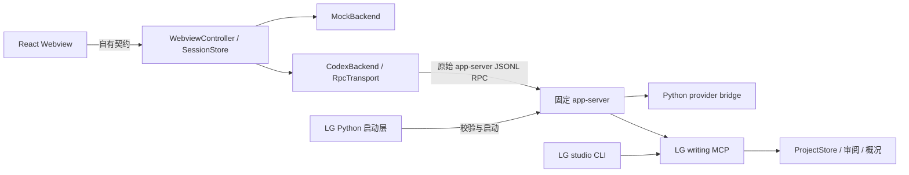

# LG 扩展架构

Python 启动器继承 stdin/stdout，协议不转为 `backend_stdio`。真实模型凭据只在 Python 侧使用；核心进程获得本次 bridge token。固定核心保持原样，文学能力在产品层。

## 文件与责任

| 路径 | 责任 |
| --- | --- |
| `shared/protocol.ts` | Zod 校验 Webview 请求、自有快照与事件；不向浏览器暴露原始 RPC |
| `src/backend/CodexBackend.ts` | 握手、会话、流、工具、审批、用户问题、取消及概况读取 |
| `src/backend/RpcTransport.ts` | UTF-8 字节分帧、请求 ID、超时、子进程及断线收敛 |
| `src/backend/generated/` | 固定二进制生成的协议类型闭包，仅用于适配层 |
| `src/host/LatestSnapshotSender.ts` | 一份在途快照与一份最新待发送快照，限制慢 Webview 导致的发送积压 |
| `src/host/SessionStore.ts` | 宿主持有权威状态，Webview 重建时重发快照 |
| `src/host/WorkspaceBridge.ts` | 作品路径约束、文件打开、只读 diff、未保存文件保护 |
| `webview/ui/` | 提取后的展示组件；无需原 Qwen 源码树或 CLI |

## 审批与恢复

LG 写工具由 MCP elicitation 请求一次性确认。未知表单和未知请求拒绝；没有默认同意或永久允许选项。回复后即移除请求 ID，服务端撤销、任务终止及断线会使剩余审批过期。请求 ID 的数字和字符串类型保持区分。

MCP 在审批前后比较作品指纹，检测到并发改变便拒绝写入。扩展不二次应用工具产生的补丁；diff 来自后端返回的完整 before/after，使用只读文档。候选保存不等于采用；采用走既有版本审阅及过期检查。

超时意味着执行结果可能未知。适配器关闭连接，不自动重试变更。恢复会话只读取历史；若发现仍在运行的任务，先请求中断。会话列表读取到末页；历史按固定版本声明选择完整 thread 历史或 `thread/turns/list` 分页接口。分页按 turn ID 去重，拒绝摘要代替完整内容及重复游标，不把不完整历史当作恢复成功。类型检查、分页 fixture 回归和固定二进制重启恢复集成已通过；多页边界由 fixture 覆盖。

## 概况

`book_dashboard` 共用 CLI 的书籍数据及产品存储，新增规划信息持久化到版本化的 studio profile。面板包含创作定位、百万字目标、已写与已采用进度、分卷章节、人物关系、设定、伏笔、任务和待审批事项。字数是非空白字符数；规划、候选与已采用状态分开显示。

MockBackend 仅在内存中模拟状态，面板明确标示离线演示；其输出不代表真实作品已写入。浏览器不读取模型凭据、不执行 shell、不直接操作数据库。

## 模型参数边界

Python `anthropic_bridge.py` 在完整上游响应确认后才提交工具调用。只对单个、完整的函数调用尝试有限 JSON 标点修复：在解析错误位置增删至多两个分隔符，不改变键名、标量值或顺序，必须通过原工具 schema，且搜索范围内只有一个语义结果。不能修复、响应截断或多个调用中出现错误时不执行工具，不增加模型请求或自动重放写操作。Studio 的审阅工具直接发布五类报告 schema；采用仍要求有效的完整审阅和作者明确批准。
