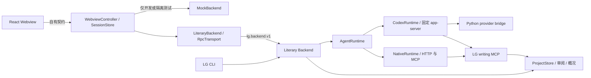

# LG 扩展架构

Python `backend_stdio` 使用 LG JSON-RPC 契约，写作入口与 CLI 共用 Backend。真实模型凭据只在 Python 侧使用；Codex 核心进程获得本次 bridge token。固定核心保持原样，文学能力在产品层。

## 文件与责任

| 路径 | 责任 |
| --- | --- |
| `shared/protocol.ts` | Zod 校验 Webview 请求、自有快照与事件；不向浏览器暴露原始 RPC |
| `src/backend/createBackend.ts` | 两种正式设置均选择 LiteraryBackend；codex 指定执行器 |
| `src/backend/LiteraryBackend.ts` | LG 握手、会话、公开事件、审批、取消及资料读取 |
| `src/backend/RpcTransport.ts` | UTF-8 字节分帧、请求 ID、超时、子进程及断线收敛 |
| `src/host/LatestSnapshotSender.ts` | 一份在途快照与一份最新待发送快照，限制慢 Webview 导致的发送积压 |
| `src/host/SessionStore.ts` | 宿主持有界面状态，Webview 重建时重发快照；小说权威状态仍在产品存储 |
| `src/host/WorkspaceBridge.ts` | 作品路径约束、文件打开、只读 diff、未保存文件保护 |
| `webview/ui/` | 提取后的展示组件；无需原 Qwen 源码树或 CLI |

## 审批与恢复

LG 写工具由 Backend 的任务范围、操作权限和独立创作权限约束，扩展接收公开审批事件。未知请求拒绝；界面没有永久允许选项。回复后即移除请求 ID，服务端撤销、任务终止及断线会使剩余审批过期。Runtime 负责转换自己的请求，不向 React 暴露 Core RPC。

MCP 在审批前后比较作品指纹，检测到并发改变便拒绝写入。扩展不二次应用工具产生的补丁；diff 来自后端返回的完整 before/after，使用只读文档。候选保存不等于采用；采用走既有版本审阅及过期检查。

超时意味着执行结果可能未知。适配器关闭连接，不自动重试变更。LG 历史通过冻结快照分页读取并核对内容哈希；恢复不重放工具或审批。旧 Extension 历史由受限 Codex 解码器读取，再导入新 LG 会话。原始文件保留，完整工具载荷和非文本附件不导入；旧 inProgress 记录也不证明外部进程已经停止。导入后的继续写作使用默认作者权限及当前上下文预算，不直接恢复原 Core thread。

## 概况

`book_dashboard` 共用 CLI 的书籍数据及产品存储，新增规划信息持久化到版本化的 studio profile。面板包含创作定位、百万字目标、已写与已采用进度、分卷章节、人物关系、设定、伏笔、任务和待审批事项。字数是非空白字符数；规划、候选与已采用状态分开显示。

MockBackend 仅在内存中模拟状态，面板明确标示离线演示；其输出不代表真实作品已写入。浏览器不读取模型凭据、不执行 shell、不直接操作数据库。

## 模型参数边界

Python `anthropic_bridge.py` 在完整上游响应确认后才提交工具调用。只对单个、完整的函数调用尝试有限 JSON 标点修复：在解析错误位置增删至多两个分隔符，不改变键名、标量值或顺序，必须通过原工具 schema，且搜索范围内只有一个语义结果。不能修复、响应截断或多个调用中出现错误时不执行工具，不增加模型请求或自动重放写操作。Studio 的审阅工具直接发布五类报告 schema；采用仍要求有效的完整审阅和作者明确批准。

## 0.2.0 文学工作台

`workspace_library.py` 复用 `book_home.snapshot/panel_entries` 与 `project_browser.project_entries`，保留 CLI 的人物聚合和来源、审阅有效性、时间线与伏笔解释。`book_library` 返回最多 24 条摘要；`book_entry` 按需返回有界详情及最近版本。概况也限制摘要数量和长度，避免把全文长期附在每次流式快照里。

`LibraryReader` 只保留一份在途读取和一份最新待处理读取，用代次丢弃迟到结果；内容更新不改变人物的选择键。宿主监听已保存数据库、索引、资料和正文变更，忽略共享内存及空 WAL 整理事件，延迟合并刷新。任务运行期间标记过期，空闲后更新。只读 MCP 不启动模型 turn。

生成操作先由 `book_action_context` 核对当前预览指纹，宿主也核对选中详情及未保存文件。`studio_reference` 使用 ProjectStore 保存人物/世界/大纲资料候选，归档到既有输出分类；`studio_adopt_reference` 单独采用，`studio_accept_proposal` 复用 CLI 的设定提案采用。每个写工具有明确审批策略，拒绝、旧预览、重复采用不能继续写入。候选正文及场景的采用沿用 ProjectStore 监督规则，不另造自动批准链路。

## 0.3.0 真实书架与共享模型

`DesktopHost` 管理实际作品选择、模型原生对话框和后端重连；`DesktopClient` 通过 Python `lg_cli.desktop` 调用 CLI 的 Bookshelf、ProjectRegistry、load_config 和 credentials。作品不复制、不重新初始化；凭证仍在 Python 存储中。新增 API 配置仅传递密钥环境变量名，订阅登录及隐藏输入通过显式 CLI 管理入口进行。

正式安装只启动 LiteraryBackend；codex 设置指定其执行器，literary 沿用 LG 配置。显式执行器要求握手确认，不兼容服务明确失败。Mock 必须处于开发宿主或明确的 LitIsLand 测试目录，普通用户设置不能开启演示。管理入口即使在后端配置失败时仍保留。共享凭证/配置文件变化合并为重连，忽略仅权限修复的事件；任务运行时延后，手动切换前检查任务及未保存文件。重连关闭旧进程、监听器和消息接收器，只恢复当前作品历史。

CLI 每次创作前重读同一配置；连接复用身份包括配置空间、账号、协议、地址、模型和密钥摘要。同模型不同账号或更新密钥也会重新建立连接，摘要不输出到日志或界面。固定核心没有修改；扩展不再携带旧直连连接器及其生成类型。

Python 还过滤当前配置空间所有已保存 API 配置对应的密钥环境变量值，防止切换账号后旧账号的自定义环境变量进入核心子进程。

## 旧连接器退出后的验证职责

Extension 正式路径继续使用 LiteraryBackend，`backend=codex` 仍表示选择共享 Backend 的 Codex 执行器。旧 `CodexBackend.ts`、TypeScript `normalize.ts` 和生成类型不再作为扩展源码维护；`RpcTransport`、通用工具、Python CodexRuntime、Rust TUI 和独立 app_server 保留。

生命周期与分页回归走 LG 事件和快照契约。候选 diff、私有推理及失败输出由 `lg_cli.codex_events` 转换，`tests/presentation.integration.ts` 调用真实 Python 转换并校验 UI schema。旧桥接错误分类不再在前端复制；RPC 错误正文与 stderr 仍不得进入界面。

`tests/real-backend.integration.ts` 使用底层 RpcTransport 检查保留的 Core stdio 兼容入口，需显式提供已验证的 Runtime 与 Python；条件跳过不代表验收通过。产品任务的候选、批准、取消、恢复与采用在 LiteraryBackend/Native 集成中验证。付费模型 `creative.smoke.ts` 已改用 LiteraryBackend，但不得将类型检查或合成模型测试解释为其真实模型验收。
